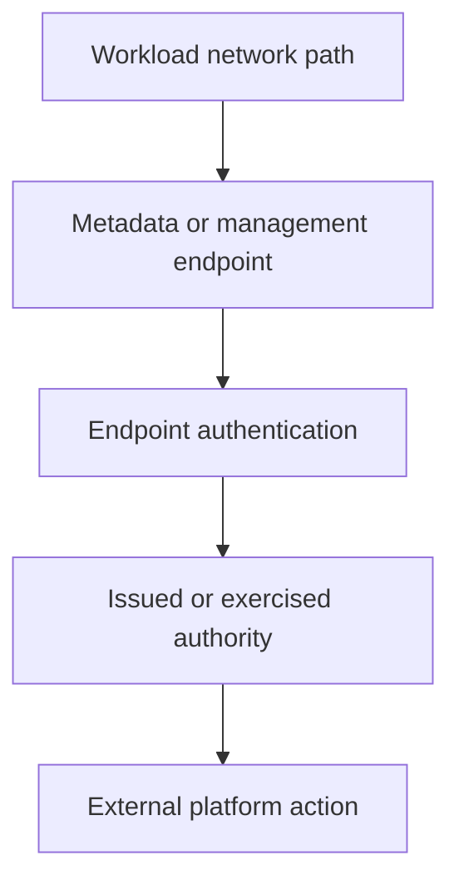

# Protecting Node Metadata And Management Endpoints

A workload reaches a node metadata service and obtains cloud authority that exceeds its own Kubernetes role. API least privilege did not protect this separate credential path.

## Learning objectives

- Identify credentials and authority exposed through node-local endpoints.
- Separate workload network paths from host and control-plane paths.
- Explain cloud metadata protections and their implementation limits.

## Before you start

This chapter is standalone reading material; no running cluster or installed tools are required. A Pod is the Kubernetes unit for running one or more containers, and a namespace groups namespaced objects. Treat the worked configurations as teaching examples rather than recorded observations from a provisioned environment.

## Responsible components and behavior

A Pod can be isolated from the Kubernetes API and still reach a sensitive node or cloud endpoint. Node metadata services often provide instance information and may provide temporary cloud credentials associated with the node's identity. Management interfaces such as the kubelet API, runtime sockets and administrative services expose different authority. Protecting these surfaces requires identifying the audience and access mechanism of each endpoint.

## Distinguish The Identities

A workload ServiceAccount is a Kubernetes identity. A cloud instance identity is authority assigned to the infrastructure hosting the workload. They are not automatically the same identity, and Kubernetes RBAC does not universally govern requests to a cloud metadata service. If an application can obtain node credentials, its effective reach may include cloud services unrelated to its intended task.

Workload identity mechanisms can provide narrower application credentials, but they do not excuse broad node permissions. Review what the node identity can do and whether application containers can still reach metadata credentials through another route. Least privilege reduces the consequence of exposure even when a preventative boundary fails.

## Map The Actual Traffic Paths

Ordinary Pod traffic can pass through the network plugin's policy enforcement. Host-networked Pods, node processes, link-local addresses and traffic to local host interfaces may follow paths with different treatment. A namespaced NetworkPolicy is therefore not a universal host firewall. The chosen network implementation and its documented handling of host traffic determine coverage.

A conceptual access map identifies application Pods, node agents, administrators and control-plane callers separately. It then lists the endpoints each needs: application dependencies, DNS, the API server, kubelet operations and any cloud services. Explicitly include metadata addresses and IPv4 or IPv6 variants that the deployment supports. Blocking only one address while another supported path remains reachable leaves the boundary incomplete.

## Apply Metadata-Specific Protection

Cloud platforms offer different metadata protections. Some use session tokens, configurable request behavior or response hop limits. A token requirement can reduce particular request-forgery attacks, but a compromised application may still request a token if the network path and service permit it. A hop limit also depends on the actual network topology. Neither should be described as a universal substitute for workload identity and restricted reachability.

A meaningful protection design prevents unnecessary application access, preserves supported node bootstrap behavior and narrows cloud permissions. Confirm how host-networked workloads and privileged agents fit into that design. The control must match the provider and deployed configuration rather than assume that every metadata service has identical features.

## Protect Management Interfaces

The kubelet serves operations involving workloads on its node. Authentication identifies its callers, and authorization determines allowed actions. Network filtering restricts who can attempt access, but does not replace these controls. Exposed unauthenticated or overly permissive management APIs can bypass protections that an administrator expects from the main Kubernetes API server.

Runtime sockets are also powerful. Mounting a host runtime socket into an application container can grant control over containers or host resources despite an otherwise restricted Pod configuration. File permissions, mount admission and host access restrictions matter alongside network controls. An endpoint need not be reachable over TCP to create a serious authority boundary.

## Assess A Failure Scenario

Suppose an application bug permits outbound requests to an attacker-chosen URL. Review whether that request can reach metadata, what credentials could be returned, and what those credentials authorize. Then examine node-local management access and any socket mounts independently. The appropriate correction addresses the actual reachable authority, not merely the public application ingress.

## Work through the decision

Node metadata and management services can expose configuration, credentials or control operations under the platform's model. Identify the endpoint, reachable sources, authentication method and authority it can issue. A network address alone does not describe a safe permission boundary.

Restrict unnecessary workload access using the platform's supported endpoint and network controls. Host-network paths and local node access can differ from ordinary Pod policy behavior, so verify the intended source rather than assuming one NetworkPolicy covers every route. Reducing API role grants cannot revoke independently issued cloud credentials. Protect and review those authorities through their actual issuer and access path.

Node endpoint protection must account for authority outside Kubernetes API role grants.

Node endpoint protection must account for authority outside Kubernetes API role grants.

## Common pitfalls

> [!WARNING]
> Kubernetes API permissions do not automatically protect cloud metadata or runtime sockets. Endpoint reachability, endpoint authorization and credential scope are separate controls that must agree.
