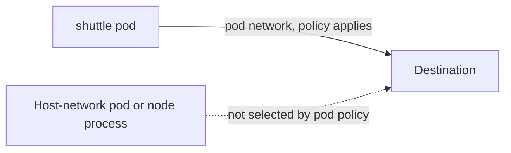

# Network Paths To A Metadata-Style Endpoint

A NetworkPolicy can only restrict traffic that passes through the pod network. To use it well you need a clear picture of which paths exist and what they carry. This part sets up a stand-in for the metadata service, shows that, before any policy exists, both the pod you will restrict and a pod in another namespace can reach it, and explains which paths a NetworkPolicy never sees.

## Which paths a policy covers

A pod with its own network namespace sends traffic out of a virtual interface. The network plugin, here Calico, enforces NetworkPolicy on that interface. The policy sees the pod as the source and can match on the destination address and port. This is the normal case.

A pod with `hostNetwork: true` shares the network namespace of the node. It has no pod interface, and NetworkPolicy does not select it as a pod. The same is true for processes running directly on the node. Traffic that comes from them is node traffic, and policy for node traffic needs host-level controls from the network plugin or the provider. The rule to remember is that a namespaced NetworkPolicy protects the pod network and nothing else.

The destination matters as well. The real metadata service lives on a link-local address on the node's side of the network, so a pod reaches it with an egress path that leaves the pod network. A policy that selects the pod for egress and does not list that address as allowed blocks it. A policy that does not select the pod, or one with a broad rule such as `0.0.0.0/0`, allows it.

## A stand-in endpoint

The playground has no cloud, so you model the metadata service with a web server pod. It listens on port 8080 and it can be reached by its pod IP. Whether it is a cloud endpoint or a pod, the network question is the same: which sources may open a connection to this address and port.

<!-- astrona:playground:renew -->

Save this as `pod-metadata-simulator.yaml`:

```yaml
apiVersion: v1
kind: Pod
metadata:
  name: metadata-simulator
  namespace: starfleet
  labels:
    app: metadata-simulator
spec:
  restartPolicy: Never
  containers:
  - name: web
    image: docker.io/library/python:3.13-alpine
    command:
    - python
    - -m
    - http.server
    - '8080'
```

Apply it:

```sh
kubectl apply -f pod-metadata-simulator.yaml
```

## The unrestricted baseline

Wait for the pod to be ready, store its IP address and request it from two different clients. `shuttle` is in `starfleet` and `drifter` is in `outpost`. No policy exists in either namespace, so nothing limits either request.

```sh
kubectl -n starfleet wait --for=condition=Ready pod/metadata-simulator --timeout=120s
SIM_IP=$(kubectl -n starfleet get pod metadata-simulator -o jsonpath='{.status.podIP}')
kubectl -n starfleet exec shuttle -- wget -q -T 3 -O- "http://$SIM_IP:8080/"
kubectl -n outpost exec drifter -- wget -q -T 3 -O- "http://$SIM_IP:8080/"
```

Both requests succeed and return a directory listing from the Python server. Pods in a cluster without policy can reach each other across namespaces, and the stand-in is exactly as exposed as a real metadata endpoint would be to a default pod. This is the starting point that you will change.

## Allow-list or deny-list

There are two ways to close the path for `shuttle`. A deny-list names the address to block, for example an `ipBlock` for `0.0.0.0/0` with the metadata address in `except`. It is short, but it covers only what you listed. Another supported address, an IPv6 form, or a second endpoint stays open. An allow-list selects the pod for egress and names the few destinations it needs, so everything else, including addresses you have not thought of, is blocked. For a pod with a small, known set of dependencies the allow-list is the stronger choice, and it is what the next part builds.



The diagram shows that the policy filters the pod route and has no say over the dotted route.

## Common pitfalls

> [!WARNING]
> - **Testing only from the pod you plan to restrict.** You also need an unrestricted client to prove the target works.
> - **Believing a pod policy covers host-network pods.** It does not select them.
> - **Writing a deny-list with one address.** The next address you forgot stays reachable.
> - **Using the Service name for the stand-in.** There is no Service for it. Use the pod IP.
