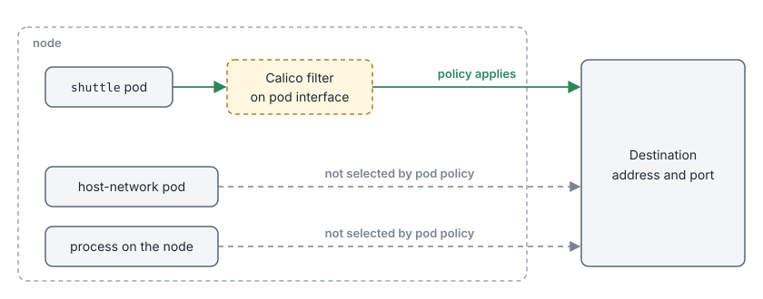
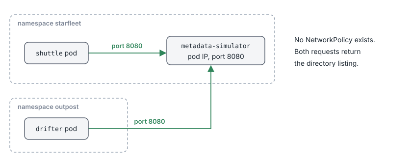
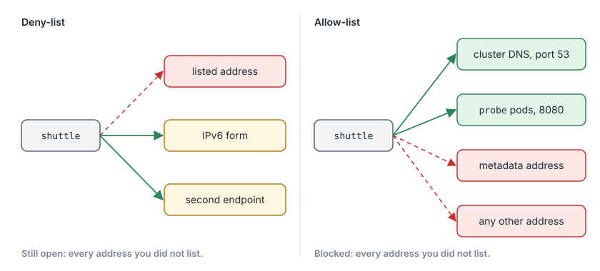

# Network Paths To A Metadata-Style Endpoint

A NetworkPolicy can only restrict traffic that passes through the pod network. To use it well, you need a clear picture of which paths exist and what they carry. A NetworkPolicy is the Kubernetes object that selects a group of pods and lists the connections they may receive (ingress) or make (egress).

On this page, you see which paths a NetworkPolicy covers and which it never sees. Then you set up a stand-in for the metadata service and show that, before any policy exists, two pods in different namespaces can both reach it.

## Which paths a policy covers

Start with the normal case. A pod with its own network namespace sends traffic out of a virtual network interface. The network plugin, here Calico, enforces NetworkPolicy on that interface. The policy sees the pod as the source, and it can match on the destination address and port.

A pod with `hostNetwork: true` is different. It shares the network namespace of the node, so it has no pod interface, and NetworkPolicy does not select it as a pod. The same is true for processes that run directly on the node. Their traffic is node traffic. To filter node traffic, you need host-level controls from the network plugin or the provider.



The drawing shows that the policy filters only the route through the pod interface. The rule to remember is short: a namespaced NetworkPolicy protects the pod network and nothing else.

The destination matters as well. The real metadata service lives on a link-local address on the node's side of the network, which is an address that is only valid on the local network segment. A pod reaches it with an egress path that leaves the pod network. Two cases follow from this:

- A policy that selects the pod for egress, and does not list that address as allowed, blocks it.
- A policy that does not select the pod, or a policy with a broad rule such as `0.0.0.0/0`, allows it.

## A stand-in endpoint

The playground has no cloud, so you model the metadata service with a web server pod. The pod listens on port 8080, and you reach it by its pod IP address. The network question is the same for a cloud endpoint and for a pod: which sources may open a connection to this address and port.

<!-- astrona:playground:renew -->

Save this as `pod-metadata-simulator.yaml`:

```yaml
apiVersion: v1
kind: Pod
metadata:
  name: metadata-simulator
  namespace: starfleet
  labels:
    app: metadata-simulator
spec:
  restartPolicy: Never
  containers:
  - name: web
    image: docker.io/library/python:3.13-alpine
    command:
    - python
    - -m
    - http.server
    - '8080'
```

Apply it:

```sh
kubectl apply -f pod-metadata-simulator.yaml
```

## The unrestricted baseline

With the stand-in running, measure what is reachable before you change anything. Wait for the pod to be ready, store its IP address, and request it from two different clients. The `shuttle` pod is in `starfleet`, and the `drifter` pod is in `outpost`. No policy exists in either namespace, so nothing limits either request.

```sh
kubectl -n starfleet wait --for=condition=Ready pod/metadata-simulator --timeout=120s
SIM_IP=$(kubectl -n starfleet get pod metadata-simulator -o jsonpath='{.status.podIP}')
kubectl -n starfleet exec shuttle -- wget -q -T 3 -O- "http://$SIM_IP:8080/"
kubectl -n outpost exec drifter -- wget -q -T 3 -O- "http://$SIM_IP:8080/"
```

Both requests succeed. Each returns a directory listing from the Python server. In a cluster without policy, pods can reach each other across namespaces.



The drawing shows the starting point: both clients reach the stand-in, so it is exactly as exposed as a real metadata endpoint would be to a default pod. This is the state you will change.

## Allow-list or deny-list

There are two ways to close the path for `shuttle`, and they protect very different amounts:

- A **deny-list** names the address to block, for example an `ipBlock` for `0.0.0.0/0` with the metadata address in `except`. It is short, but it covers only what you listed. Another supported address, an IPv6 form or a second endpoint stays open.
- An **allow-list** selects the pod for egress and names the few destinations it needs. Everything else is blocked, including addresses you have not thought of.



The drawing compares the two: a deny-list leaves open every address you did not list, and an allow-list blocks every address you did not list. For a pod with a small, known set of dependencies, the allow-list is the stronger choice.

You now know which paths a NetworkPolicy sees, and you have proved that both clients reach the stand-in today. The open question is how to write the allow-list for `shuttle`, and how to prove that it blocks the stand-in without breaking what `shuttle` needs.

## Common pitfalls

> [!WARNING]
> - **Testing only from the pod you plan to restrict.** You also need an unrestricted client to prove that the target works.
> - **Believing a pod policy covers host-network pods.** It does not select them.
> - **Writing a deny-list with one address.** The next address you forgot stays reachable.
> - **Using a Service name for the stand-in.** There is no Service for it. Use the pod IP address.
