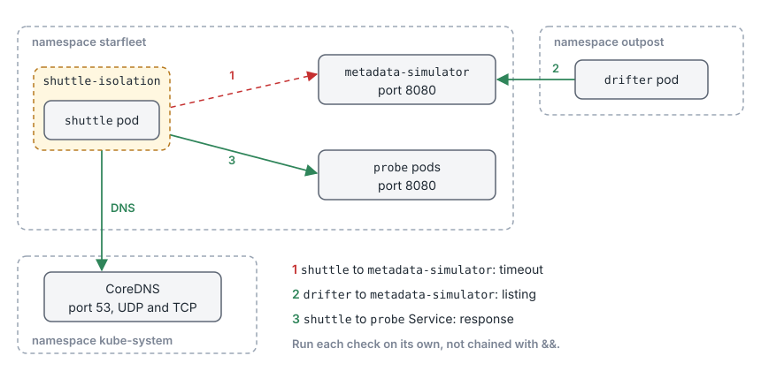

# Restrict The Pod And Verify The Boundary

Right now, the `shuttle` pod and the `drifter` pod can both reach `metadata-simulator`, a web server pod on port 8080 that stands in for a cloud metadata endpoint. On this page, you close the path from `shuttle` with an egress allow-list. An egress allow-list is a NetworkPolicy that selects a pod for outgoing traffic and names only the destinations the pod needs.

Then you prove three things with requests: the target still works, the restricted pod cannot reach it, and the dependencies of the restricted pod still work. The page ends with the provider-specific protections that a NetworkPolicy cannot replace.

## The allow-list policy

The policy selects `shuttle` for egress only. It allows two destinations:

- DNS to CoreDNS, the cluster DNS server, on UDP and TCP port 53. Without this rule, `shuttle` cannot look up any Service name.
- TCP port 8080 to pods labelled `app: probe`.

Nothing else is listed, so Calico drops everything else. That includes `metadata-simulator`, which is a pod with the label `app: metadata-simulator`.

<!-- astrona:playground:renew -->

Save this as `networkpolicy-shuttle-isolation.yaml`:

```yaml
apiVersion: networking.k8s.io/v1
kind: NetworkPolicy
metadata:
  name: shuttle-isolation
  namespace: starfleet
spec:
  podSelector:
    matchLabels:
      app: shuttle
  policyTypes:
  - Egress
  egress:
  - to:
    - namespaceSelector:
        matchLabels:
          kubernetes.io/metadata.name: kube-system
      podSelector:
        matchLabels:
          k8s-app: kube-dns
    ports:
    - port: 53
      protocol: UDP
    - port: 53
      protocol: TCP
  - to:
    - podSelector:
        matchLabels:
          app: probe
    ports:
    - port: 8080
      protocol: TCP
```

Apply it:

```sh
kubectl apply -f networkpolicy-shuttle-isolation.yaml
```

## Three checks

A single blocked request does not prove much on its own, so you send three. Run each check on its own. A blocked request ends with a nonzero exit status, so do not chain the commands with `&&` or run them under `set -e`.

```sh
SIM_IP=$(kubectl -n starfleet get pod metadata-simulator -o jsonpath='{.status.podIP}')
kubectl -n starfleet exec shuttle -- wget -q -T 3 -O- "http://$SIM_IP:8080/"
kubectl -n outpost exec drifter -- wget -q -T 3 -O- "http://$SIM_IP:8080/"
kubectl -n starfleet exec shuttle -- wget -q -T 3 -O- http://probe/
```

Each request tells you something different:

1. The request from `shuttle` to the stand-in times out. Calico dropped the packets.
2. The request from `drifter` still returns the directory listing. This proves that the stand-in is healthy, so the timeout in the first request comes from the policy and not from a broken server.
3. The request from `shuttle` to the `probe` Service returns the application response. This proves that DNS and the allowed dependency still work.

The third request goes to the Service port 80, but the rule names port 8080. That is correct. The Service address is translated to a pod address before the policy is evaluated, so the policy sees the pod port 8080.



The drawing shows the three checks and the DNS lookup together. The target works, the restricted source is blocked, and the permitted dependency survives. A single timeout alone would not tell you which of these three is true.

## Troubleshooting the result

If the checks do not give these results, the pattern of failures points to the cause:

- **The first request still succeeds.** Check that the policy exists in the right namespace. Check that its `podSelector` matches the pod label with `kubectl -n starfleet get pod shuttle --show-labels`. Check also that the network plugin enforces policy.
- **Every request from `shuttle` fails, including the third.** The DNS rule or the `probe` rule is wrong.
- **The `drifter` request fails.** The stand-in is not ready, or you used the wrong IP address.

A recreated pod gets a new IP address. So read the address again before each test.

## What the policy does not do

The policy restricted one pod on the pod network. It did not change the node, the metadata service or the credentials behind it. On a cloud cluster, the following measures work together with a policy, and none of them replaces the others:

- **Restrict the path for all application pods.** Select the application namespaces with an egress policy that does not allow the metadata address, and review every exception.
- **Use the provider's protection for the metadata service.** Some providers require a session token for requests, limit the number of network hops a response may travel, or hide the node credentials from pods completely. These features reduce request forgery and accidental exposure. A compromised application that may still reach the service may be able to ask for a token, so these features add to the network rule; they do not replace it.
- **Give workloads their own identity.** The provider's workload identity features issue narrow credentials to a ServiceAccount, so applications need nothing from the node.
- **Narrow the node identity.** Give the node role only what the node needs, so that an exposure has a limited cost.
- **Close the other routes.** Keep anonymous kubelet access off and use Webhook authorization. Never mount the runtime socket into application pods. Use admission controls to reject `hostNetwork` and `hostPath` in application namespaces.

The playground proves only the network step. It does not prove that a real metadata service is protected, so report your result that way.

## Clean up

If you want to repeat the exercise, remove the policy and the stand-in:

```sh
kubectl delete -f networkpolicy-shuttle-isolation.yaml
kubectl delete -f pod-metadata-simulator.yaml
```

You can now block a metadata-style endpoint for one pod with an egress allow-list, and prove the result with a blocked request, a working control request and a working dependency. The open question on a real cluster is everything outside the pod network: the provider's metadata protections, the node identity and the admission rules must each be set up and checked on their own.

## Common pitfalls

> [!WARNING]
> - **Calling a timeout proof.** Also show that the target works from an unrestricted client.
> - **Forgetting DNS in the allow-list.** The restricted pod then fails on every name.
> - **Stopping at the network rule.** The credentials behind a real metadata service need their own limits.
> - **Using an old pod IP address.** Read the address again after a pod is recreated.
