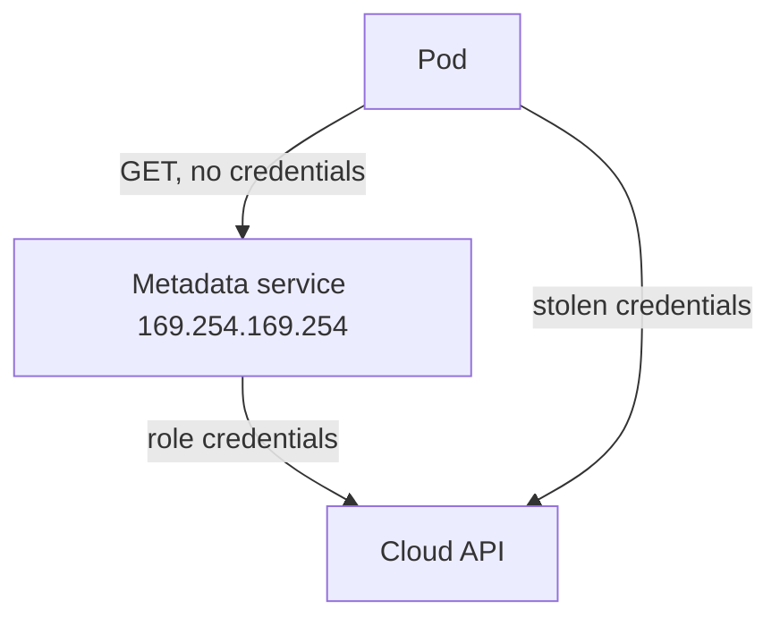

# What The Metadata Service Hands Out

Before you block an address you should know what sits behind it. The instance metadata service (IMDS) is an HTTP server that the cloud provider runs for each virtual machine. This part describes what it returns, why that matters for a cluster, and how the provider-specific versions differ. It has no commands, because the playground has no cloud provider. The next part builds a stand-in that you can query.

## A link-local address that every process can reach

The service listens on `169.254.169.254`, port 80. This address is in the link-local range `169.254.0.0/16`, which routers never forward. The virtual machine reaches it through its own network interface, and the provider's network layer answers on behalf of the machine. No credentials are needed to send the request. The service trusts the network position: a request that arrives from this machine is a request from this machine.

On a Kubernetes node this trust is too wide. A pod that has its own network namespace still sends its packets out through the node, and the node's route to `169.254.169.254` works for the pod as well. Unless something filters the traffic, a pod can ask the metadata service the same questions the node can.

## What the service returns

The service has several kinds of data. The most important kinds for security are these:

- **Instance identity.** The instance identifier, the host name, the region, the network interfaces and the addresses of the machine. This helps an attacker to map the environment.
- **Role credentials.** A temporary access key, secret key and session token for the identity that the provider attached to the machine. On Amazon Web Services (AWS) this is an instance profile role, and the credentials appear under `/latest/meta-data/iam/security-credentials/`. They are valid for hours and work from anywhere, not only from the machine.
- **User data.** The start-up script or text that the person who created the machine supplied. It often holds bootstrap tokens, passwords or internal host names that someone pasted in.

Role credentials are the main risk. Kubernetes RBAC controls what a ServiceAccount may do in the Kubernetes API, but the cloud role of a node is a separate identity decided by the provider. A pod with no Kubernetes permissions can fetch the node's role credentials and then call the cloud provider's API, for example to read storage buckets or to pull container images from a private registry. The node role is usually broader than any single pod needs, because it serves every pod on the machine.

## Version one and version two

The first version of the AWS service, called IMDSv1, answers a plain `GET` request. Any code that can make an HTTP request to the address gets the data. This includes a pod with a server-side request forgery (SSRF) flaw, where an attacker makes the application fetch a URL of the attacker's choice.

The second version, IMDSv2, requires two steps. The client first sends a `PUT` request to `/latest/api/token` with a header that sets the lifetime of the token, and receives a session token. It then sends each `GET` request with the token in a header. This blocks most SSRF attacks, because a simple URL fetch cannot send a `PUT` or add a custom header. IMDSv2 also limits how far the token response can travel. The response has an IP time to live (TTL) of 1 by default, so it expires after one network hop. A pod on a bridge network is one hop further away than the host, which is why the hop limit setting matters for containers. Providers document the exact defaults, and they differ between instance types and tools, so check the current documentation for your account.

## Other providers

Google Cloud Platform (GCP) serves its metadata at `169.254.169.254` and also at the name `metadata.google.internal`. It requires the request header `Metadata-Flavor: Google`, which stops simple URL fetches. Service account tokens are available under a path in the `instance/service-accounts/` tree. Microsoft Azure serves instance data at `169.254.169.254` under `/metadata/instance` and requires the header `Metadata: true`. Azure also has a separate virtual address, `168.63.129.16`, used by the platform for host services. Because every provider uses the same link-local address, one NetworkPolicy rule for `169.254.169.254/32` is the common first control, and it works on any cluster whose network plugin enforces egress policy.

The diagram shows why the address matters: the pod gets credentials from the metadata service and then calls the cloud API as the node, not as the pod.

You now know what the address returns and which versions and providers exist. The question for the rest of the module is how to stop pods from asking. The next part builds a playground target that behaves like the first version of the service, so that you can see the request and the response yourself.

## Common pitfalls

> [!WARNING]
> - **Thinking RBAC protects cloud credentials.** The node role belongs to the cloud provider, not to Kubernetes.
> - **Treating IMDSv2 as a replacement for a network rule.** Tokens and hop limits help, but a pod that can reach the address and send a `PUT` still gets a token on a node where the hop limit allows it.
> - **Blocking only `metadata.google.internal` or another name.** Pods can use the IP address directly, so rules must match the address.
> - **Forgetting user data.** It can hold secrets even when no role is attached to the machine.
