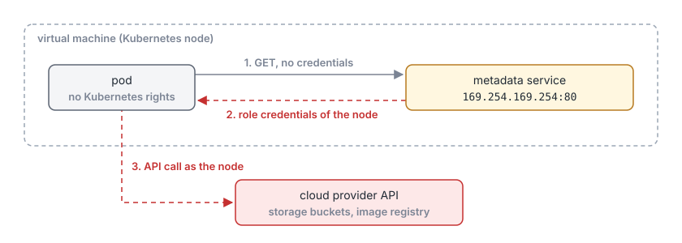
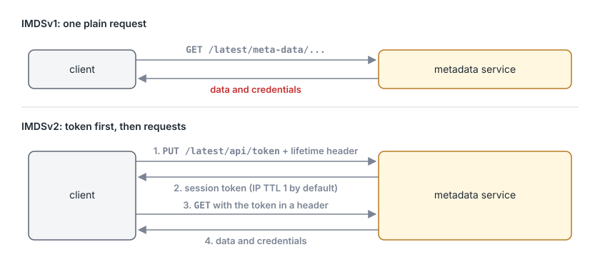

# What The Metadata Service Hands Out

Before you block an address, you should know what sits behind it. The instance metadata service (IMDS) is an HTTP server that the cloud provider runs for each virtual machine. Programs on the machine ask it for facts about the machine and for credentials.

This page explains what the service returns, why that matters for a cluster, and how the versions and providers differ. It has no commands, because the playground has no cloud provider. The playground has a stand-in server instead, which you can query on the next page.

## A link-local address that every process can reach

The service listens on `169.254.169.254`, port 80. This address is in the link-local range `169.254.0.0/16`. A link-local address works only on the local network link, and routers never forward it. The virtual machine reaches the address through its own network interface, and the network layer of the provider answers for the machine.

The request needs no credentials. The service trusts the network position: a request that arrives from this machine counts as a request from this machine.

On a Kubernetes node, this trust is too wide. A pod has its own network namespace, but its packets still leave through the node. The node's route to `169.254.169.254` works for the pod as well. Unless something filters the traffic, a pod can ask the metadata service the same questions as the node.

## What the service returns

The service holds several kinds of data. These kinds matter most for security:

- **Instance identity.** The instance identifier, the host name, the region, the network interfaces and the addresses of the machine. This helps an attacker to map the environment.
- **Role credentials.** A temporary access key, secret key and session token for the identity that the provider attached to the machine. On Amazon Web Services (AWS), this identity is an instance profile role, and the credentials appear under `/latest/meta-data/iam/security-credentials/`. They are valid for hours, and they work from anywhere, not only from the machine.
- **User data.** The start-up script or text that the person who created the machine supplied. It often holds bootstrap tokens, passwords or internal host names that someone pasted in.

Role credentials are the main risk. Kubernetes role-based access control (RBAC) decides what a ServiceAccount may do in the Kubernetes API. The cloud role of a node is a separate identity, and the cloud provider controls it, not Kubernetes.

So a pod with no Kubernetes permissions can still fetch the node's role credentials. It can then call the cloud provider's API, for example to read storage buckets or to pull container images from a private registry. The node role is usually broader than any single pod needs, because it serves every pod on the machine.

The drawing shows the two steps of the attack: the pod reads the node's credentials from the metadata service, and then it calls the cloud API as the node, not as the pod.

## Version one and version two

AWS has two versions of the service, and they differ in what a request must look like. The difference decides which attacks still work.

The first version, called IMDSv1, answers a plain `GET` request. Any code that can make an HTTP request to the address gets the data. This includes an application with a server-side request forgery (SSRF) flaw. In an SSRF attack, the attacker makes the application fetch a URL of the attacker's choice.

The second version, IMDSv2, requires two steps. First, the client sends a `PUT` request to `/latest/api/token` with a header that sets the lifetime of the token, and it receives a session token. Then the client sends each `GET` request with the token in a header. This blocks most SSRF attacks, because a simple URL fetch cannot send a `PUT` request or add a custom header.

The drawing compares the two versions: IMDSv1 needs one plain request, and IMDSv2 needs a token request first and the token on every later request.

IMDSv2 also limits how far the token response can travel. The response has an IP time to live (TTL) of 1 by default, so it expires after one network hop. A pod on a bridge network is one hop further away than the host, so the hop limit setting matters for containers. The exact defaults differ between instance types and tools, so check them for your own account.

## Other providers

Google Cloud Platform (GCP) serves its metadata at `169.254.169.254` and also at the name `metadata.google.internal`. It requires the request header `Metadata-Flavor: Google`, which stops simple URL fetches. Service account tokens are available under a path in the `instance/service-accounts/` tree.

Microsoft Azure serves instance data at `169.254.169.254` under `/metadata/instance`, and it requires the header `Metadata: true`. Azure also has a separate virtual address, `168.63.129.16`, which the platform uses for host services.

Every provider uses the same link-local address. So one NetworkPolicy rule for `169.254.169.254/32` is the common first control. It works on any cluster whose network plugin enforces egress policy.

You now know what the address returns and which versions and providers exist. The open question is how to stop pods from asking, and what that request and response look like on a real network path.

## Common pitfalls

> [!WARNING]
> - **Thinking RBAC protects cloud credentials.** The node role belongs to the cloud provider, not to Kubernetes.
> - **Treating IMDSv2 as a replacement for a network rule.** Tokens and hop limits help. But a pod that can reach the address and send a `PUT` request still gets a token on a node where the hop limit allows it.
> - **Blocking only `metadata.google.internal` or another name.** Pods can use the IP address directly, so rules must match the address.
> - **Forgetting user data.** It can hold secrets even when no role is attached to the machine.
