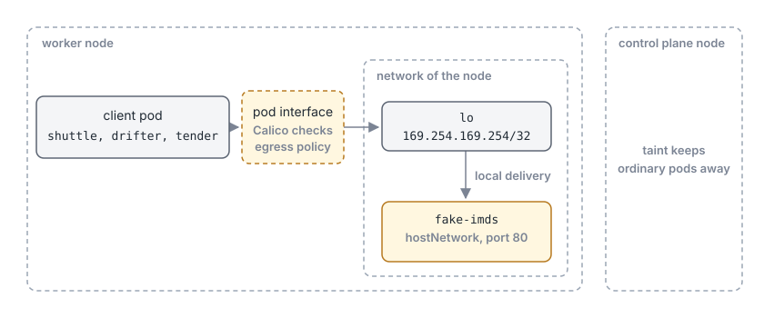

# The Playground Metadata Server

A block only convinces you if you first saw the thing it blocks. So before you write any policy, you look at the fake metadata server that the playground runs. You also follow the path a request takes from a pod to it, and you record the starting state: with no policy, every client pod can read the fake credentials.

Everything the server returns is fake and marked as fake. The server exists so that you can test the network path, which is real, without any risk.

## How the fake server is built

The playground setup does two things on the worker node. First, it adds the address `169.254.169.254/32` to the loopback interface `lo` of the worker, so the node itself owns that address. Then it starts the pod `fake-imds` in the namespace `metadata-stub`.

The pod sets `hostNetwork: true`. This setting makes the pod use the network namespace of the worker node instead of its own. The pod runs a small Python HTTP server bound to `169.254.169.254` on port 80. The control plane node has a taint that keeps ordinary pods away, so the pod runs on the worker.

A real cloud network answers the address outside the machine. In the playground, the machine answers it itself. For a pod, this difference does not matter. The pod sends a packet to `169.254.169.254`, the packet leaves the pod through its virtual network interface, and the node delivers it to the local server.

Calico, the network plugin of the playground, enforces egress policy at the pod's interface, before the packet reaches the node. So a NetworkPolicy sees this traffic in the same way as traffic to a real metadata service. The setup also sets the Calico option `defaultEndpointToHostAction` to `Accept`, so that pods may send traffic to addresses on the node when no policy stops them.



The drawing shows that the client pod is the one the policy applies to, at its own interface, and that the server lives in the network of the node, not in the pod network.

## Look at the target

You start by confirming where the server runs and which network it uses. The first command lists the pod with its node. The second command prints the host network setting:

<!-- astrona:playground:renew -->

```sh
kubectl -n metadata-stub get pod fake-imds -o wide
kubectl -n metadata-stub get pod fake-imds -o jsonpath='{.spec.hostNetwork}{"\n"}'
```

The first command shows the pod on the worker node. Its pod IP address is the address of the node, because a host network pod has no address of its own. The second command prints `true`.

## Read the fake data from a pod

Now read the data the way an attacker would. Define a small shell function that sends a request from a named pod to the metadata address and prints only the body. The function takes a namespace, a pod name and a path:

```sh
read_metadata() { kubectl -n "$1" exec "$2" -- curl -s -m 3 "http://169.254.169.254$3"; }
read_metadata dock tender /latest/meta-data/
read_metadata dock tender /latest/meta-data/iam/security-credentials/
```

The first request returns a list of names, such as `instance-id`, `hostname` and `iam/`. The second request returns the name of a fake role. Fetch the credentials of that role by adding its name to the path:

```sh
read_metadata dock tender /latest/meta-data/iam/security-credentials/fake-node-role
```

The response is a JSON document with an access key, a secret key, a token and an expiry time. All of them are fake values, and one field says that they are fake. A real response from a cloud provider has the same shape, and an attacker would paste the values into the cloud command-line tool.

## The starting state in three namespaces

For the policy tests, you only need the HTTP status code, not the body. The function below prints only the status code. It also stops the request after three seconds, so a later block shows up as a quick failure instead of a long wait:

```sh
check_metadata() { kubectl -n "$1" exec "$2" -- curl -s -m 3 -o /dev/null -w '%{http_code}\n' http://169.254.169.254/latest/meta-data/; }
check_metadata starfleet shuttle
check_metadata outpost drifter
check_metadata dock tender
```

Each command prints `200`. No policy exists, so nothing separates the clients from the server, and the namespace of the client makes no difference.

A request that gets no answer prints `000` instead. `curl` uses this code when no HTTP response arrived, and the command then exits with a non-zero status. You will see `000` after each block that works.

You now have a target that behaves like the real service, and a starting state in which every pod reaches it. The open question is how to close this address for a whole namespace while the rest of the pods' traffic keeps working.

## Common pitfalls

> [!WARNING]
> - **Testing a block without a starting state.** A request that fails before the policy exists proves nothing about the policy. Record a `200` first.
> - **Reading `000` as a policy result without a control.** The server could be down. Always keep one client that still gets `200`.
> - **Using a long timeout.** Without `-m 3`, a dropped connection makes the command wait for a long time.
> - **Expecting the pod IP address of `fake-imds` to come from the pod address range.** A host network pod uses the address of the node.
