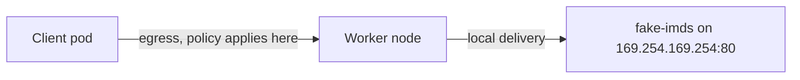

# The Playground Metadata Server

A block is only convincing if you have first seen the thing it blocks. This part inspects the fake metadata server that the playground runs, explains how a request from a pod travels to it, and records the baseline: with no policy, every client pod can read the fake credentials. Everything the server returns is fake and marked as fake. It exists so that the network path, which is real, can be tested safely.

## How the fake server is built

The playground setup does two things on the worker node. It adds the address `169.254.169.254/32` to the loopback interface of the worker, which makes the node itself own that address. It then starts the pod `fake-imds` in the namespace `metadata-stub`. The pod sets `hostNetwork: true`, so it uses the network namespace of the worker node, and it runs a small Python HTTP server bound to `169.254.169.254` on port 80. The control plane node has a taint that keeps ordinary pods away, so the pod runs on the worker.

A real cloud network answers the address outside the machine. Here the machine answers it itself. For a pod the difference does not matter. The pod sends a packet to `169.254.169.254`, the packet leaves the pod through its virtual network interface, and the node delivers it to the local server. Calico enforces egress policy at the pod's interface, before the packet reaches the node, so a NetworkPolicy sees this traffic in the same way as it would see traffic to a real metadata service.



The diagram shows that the client pod is the policy subject and that the server lives on the node, not in the pod network.

## Look at the target

<!-- astrona:playground:renew -->

Start by confirming where the server runs and what it uses. The first command lists the pod with its node. The second prints the host network setting:

```sh
kubectl -n metadata-stub get pod fake-imds -o wide
kubectl -n metadata-stub get pod fake-imds -o jsonpath='{.spec.hostNetwork}{"\n"}'
```

The first command shows the pod on the worker node, with the node's address as the pod IP, because a host network pod has no separate address. The second prints `true`.

## Read the fake data from a pod

Define a small shell function that sends a request from a named pod to the metadata address and prints only the body. The function takes a namespace, a pod name and a path:

```sh
read_metadata() { kubectl -n "$1" exec "$2" -- curl -s -m 3 "http://169.254.169.254$3"; }
read_metadata dock tender /latest/meta-data/
read_metadata dock tender /latest/meta-data/iam/security-credentials/
```

The first request returns a list of names, such as `instance-id`, `hostname` and `iam/`. The second returns the name of a fake role. Fetch the credentials of that role by adding the name to the path:

```sh
read_metadata dock tender /latest/meta-data/iam/security-credentials/fake-node-role
```

The response is a JSON document with an access key, a secret key, a token and an expiry, all filled with fake values and a field that says they are fake. A real response from a cloud provider has the same shape, and an attacker would paste the values into the cloud command-line tool.

## The baseline from three namespaces

Now print only the HTTP status code from a client in each of the three namespaces. The function below sends the request with a three second limit, so that a later block shows up as a quick failure instead of a long wait:

```sh
check_metadata() { kubectl -n "$1" exec "$2" -- curl -s -m 3 -o /dev/null -w '%{http_code}\n' http://169.254.169.254/latest/meta-data/; }
check_metadata starfleet shuttle
check_metadata outpost drifter
check_metadata dock tender
```

Each command prints `200`. No policy exists, so nothing separates the clients from the server, and the namespace of the client makes no difference. A request that gets no answer prints `000`, which is the code `curl` uses when no HTTP response arrived, and the command exits with a non-zero status. You will see `000` after each successful block.

You now have a target that behaves like the real service, and a baseline in which every pod reaches it. The next part blocks the address for a whole namespace while the rest of the pod's traffic keeps working.

## Common pitfalls

> [!WARNING]
> - **Testing a block without a baseline.** A request that fails before the policy exists proves nothing about the policy. Record a `200` first.
> - **Reading `000` as a policy result without a control.** The server could be down. Always keep one client that still gets `200`.
> - **Using a long timeout.** Without `-m 3`, a dropped connection makes the command wait for a long time.
> - **Expecting the pod IP of `fake-imds` to be a pod CIDR address.** A host network pod uses the node's address.
