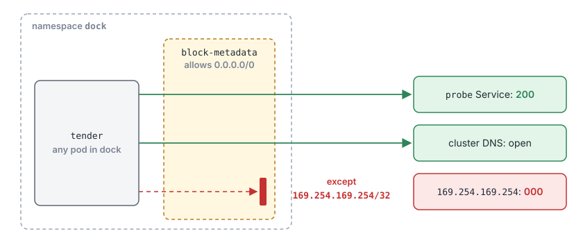

# Block With An ipBlock Except Rule

Every pod in the playground can read the fake credentials today. The fastest way to close the metadata address for a whole namespace is one NetworkPolicy that allows all egress except that address.

On this page, you see how that rule works and apply it to the `dock` namespace. Then you prove three things: the address is blocked, other egress still works, and the policy covers pods that did not exist when you wrote it.

## Why an except rule

A pod that no policy selects for egress can send traffic anywhere. The moment one policy selects it for egress, only the destinations that policies allow stay open. So to block one address and keep everything else, the policy must select all pods and allow everything except that address.

The field `ipBlock` describes a range of addresses in classless inter-domain routing (CIDR) notation, such as `10.0.0.0/8`. Its `except` list removes smaller ranges from that range. The range `0.0.0.0/0` means every IPv4 address. So `0.0.0.0/0` with the exception `169.254.169.254/32` means every address except the metadata address.



The drawing shows the allowed range as one wide band with a single hole for the metadata address. Requests from `tender` to the `probe` Service and to DNS fall inside the band, and only the request to `169.254.169.254` falls into the hole.

Three details decide whether the policy works:

- `podSelector: {}` selects every pod in the namespace of the policy, including pods created later.
- `policyTypes` should list `Egress` explicitly. If the field is missing, Kubernetes always assumes `Ingress` and adds `Egress` only when the policy has egress rules. Writing it out removes the guess.
- The `to` entry has only an `ipBlock`. An `ipBlock` cannot share one entry with a `podSelector` or a `namespaceSelector`, and the API server rejects the policy if you try.

The range `0.0.0.0/0` also contains the addresses of pods and of the Domain Name System (DNS) server. Service traffic counts too, because the node translates a Service address to a pod address before the policy sees it. So the policy needs no separate rule for DNS or for traffic inside the cluster.

There is one limit to know. The Kubernetes documentation describes `ipBlock` as meant for addresses outside the cluster, and some network plugins treat pod addresses differently. Calico applies the range to any destination address, and this playground relies on that behaviour.

## Apply the policy to dock

With the rule clear, you can apply it. First record the starting state. The two functions below send one request to the metadata address and one request to the `probe` Service in the same namespace:

<!-- astrona:playground:renew -->

```sh
check_metadata() { kubectl -n "$1" exec "$2" -- curl -s -m 3 -o /dev/null -w '%{http_code}\n' http://169.254.169.254/latest/meta-data/; }
check_service() { kubectl -n "$1" exec "$2" -- curl -s -m 3 -o /dev/null -w '%{http_code}\n' http://probe/; }
check_metadata dock tender
check_service dock tender
```

Both commands print `200`. Save this as `networkpolicy-block-metadata.yaml`:

```yaml
apiVersion: networking.k8s.io/v1
kind: NetworkPolicy
metadata:
  name: block-metadata
  namespace: dock
spec:
  podSelector: {}
  policyTypes:
  - Egress
  egress:
  - to:
    - ipBlock:
        cidr: 0.0.0.0/0
        except:
        - 169.254.169.254/32
```

Apply it:

```sh
kubectl apply -f networkpolicy-block-metadata.yaml
```

Then check the result with the same two functions:

```sh
check_metadata dock tender
check_service dock tender
```

Calico programs the rule within a moment. If the first command still prints `200`, wait a few seconds and run it again.

After that, the first command prints `000` and exits with status 28, which is the `curl` exit code for a timeout. `kubectl` reports that the command terminated with that exit code. The second command still prints `200`. The request to the `probe` Service needed a DNS lookup and a connection to a pod, and both paths stayed open.

## Prove other namespaces are unaffected

A policy lives in one namespace, so the other namespaces should not change. Run the check function against a namespace that has no policy:

```sh
check_metadata outpost drifter
```

It prints `200`. This is the control request. It shows that the server is healthy, so the block in `dock` comes from the policy and not from a failed server.

You now know the deny-list form, which blocks one address and keeps all other egress. Its weakness is the weakness of every deny-list: it names only the addresses you thought of. It is still the right tool here, because the task names the address. The task on the next page asks you to do this yourself in another namespace. The open question is what to do when one pod really needs the address.

## Common pitfalls

> [!WARNING]
> - **Leaving out `policyTypes: [Egress]`.** Kubernetes often adds `Egress` by itself, but a policy that lists only `Ingress` has no effect on egress.
> - **Using `/24` or another wide range in `except`.** Block exactly `169.254.169.254/32` unless the task says more.
> - **Putting `ipBlock` and a selector in the same `to` entry.** The API server rejects it. Use separate entries.
> - **Applying the policy in the wrong namespace.** A policy protects only the pods in its own namespace.
> - **Testing too soon.** Wait a few seconds after `apply` before you decide that the policy failed.
