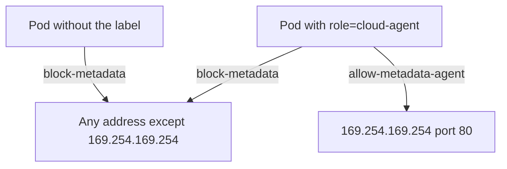

# Default Deny Plus A Selective Allow

Some pods have a real reason to read the metadata service. A cloud agent that manages volumes or load balancers, for example, may need the node's role. The safe design blocks the address for every pod and opens it for the few pods that need it. This part shows how NetworkPolicy builds that design from rules that add up, applies it in the `dock` namespace, and explains why the label that opens the path must be protected.

## Policies add up

NetworkPolicy has no deny rule. A policy only lists what it allows. When several policies select the same pod for egress, the pod may send traffic that any one of them allows. This is how a selective allow works. One policy allows everything except the metadata address for all pods. A second policy allows the metadata address for pods with a particular label. For a labelled pod the union of the two policies covers every address, and for every other pod it excludes the metadata address.

The label in this module is `role=cloud-agent`. The second policy selects pods by that label with `matchLabels` and allows egress to `169.254.169.254/32` on TCP port 80. Narrowing the allow to the port is a good habit, because the metadata service uses only port 80.

## Build the pair of policies

<!-- astrona:playground:renew -->

The commands below need the blocking policy from the previous step in place, so you apply it again here. Applying an object that already exists with the same content changes nothing. Save this as `networkpolicy-block-metadata.yaml`:

```yaml
apiVersion: networking.k8s.io/v1
kind: NetworkPolicy
metadata:
  name: block-metadata
  namespace: dock
spec:
  podSelector: {}
  policyTypes:
  - Egress
  egress:
  - to:
    - ipBlock:
        cidr: 0.0.0.0/0
        except:
        - 169.254.169.254/32
```

Save this as `networkpolicy-allow-metadata-agent.yaml`:

```yaml
apiVersion: networking.k8s.io/v1
kind: NetworkPolicy
metadata:
  name: allow-metadata-agent
  namespace: dock
spec:
  podSelector:
    matchLabels:
      role: cloud-agent
  policyTypes:
  - Egress
  egress:
  - to:
    - ipBlock:
        cidr: 169.254.169.254/32
    ports:
    - protocol: TCP
      port: 80
```

Apply both files:

```sh
kubectl apply -f networkpolicy-block-metadata.yaml
kubectl apply -f networkpolicy-allow-metadata-agent.yaml
```

## Label a pod and watch the path open

The pod `tender` has no `role` label, so it is selected only by `block-metadata`. Define the request function and check it before and after you add the label:

```sh
check_metadata() { kubectl -n "$1" exec "$2" -- curl -s -m 3 -o /dev/null -w '%{http_code}\n' http://169.254.169.254/latest/meta-data/; }
check_metadata dock tender
kubectl -n dock label pod tender role=cloud-agent
check_metadata dock tender
```

The first request prints `000`. After the label command, Calico sees the changed label and updates its rules for the pod, usually within a few seconds. The second request then prints `200`, so run it again if it still prints `000`. The pod did not restart. A policy selector is evaluated against the current labels, and a label change moves the pod from one set of policies to another.

Now remove the label and check again. The trailing minus sign deletes a label:

```sh
kubectl -n dock label pod tender role-
check_metadata dock tender
```

The request prints `000` again, after the same short delay.

## Label discipline

The last test shows the weak point of the design. Whoever can change the labels of a pod can open the metadata path for it. In RBAC terms, the verbs `patch` and `update` on pods, and the permission to create pods with any labels, include the power to give a pod the `role=cloud-agent` label. If a team can create pods in the namespace, the team can create a pod with that label. Treat the label as a credential. Limit who can create pods in the namespace, use a label name that is not guessable from the application, and add an admission policy that rejects the label from anyone but the platform team. Admission control is a later topic. For now remember that the label is a control, so protect it like one.

An alternative design is a full default deny. One policy with `podSelector: {}` and an empty `egress` list blocks all egress, and further policies allow DNS, the in-cluster traffic and the agent's address. It gives tighter control, but every dependency of every pod must be listed, and a forgotten dependency breaks an application. The pair of policies you built blocks one address and leaves the rest as it was, which is why it is the usual answer when a task asks only for the metadata address.



The diagram shows that a labelled pod matches both policies and gets the union of what they allow.

## Common pitfalls

> [!WARNING]
> - **Writing the allow policy without the block policy.** A pod that is selected by only the allow policy can reach nothing except the metadata address.
> - **Matching the allow policy to the wrong labels.** The selector must match the labels on the pod itself, not the labels on the Deployment.
> - **Leaving the label unprotected.** Anyone who can create or patch pods can open the path.
> - **Allowing the whole `169.254.0.0/16` range.** The allow rule should name one address and one port.
