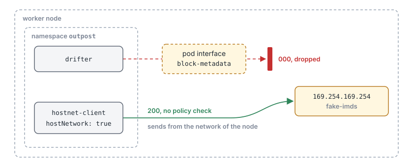

# Policy Pitfalls For The Metadata Address

A NetworkPolicy that looks right can still leave the metadata address open. Most failures come from five patterns, and the exam rewards a learner who spots them quickly.

On this page, you walk through each pattern. Then you run two of them in the playground, including the one case where no pod policy helps at all.

## Pattern one: egress with no except entry

A policy that allows `0.0.0.0/0` without an `except` list selects the pods for egress, and then it allows every address again, including the metadata address. It looks like a restriction because the file has an `egress` section, but it changes nothing.

A request from a pod that this policy selects still succeeds. So when you review a policy for this task, read the `except` list first.

## Pattern two: a policy that allows only DNS

Some policies have a single egress rule for port 53, the DNS port. Such a policy does stop the metadata request, because the pods may now reach only DNS. But it also blocks everything else.

The application then fails, because it cannot reach its own Services, and the usual reaction is to remove the policy. A correct answer to the task blocks the address and leaves the other egress open, or it lists every dependency. So check the second half of the task as carefully as the first.

## Pattern three: the policy is in the wrong namespace

A NetworkPolicy selects pods in its own namespace and nothing else. A policy in `starfleet` has no effect on pods in `outpost`.

Two common slips cause this mistake: a copied file with the wrong `namespace` field, or an `apply` without `-n` for a file that has no namespace. The cluster accepts the object and shows it in the list of policies, so the error is easy to miss.

## Pattern four: a wrong address or mask

`169.254.169.254/32` is exactly one address. A mask of `/24` covers 256 addresses, and a mask of `/16` covers the whole link-local range. A typo in one octet, such as `169.254.196.254`, blocks a different address and leaves the real one open.

Type the address and the mask exactly as the task gives them. After you apply the policy, read the stored object to confirm them.

## Pattern five: a pod on the host network

The last pattern needs no mistake in the policy at all. A pod that sets `hostNetwork: true` uses the network namespace of the node. It has no pod interface, so Calico does not apply pod NetworkPolicy to it.

Such a pod reaches the metadata address, no matter which policies exist in its namespace. The fix is to stop such pods from running in application namespaces, with an admission rule that rejects `hostNetwork`, and to review the ones that must run. An admission rule is a check that the API server runs when someone creates or changes an object.



The drawing shows why the fifth pattern is different. The `drifter` pod passes the policy check at its pod interface and is dropped, while the `hostnet-client` pod sends from the network of the node and never meets that check.

## See two patterns in the playground

Two of these patterns are safe to run in the playground. You use the `outpost` namespace. First, apply a correct blocking policy, so you start from a protected state.

<!-- astrona:playground:renew -->

Save this as `networkpolicy-block-metadata.yaml`:

```yaml
apiVersion: networking.k8s.io/v1
kind: NetworkPolicy
metadata:
  name: block-metadata
  namespace: outpost
spec:
  podSelector: {}
  policyTypes:
  - Egress
  egress:
  - to:
    - ipBlock:
        cidr: 0.0.0.0/0
        except:
        - 169.254.169.254/32
```

Apply it, and check the result from the client pod `drifter`:

```sh
kubectl apply -f networkpolicy-block-metadata.yaml
check_metadata() { kubectl -n "$1" exec "$2" -- curl -s -m 3 -o /dev/null -w '%{http_code}\n' http://169.254.169.254/latest/meta-data/; }
check_metadata outpost drifter
```

After a few seconds, the request prints `000`. Now start a pod that uses the host network in the same namespace. Save this as `pod-hostnet-client.yaml`:

```yaml
apiVersion: v1
kind: Pod
metadata:
  name: hostnet-client
  namespace: outpost
spec:
  hostNetwork: true
  restartPolicy: Never
  containers:
  - name: client
    image: docker.io/curlimages/curl:8.11.1
    command:
    - sleep
    - '3600'
```

Apply it, wait until it is ready, and send the same request from it:

```sh
kubectl apply -f pod-hostnet-client.yaml
kubectl -n outpost wait --for=condition=Ready pod/hostnet-client --timeout=120s
check_metadata outpost hostnet-client
```

The last command prints `200`. The policy `block-metadata` selects every pod in `outpost`, yet the pod `hostnet-client` reaches the address. The policy is correct. The pod bypasses it because the pod does not use the pod network.

Remove the test pod:

```sh
kubectl -n outpost delete pod hostnet-client
```

## How to review a policy quickly

When you read a policy for this task, ask these questions in this order:

1. Does the file select the pods that matter, in the right namespace?
2. Does it list `Egress` in `policyTypes`?
3. Is `169.254.169.254/32` in an `except` list, or absent from every allow rule?
4. Does everything else that the pods need stay open?
5. Could any pod in the namespace use the host network?

These questions take less than a minute, and they cover all five patterns.

You now know how a correct-looking policy fails, and how to spot each failure. The open question is how to check the whole cluster at once, instead of one namespace at a time.

## Common pitfalls

> [!WARNING]
> - **Judging a policy by its file name or its `egress` section.** Read the `ipBlock` and its `except` list.
> - **Testing with a pod that the policy does not select.** Send the request from a pod the policy selects.
> - **Forgetting hostNetwork pods.** Pod policy does not apply to them. Find them with `kubectl get pods -A`.
> - **Trusting that an accepted object is correct.** The API server checks the format, not the intent.
