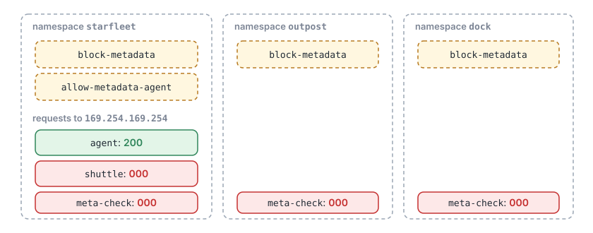

# Verify Coverage Across Namespaces

A cluster has many namespaces, and one policy covers only one of them. The task is finished only when every namespace that runs workloads blocks the address.

On this page, you build a loop that sends the metadata request from a temporary pod in each namespace. Then you list which namespaces have an egress policy and which do not, and you close the gaps. At the end, you check that the one allowed pod still works.

## Test with a fresh pod in each namespace

Testing from the pods that already exist can miss a case, because those pods may carry labels that a policy treats differently. A pod that you create only for the test has no special labels. So it shows what a new workload would get.

The command `kubectl run` creates a pod. The options `--rm` and `-i` attach the output of the pod and delete the pod when it finishes, and `--restart=Never` makes it a plain pod. The loop sends the metadata request from every application namespace:

<!-- astrona:playground:renew -->

```sh
for namespace in starfleet outpost dock; do
  kubectl -n "$namespace" run meta-check --rm -i --restart=Never --image=docker.io/curlimages/curl:8.11.1 --command -- curl -s -m 3 -o /dev/null -w "$namespace %{http_code}\n" http://169.254.169.254/latest/meta-data/
done
```

Each iteration prints the namespace and the status code. A namespace with no policy prints `200`. A protected namespace prints `000`, and `kubectl` reports the exit code 28.

Because this is a loop, a failure in one namespace does not stop the next one. The messages about the pod being deleted are normal. In a playground that has just started, all three namespaces print `200`.

## List the policies and find the gaps

The loop shows the result, but it does not show the reason. To see the reason, list every NetworkPolicy with its namespace, its pod selector and its types:

```sh
kubectl get networkpolicy -A -o custom-columns='NAMESPACE:.metadata.namespace,NAME:.metadata.name,POD-SELECTOR:.spec.podSelector,TYPES:.spec.policyTypes'
```

A namespace that does not appear in the list has no policy at all, and every pod there is open. A namespace that appears may still have a gap, so read two columns:

- **`POD-SELECTOR`.** A selector shown as `map[]` is the empty selector, which means every pod. A selector with a label selects only pods with that label, so the other pods in the namespace stay open.
- **`TYPES`.** A policy that lists only `Ingress` does not restrict egress.

To see which pods a label selector would leave out, list the pods and their labels:

```sh
kubectl get pods -A --show-labels
```

Compare the labels with each selector. A pod whose labels match no egress policy has no egress restriction.

## Close the gaps with one file

Once you know the gaps, you can close them all with one file. A policy file without a namespace in its `metadata` can be applied to many namespaces with the `-n` option. Save this as `networkpolicy-block-metadata.yaml`:

```yaml
apiVersion: networking.k8s.io/v1
kind: NetworkPolicy
metadata:
  name: block-metadata
spec:
  podSelector: {}
  policyTypes:
  - Egress
  egress:
  - to:
    - ipBlock:
        cidr: 0.0.0.0/0
        except:
        - 169.254.169.254/32
```

Apply it to each application namespace:

```sh
for namespace in starfleet outpost dock; do
  kubectl apply -n "$namespace" -f networkpolicy-block-metadata.yaml
done
```

Run the test loop from the start of this page again. After a few seconds, every namespace prints `000`.

## Keep the exception working

A block that also blocks the one pod that needs the address is a failure of the other kind. The pod `agent` in `starfleet` carries the label `role=cloud-agent`, and it needs the metadata address. Save this as `networkpolicy-allow-metadata-agent.yaml`:

```yaml
apiVersion: networking.k8s.io/v1
kind: NetworkPolicy
metadata:
  name: allow-metadata-agent
  namespace: starfleet
spec:
  podSelector:
    matchLabels:
      role: cloud-agent
  policyTypes:
  - Egress
  egress:
  - to:
    - ipBlock:
        cidr: 169.254.169.254/32
    ports:
    - protocol: TCP
      port: 80
```

Apply it, and send a request from each of the two clients in `starfleet`:

```sh
kubectl apply -f networkpolicy-allow-metadata-agent.yaml
check_metadata() { kubectl -n "$1" exec "$2" -- curl -s -m 3 -o /dev/null -w '%{http_code}\n' http://169.254.169.254/latest/meta-data/; }
check_metadata starfleet agent
check_metadata starfleet shuttle
```

The first request prints `200`, and the second prints `000`. Together with the three `000` results from the loop, you have now proven every denied path and the one allowed path.



The drawing shows the final state of the cluster. Every application namespace has `block-metadata`, and only the `agent` pod in `starfleet` still reaches the address, through `allow-metadata-agent`.

A complete answer to the exam task has this shape:

- one request that works for each pod that should reach the address;
- one request that fails for each pod that should not reach it;
- a control request that shows the server is healthy.

## Check the host network pods

Pods that use the host network stay outside this check, because pod policy does not apply to them. List them with the next command, and review each one:

```sh
kubectl get pods -A -o custom-columns='NAMESPACE:.metadata.namespace,NAME:.metadata.name,HOSTNETWORK:.spec.hostNetwork' | grep true
```

The output includes system pods and the `fake-imds` server itself. An application namespace that appears here needs a good reason.

You now know how to test every namespace, find the gaps in the policy list, close them with one file and keep the one exception working. The question that stays open is the host network pods, which no NetworkPolicy can cover.

## Common pitfalls

> [!WARNING]
> - **Testing only the namespaces you remember.** List the namespaces with `kubectl get namespaces` and compare.
> - **Judging coverage from the list of policies alone.** A policy with a narrow selector leaves other pods open.
> - **Leaving test pods behind.** Use `--rm`, and check with `kubectl get pods -A` afterwards.
> - **Treating `000` as proof without a control.** Keep one request that returns `200`.
