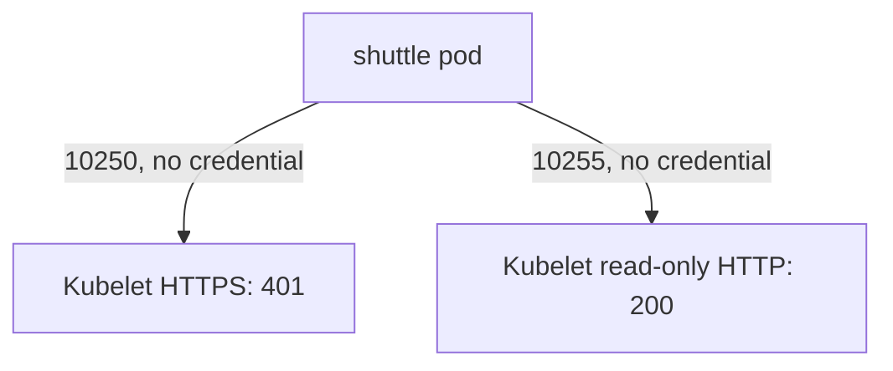

# The Kubelet API From A Pod

The kubelet is the agent on every node that starts and watches the pods. It also serves an API, and the pod network can reach it. This part sends requests to the kubelet from an ordinary client pod, explains what the three common answers mean, and shows why an open read-only port is a finding even when the main port is secure.

## Two ports and three answers

The kubelet serves HTTPS on port 10250. Through this port a caller can list the pods on the node, read container logs, run commands in containers with `exec` and open sessions with `attach` and `portforward`. Two kubelet settings decide who may do that. Authentication decides whether the kubelet accepts a request without credentials: with `authentication.anonymous.enabled: false` a request with no certificate or token is refused. Authorization decides what an authenticated caller may do: with `authorization.mode: Webhook` the kubelet asks the API server, so Kubernetes RBAC applies, and with `AlwaysAllow` every authenticated caller may do everything.

The three answers a client sees are:

- **401 Unauthorized.** The request carried no valid credential and anonymous access is off.
- **403 Forbidden.** The kubelet knew the caller but the caller has no permission for this request.
- **200 OK with data.** The request was accepted. If it carried no credential, anonymous access is on, which is a serious finding.

The kubelet can also serve a read-only HTTP port, 10255 by default when it is enabled, set with `readOnlyPort`. This port needs no credentials. It serves pod lists, node information and metrics. A secure node turns it off with the value `0`. In the playground the setup enables it on the worker node on purpose.

## Find the node address and read the settings

<!-- astrona:playground:renew -->

A pod reaches the kubelet on the node address, so first store the address of the worker node. The command selects the node that does not carry the control plane label and prints its internal address:

```sh
WORKER_IP=$(kubectl get nodes -l '!node-role.kubernetes.io/control-plane' -o jsonpath='{.items[0].status.addresses[?(@.type=="InternalIP")].address}')
echo "$WORKER_IP"
```

Read the kubelet settings the way the node uses them. The API server can proxy a request to the kubelet and return its running configuration:

```sh
WORKER=$(kubectl get nodes -l '!node-role.kubernetes.io/control-plane' -o jsonpath='{.items[0].metadata.name}')
kubectl get --raw "/api/v1/nodes/$WORKER/proxy/configz" | grep -o '"anonymous":{[^}]*}'
kubectl get --raw "/api/v1/nodes/$WORKER/proxy/configz" | grep -o '"readOnlyPort":[0-9]*'
```

The first line shows anonymous access disabled. The second shows the read-only port set to 10255, because the playground opened it. On a hardened node the second line would show no match or the value 0.

## Ask the kubelet from a pod

Now send the same kind of request that a compromised pod would send. The `-k` option tells `curl` to accept the kubelet's self-signed certificate. The option `-w` prints only the status code:

```sh
kubectl -n starfleet exec shuttle -- curl -sk -m 3 -o /dev/null -w '%{http_code}\n' "https://$WORKER_IP:10250/pods"
kubectl -n starfleet exec shuttle -- curl -s -m 3 -o /dev/null -w '%{http_code}\n' "http://$WORKER_IP:10255/pods"
```

The first request prints `401`: the port is reachable and the kubelet refuses a request with no credential. The second prints `200`: the read-only port answers without any credential. A body from this port holds the specification of every pod on the node, including image names, environment variable values that are written in the specification, and the names of mounted Secrets. See a part of it:

```sh
kubectl -n starfleet exec shuttle -- curl -s -m 3 "http://$WORKER_IP:10255/pods" | head -c 300
```

The output is the start of a JSON document that describes a pod list. Reading the pod specifications of a node helps an attacker choose the next target. The pod `shuttle` has no Kubernetes permission at all, and it still obtained this data.



The diagram shows that the secure port refuses the request while the read-only port answers it.

You now know that both ports are reachable from a pod, and that reachability and exposure are two separate questions. The kubelet's own settings answer the second question for port 10250. For port 10255 only turning it off, or blocking the path, helps. The next part blocks the path.

## Common pitfalls

> [!WARNING]
> - **Calling a 401 safe and stopping there.** It shows the settings are right, but the port is still reachable from every pod.
> - **Forgetting the read-only port.** It needs no credential and is easy to miss because the main port looks secure.
> - **Using `-k` in real tools without understanding it.** It skips certificate checks. Here it is acceptable because the target is a known node of the playground.
> - **Testing from the control plane node only.** Worker nodes can have different kubelet settings.
