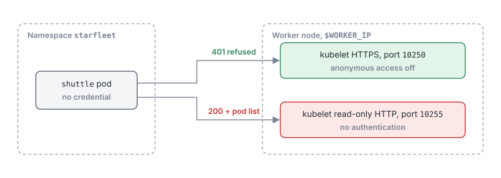

# The Kubelet API From A Pod

The kubelet is the agent on every node that starts the pods and watches them. It also serves an application programming interface (API), and the pod network can reach it. So a pod that an attacker controls can send requests to the kubelet of its node.

On this page, you send those requests from an ordinary client pod. You learn what the three common answers mean. You also see why an open read-only port is a finding, even when the main port is secure.

## Two ports and three answers

The kubelet serves HTTPS on port 10250. Through this port, a caller can list the pods on the node and read container logs. The caller can also run commands in containers with `exec`, and open sessions with `attach` and `portforward`.

Two kubelet settings decide who may do that:

- **Authentication** decides whether the kubelet accepts a request without credentials. With `authentication.anonymous.enabled: false`, the kubelet refuses a request that has no certificate or token.
- **Authorization** decides what an authenticated caller may do. With `authorization.mode: Webhook`, the kubelet asks the API server, so Kubernetes role-based access control (RBAC) applies. With `AlwaysAllow`, every authenticated caller may do everything.

These two settings lead to three answers that a client sees:

- **401 Unauthorized.** The request carried no valid credential, and anonymous access is off.
- **403 Forbidden.** The kubelet knew the caller, but the caller has no permission for this request.
- **200 OK with data.** The kubelet accepted the request. If the request carried no credential, anonymous access is on, and that is a serious finding.

The kubelet can also serve a read-only HTTP port. The setting `readOnlyPort` controls it, and the port is 10255 by default when it is enabled. This port needs no credentials. It serves pod lists, node information and metrics. A secure node turns it off with the value `0`. In the playground, the setup turns it on for the worker node on purpose.

## Find the node address and read the settings

A pod reaches the kubelet on the address of the node. So first store the address of the worker node. The command selects the node that does not carry the control plane label, and prints its internal address:

<!-- astrona:playground:renew -->

```sh
WORKER_IP=$(kubectl get nodes -l '!node-role.kubernetes.io/control-plane' -o jsonpath='{.items[0].status.addresses[?(@.type=="InternalIP")].address}')
echo "$WORKER_IP"
```

Next, read the kubelet settings as the node really uses them. The API server can pass a request on to the kubelet and return the kubelet's running configuration. The `configz` path below does that:

```sh
WORKER=$(kubectl get nodes -l '!node-role.kubernetes.io/control-plane' -o jsonpath='{.items[0].metadata.name}')
kubectl get --raw "/api/v1/nodes/$WORKER/proxy/configz" | grep -o '"anonymous":{[^}]*}'
kubectl get --raw "/api/v1/nodes/$WORKER/proxy/configz" | grep -o '"readOnlyPort":[0-9]*'
```

The first line shows that anonymous access is disabled. The second shows the read-only port set to 10255, because the playground opened it. On a hardened node, the second command would find no match or show the value 0.

## Ask the kubelet from a pod

You know the settings now, so test what they mean in practice. Send the same kind of request that a compromised pod would send. The `-k` option tells `curl` to accept the kubelet's self-signed certificate. The `-w` option prints only the status code:

```sh
kubectl -n starfleet exec shuttle -- curl -sk -m 3 -o /dev/null -w '%{http_code}\n' "https://$WORKER_IP:10250/pods"
kubectl -n starfleet exec shuttle -- curl -s -m 3 -o /dev/null -w '%{http_code}\n' "http://$WORKER_IP:10255/pods"
```

The first request prints `401`. The port is reachable, and the kubelet refuses a request with no credential. The second request prints `200`: the read-only port answers without any credential.

The body from the read-only port holds the specification of every pod on the node. That includes image names, environment variable values that are written in the specification, and the names of mounted Secrets. Look at the start of it:

```sh
kubectl -n starfleet exec shuttle -- curl -s -m 3 "http://$WORKER_IP:10255/pods" | head -c 300
```

The output is the start of a JSON document that describes a pod list. The pod specifications of a node help an attacker choose the next target. The `shuttle` pod has no Kubernetes permission at all, and it still got this data.



The drawing shows the two requests. The kubelet refuses the request on the secure port 10250, and it answers the same request on the read-only port 10255.

You now know that a pod can reach both kubelet ports, and that "reachable" and "exposed" are two separate questions. For port 10250, the kubelet's own settings decide the exposure. For port 10255, only two things help: turning the port off, or blocking the path from the pods to the node. The open question is how to block that path.

## Common pitfalls

> [!WARNING]
> - **Calling a 401 safe and stopping there.** A 401 shows that the settings are right, but every pod can still reach the port.
> - **Forgetting the read-only port.** It needs no credential, and it is easy to miss because the main port looks secure.
> - **Using `-k` in real tools without understanding it.** It skips the certificate check. It is acceptable here because the target is a known node of the playground.
> - **Testing from the control plane node only.** Worker nodes can have different kubelet settings.
