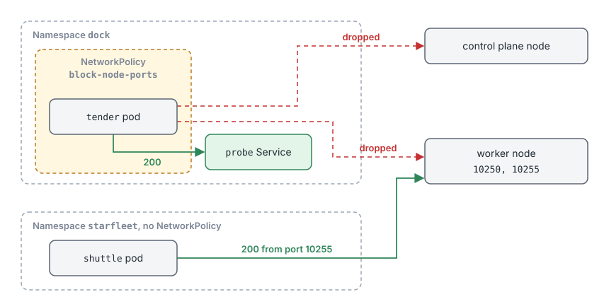

# Restrict Reachability To Node Ports

Any pod in the playground can send a request to the kubelet ports of a node. Yet a normal application pod almost never needs to talk to a kubelet. So the path from the pods to the node ports is an exposure with no benefit.

A NetworkPolicy can close that path. The policy allows all outgoing traffic, except traffic to the addresses of the nodes. This is the same form that blocks the metadata address `169.254.169.254`. On this page, you build that policy for the `dock` namespace, look at a second form based on ports, and see what a pod policy cannot protect on a node.

## The policy shape

Pods in an application namespace need DNS, other pods, Services and sometimes the internet. They do not need the addresses of the nodes. So the policy selects all pods and allows `0.0.0.0/0`, with the node addresses in its `except` list. This closes the node ports and keeps everything else open.

That `except` entry has side effects, so check two things before you use it:

- A node address in the `except` list blocks every port on that node for these pods, not only the kubelet ports. Check that your pods do not depend on another port of a node.
- The API server of a `kind` cluster listens on the control plane node. A pod that calls the Kubernetes API through the `kubernetes` Service reaches a node address after the Service address is translated. Pods that need the API server must have an explicit allow rule for it.

The node addresses must be exact, so list them first. This command prints one node name and its internal address per line:

<!-- astrona:playground:renew -->

```sh
kubectl get nodes -o jsonpath='{range .items[*]}{.metadata.name}{" "}{.status.addresses[?(@.type=="InternalIP")].address}{"\n"}{end}'
```

Write down the address of each node. Also check that the pod network range does not overlap the node range. In this cluster, the pods use a different range from the nodes, so a `/32` entry for each node cannot hit a pod.

## Apply the policy

With the two addresses written down, you can build the policy. Save this as `networkpolicy-block-node-ports.yaml`. Replace `<WORKER_IP>` and `<CONTROL_PLANE_IP>` with the addresses you wrote down:

```yaml
apiVersion: networking.k8s.io/v1
kind: NetworkPolicy
metadata:
  name: block-node-ports
  namespace: dock
spec:
  podSelector: {}
  policyTypes:
  - Egress
  egress:
  - to:
    - ipBlock:
        cidr: 0.0.0.0/0
        except:
        - <WORKER_IP>/32
        - <CONTROL_PLANE_IP>/32
```

Apply it:

```sh
kubectl apply -f networkpolicy-block-node-ports.yaml
```

Then check the result. Send a request to each kubelet port and to the Service in the namespace. Also send a control request from another namespace. Store the worker address in a variable first:

```sh
WORKER_IP=$(kubectl get nodes -l '!node-role.kubernetes.io/control-plane' -o jsonpath='{.items[0].status.addresses[?(@.type=="InternalIP")].address}')
kubectl -n dock exec tender -- curl -sk -m 3 -o /dev/null -w '%{http_code}\n' "https://$WORKER_IP:10250/pods"
kubectl -n dock exec tender -- curl -s -m 3 -o /dev/null -w '%{http_code}\n' "http://$WORKER_IP:10255/pods"
kubectl -n dock exec tender -- curl -s -m 3 -o /dev/null -w '%{http_code}\n' http://probe/
kubectl -n starfleet exec shuttle -- curl -s -m 3 -o /dev/null -w '%{http_code}\n' "http://$WORKER_IP:10255/pods"
```

If the first request still gets an answer, wait a few seconds after the apply and try again. The four requests show four results:

- The first two requests print `000`, and `kubectl` reports exit code 28. Calico dropped the packets, so `curl` timed out.
- The third prints `200`. DNS and the `probe` Service still work.
- The fourth prints `200`. The read-only port still answers pods in `starfleet`, a namespace with no policy. This proves that the block comes from the policy.



The drawing shows the effect of the policy. It drops traffic from `dock` to the node addresses, it lets traffic to the `probe` Service through, and it has no effect on the `shuttle` pod in `starfleet`.

## The port-based alternative

The `ipBlock` form needs a list of node addresses. There is a second form that needs no such list. Instead of leaving out node addresses, you allow every address and every port except the kubelet ports.

A NetworkPolicy has no field for "every port except these". So this form lists the allowed port ranges instead: 1 to 10249, 10251 to 10254, and 10256 to 65535. It uses the fields `port` and `endPort` for each range. The `endPort` field is stable since Kubernetes 1.25, and the network plugin must support it. Calico does.

The two forms have different strengths:

- **The port form** blocks the kubelet ports on every address in one rule. It needs no node list, and it breaks no other port of a node. Its drawback is that it also blocks those ports on pods and on external hosts. That matters if an application listens on one of them.
- **The `ipBlock` form** blocks only the node addresses, but it blocks every port on them.

Choose the form that fits the task. When the task names the node addresses, use `ipBlock`.

## What a pod policy cannot cover

Both forms are egress rules, and an egress rule has limits. It filters traffic that leaves the network interface of the pod. So it does not protect the node from a process that runs on the node. It also does not apply to a pod with `hostNetwork: true`.

The policy also does not close the port. The kubelet keeps listening, and every client that is not a selected pod can still connect, for example other machines on the node network. The lasting fixes are on the node itself: turn the read-only port off, keep anonymous authentication off and use Webhook authorization. The network rule lowers the exposure from pods while you make those changes.

You can now close the path from the pods of a namespace to the node ports, and you know what that rule leaves open. The policy limits where traffic goes. It does not limit what a node itself may do with its own credential, and that credential is the open question.

## Common pitfalls

> [!WARNING]
> - **Writing separate deny-list policies.** A metadata policy and a node-port policy on the same pods add up, and each one allows the address the other blocks. Put every exception in one `except` list.
> - **Guessing the node range.** Read the real addresses with `kubectl get nodes -o wide`.
> - **Forgetting the control plane node.** Its kubelet answers on port 10250 too.
> - **Blocking the API server by accident.** An `except` entry for a node blocks all its ports, including 6443.
> - **Judging success by one request.** Check the denied ports, a working Service and a control pod without the policy.
