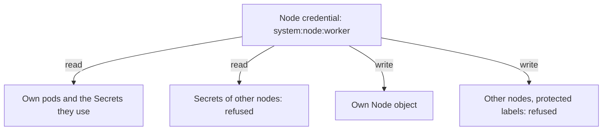

# Node Identity And NodeRestriction

A kubelet talks to the API server with its own credential. If an attacker steals that credential, the damage depends on what a node may do. Kubernetes limits a node with two features, the node authorizer and the `NodeRestriction` admission plugin. This part explains both, shows how to confirm they are on, and tests what a node identity is allowed to read.

## Who a node is

A kubelet authenticates with a client certificate. The certificate names the user `system:node:<node name>` and puts it in the group `system:nodes`. The API server then decides what this user may do. Ordinary RBAC rules for nodes would have to cover every pod on every node, so Kubernetes uses a special authorizer instead. The node authorizer allows a kubelet to read the objects that relate to pods scheduled on its own node: the pods themselves, and the Secrets, ConfigMaps, PersistentVolumeClaims and PersistentVolumes that those pods reference. It refuses the same requests for objects of other nodes. A kubelet cannot list all Secrets in the cluster, even though a kubelet needs Secrets to start pods.

Authorization is not enough for writes, because a kubelet must be able to update its own Node object and the status of its own pods. The `NodeRestriction` admission plugin checks these writes. It allows a kubelet to modify only its own Node object and only the pods bound to it, and it refuses changes to other nodes. It also restricts labels. A kubelet may not set or change labels in the namespace `node-restriction.kubernetes.io/`, and it may not set most labels in the `kubernetes.io` and `k8s.io` namespaces, apart from a short list of well-known ones such as the host name, operating system and architecture. This matters because schedulers and policies trust labels. If a compromised node could label itself with `node-restriction.kubernetes.io/dedicated=payments`, workloads that select that label would be scheduled onto the node, and the node would collect their Secrets.

## Confirm both are enabled

<!-- astrona:playground:renew -->

Both features are set as flags on the API server. A kubeadm cluster, which is what `kind` builds, runs the API server as a static pod, so you can read its command line. This command prints each flag on its own line and keeps the two that matter:

```sh
kubectl -n kube-system get pod -l component=kube-apiserver -o jsonpath='{.items[0].spec.containers[0].command}' | tr ',' '\n' | grep -E 'authorization-mode|enable-admission-plugins'
```

The first line should show an authorization mode list that contains `Node` and `RBAC`, and the second a plugin list that contains `NodeRestriction`. If `Node` is missing, kubelets would fall back on other authorizers. If `NodeRestriction` is missing, a node credential could modify objects of other nodes. Treat either as a finding.

## Test what a node may read

You can ask the API server what the node identity may do, without using the node's credential. The `--as` and `--as-group` options make `kubectl` impersonate the node. Your own account needs the permission to impersonate, which the playground administrator account has. Store the worker name and ask three questions:

```sh
WORKER=$(kubectl get nodes -l '!node-role.kubernetes.io/control-plane' -o jsonpath='{.items[0].metadata.name}')
kubectl auth can-i list secrets -A --as="system:node:$WORKER" --as-group=system:nodes
kubectl auth can-i delete nodes --as="system:node:$WORKER" --as-group=system:nodes
kubectl auth can-i get nodes --as="system:node:$WORKER" --as-group=system:nodes
```

The first two answers should be `no`: the node cannot list all Secrets, and it cannot delete nodes. The third should be `yes`, because a kubelet reads Node objects. The answers depend on how the authorizer chain is set up, so treat a result that differs as a finding to investigate and not as a mistake in the command.

The label restriction needs the node's own credential, which lives in a file on the node. The playground does not make you use it. Remember the rule: a node credential can change only its own Node object, and the protected label prefix is outside its reach.



The diagram shows the two limits: reads are scoped by the node authorizer and writes by `NodeRestriction`.

You now know how the cluster limits a stolen node credential. The limits are strong, but they do not stop a pod from becoming the node by another route, and the runtime socket is the first such route.

## Common pitfalls

> [!WARNING]
> - **Assuming a node credential is harmless.** It can read the Secrets of pods on that node, so a pod with sensitive Secrets raises the value of that node.
> - **Removing `Node` from the authorizer list or `NodeRestriction` from the plugins.** Both are needed.
> - **Trusting a node label for isolation.** Use the protected `node-restriction.kubernetes.io/` prefix for labels that policy relies on.
> - **Reading the impersonation answer as a full test.** It shows the authorizer decision, not the behaviour of the admission plugin.
