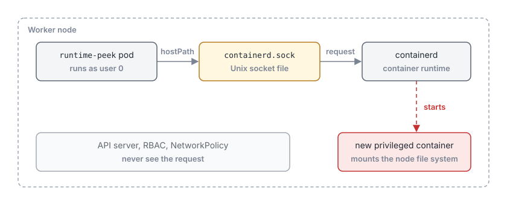

# Runtime Socket And hostPath Exposure

The container runtime is the program on a node that creates and runs the containers. In this cluster, the runtime is containerd, and it listens on a Unix socket. A Unix socket is a file that programs use to talk to a local service. Whoever can open the socket can ask the runtime to create, inspect and stop containers on the node.

So a pod that can open this socket can take control of the node, with no credential at all. On this page, you see how a pod gets the socket, find every pod that has it, and learn how to stop it.

## How a pod gets the socket

A `hostPath` volume mounts a file or a directory of the node into a container. There are two ways it can expose the runtime:

- If the path is the runtime socket, `/run/containerd/containerd.sock`, the container sees the socket as a file.
- If the path is the directory `/run/containerd`, the container sees the socket inside that directory. So a mount of the directory is as dangerous as a mount of the socket itself.

A process in the container that runs as root can then talk to the runtime. It can start a new privileged container that mounts the whole file system of the node. From there, it controls the node and every other container on it. The Kubernetes API, RBAC and NetworkPolicy do not see these actions, because the pod uses a local file and not the network.



The drawing shows the path from the pod to the runtime. The request goes through a file on the node, so the API server, RBAC and NetworkPolicy never see it.

Some tools do need the socket, such as node agents that report container metrics, and image builders. The rule is that such a mount must have a reason, must be narrow and must stay in system namespaces. In an application namespace, it is a finding.

## Find every pod that has a host path

You know what a socket mount gives a pod, so now find the pods that have one. You do not need `jq` for this. A JSONPath expression prints the namespace and name of each pod, together with the host paths of its volumes. Pods without a host path print an empty second column, so the command keeps only lines that contain a slash after the pod name:

<!-- astrona:playground:renew -->

```sh
kubectl get pods -A -o jsonpath='{range .items[*]}{.metadata.namespace}{"/"}{.metadata.name}{" "}{range .spec.volumes[*]}{.hostPath.path}{" "}{end}{"\n"}{end}' | grep -E ' /'
```

Expect system pods in `kube-system` and in the namespaces of the network plugin, because node agents need the host. The application namespaces show three more pods:

- `outpost/runtime-peek` with the socket path.
- `starfleet/cri-helper` with the directory `/run/containerd`.
- `outpost/log-reader` with `/var/log`. This is not a runtime exposure, but a log directory can hold sensitive data, so it still needs a reason.

To narrow the search to the runtime, filter for the word `containerd` and the names of other runtimes:

```sh
kubectl get pods -A -o jsonpath='{range .items[*]}{.metadata.namespace}{"/"}{.metadata.name}{" "}{range .spec.volumes[*]}{.hostPath.path}{" "}{end}{"\n"}{end}' | grep -E 'containerd|docker.sock|crio'
```

The filter finds the two pods that expose the runtime. It also finds system pods that mount the same path for a reason. The names `docker.sock` and `crio` cover other runtimes, so the same command works when you do not know which runtime a cluster uses.

## See what the pod holds

The search shows which pods have the mount. Now look at the socket from inside `runtime-peek`. The pod runs as root, as a pod that uses the socket usually does:

```sh
kubectl -n outpost exec runtime-peek -- id
kubectl -n outpost exec runtime-peek -- ls -l /run/containerd/containerd.sock
```

The first command shows user id 0. The second shows a file whose type letter is `s`, which marks a socket, and root owns it. The playground does not call the runtime from the pod. With a client such as `ctr` or `crictl` in the image, the same pod could list every container on the node, read the environment of other pods and start a new container.

## How to stop it

There are three layers of defence, and each one works at a different time:

1. **Review.** List host paths regularly, as above, and refuse a socket mount that has no owner.
2. **Admission.** A policy engine or the built-in Pod Security admission can reject pods that use `hostPath`. The `baseline` level of the Pod Security Standards forbids host path volumes and the host network.
3. **Runtime hardening.** The pod should not run as root, should drop capabilities and should use a read-only root file system. Then a mount alone is not enough.

You can test the admission layer without changing anything. A server-side dry run shows what the `baseline` level would reject:

```sh
kubectl label --dry-run=server --overwrite namespace outpost pod-security.kubernetes.io/enforce=baseline
```

The response is a warning that existing pods in `outpost` break the level. It names the pods and the reason, such as a host path volume. The API server does not store the label, because of the dry run. Admission control and pod hardening are covered in depth by other parts of the exam, so this page names only what you need here.

NetworkPolicy plays no role against a socket, because the socket is not on the network. That is why this exposure needs its own search. The open question is what happens with pods that reach the node through the network, but do not use the pod network at all.

## Common pitfalls

> [!WARNING]
> - **Searching only for `containerd.sock`.** A mount of the parent directory `/run/containerd` exposes the same socket.
> - **Forgetting other runtimes.** The path can be `docker.sock` or a CRI-O socket.
> - **Mounting the socket read-only and calling it safe.** A read-only bind mount does not stop a client from writing requests to the socket.
> - **Ignoring system namespaces completely.** A pod in `kube-system` that has a socket mount for no reason is also a finding.
