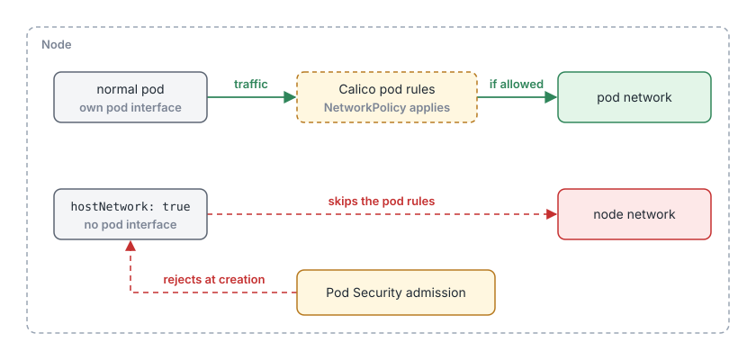

# hostNetwork And Privileged Pods Bypass Policy

A NetworkPolicy works on the network interface of a pod. A pod that has no interface of its own escapes that control. So does a pod that can reach into the node by other means. Such a pod can reach the kubelet ports and other node paths, even when a policy selects it.

On this page, you write a policy that has no effect on a host network pod and watch the request still pass. Then you find such pods in the cluster and stop new ones at the namespace level.

## Why the policy skips them

Two pod settings cause the problem, and they work in different ways. The first is the host network.

A pod with `hostNetwork: true` shares the network namespace of the node. It has the addresses of the node and listens on the ports of the node. Calico attaches its pod rules to the virtual interface of each pod, and a host network pod has no such interface. The Kubernetes documentation says that the behaviour of NetworkPolicy for host network pods is not defined, and that network plugins differ. With Calico, a policy that selects a host network pod does not restrict it.

Traffic from a host network pod looks like traffic from the node. Policy for node traffic needs Calico host endpoints or a firewall on the node.

A privileged pod is a different case. It keeps its pod interface, so pod policy still applies to its traffic. The danger is everything else that privilege gives:

- A privileged container has almost all Linux capabilities and access to the devices of the node.
- With `hostPID: true`, it can see and enter the processes of the node.
- With a host path, it can change files of the node.

From there, it can change the network rules of the node or read the kubelet credential. Either step makes the pod policy useless.

## See a policy that does not apply

The rule is easy to test in the playground. The pod `fake-imds` uses the host network. Try to isolate it with a policy that denies all ingress, then check whether a client can still reach it. Save this as `networkpolicy-deny-ingress.yaml`:

<!-- astrona:playground:renew -->

```yaml
apiVersion: networking.k8s.io/v1
kind: NetworkPolicy
metadata:
  name: deny-all-ingress
  namespace: metadata-stub
spec:
  podSelector: {}
  policyTypes:
  - Ingress
```

Apply it and send the request from a client pod:

```sh
kubectl apply -f networkpolicy-deny-ingress.yaml
kubectl -n starfleet exec shuttle -- curl -s -m 3 -o /dev/null -w '%{http_code}\n' http://169.254.169.254/latest/meta-data/
```

The request prints `200`. The policy exists and selects the pod, and the pod still answers. Delete the policy to restore the playground:

```sh
kubectl -n metadata-stub delete networkpolicy deny-all-ingress
```

The same limit applies in the other direction. An egress policy in a namespace does not restrict a host network pod that runs there.



The drawing shows the two paths. Calico checks the traffic of a normal pod at its pod interface. A host network pod skips that check, so the only control for it acts when the pod is created.

## Find the pods

A policy cannot restrict these pods, so you need to know where they are. List the host network pods across the cluster. The custom columns print one row per pod, and `grep` keeps the rows with the value `true`:

```sh
kubectl get pods -A -o custom-columns='NAMESPACE:.metadata.namespace,NAME:.metadata.name,HOSTNETWORK:.spec.hostNetwork' | grep true
```

System pods appear, such as the proxy and the network agent. In the application namespaces, `dock/net-tool` appears, and `metadata-stub/fake-imds` appears as part of the playground.

List privileged containers and pods that share the process namespace of the host in the same way:

```sh
kubectl get pods -A -o jsonpath='{range .items[*]}{.metadata.namespace}{"/"}{.metadata.name}{" privileged="}{.spec.containers[*].securityContext.privileged}{" hostPID="}{.spec.hostPID}{"\n"}{end}' | grep -E 'privileged=true|hostPID=true'
```

In a healthy cluster, only system pods match.

## Namespace-level controls

Finding these pods is only half the work. Policy cannot help against them, so the control must stop such pods from being created. Pod Security admission does that. It is a built-in admission step in the API server that checks new pods against the Pod Security Standards.

The Pod Security Standards define three levels. The `baseline` level forbids `hostNetwork`, `hostPID`, `hostIPC`, host path volumes and privileged containers. Test what it would reject in `dock` with a server-side dry run, which changes nothing:

```sh
kubectl label --dry-run=server --overwrite namespace dock pod-security.kubernetes.io/enforce=baseline
```

The response is a warning that names `net-tool` and the field it breaks. In a real cluster, roll out the level in this order:

1. Fix or move the pods that break the level.
2. Start with the `warn` and `audit` modes, which report pods but do not reject them.
3. Set the `enforce` label for real.

Keep system namespaces on a separate, less strict level. Other tools, such as a validating admission policy or a policy engine, can express the same rule with exceptions.

You now know which pods escape pod policy, how to find them, and how to stop new ones at creation. Every control so far lives inside the cluster. The open question is what the node, the cloud account and the physical network can add.

## Common pitfalls

> [!WARNING]
> - **Writing more policy for a host network pod.** It will not apply. Remove the cause instead.
> - **Treating privileged and host network as the same thing.** They are different settings, and a pod can have one without the other.
> - **Enforcing `baseline` in `kube-system`.** System components need host access, so exempt or separate them.
> - **Skipping the dry run.** Enforcing a level without a test can stop a rollout.
