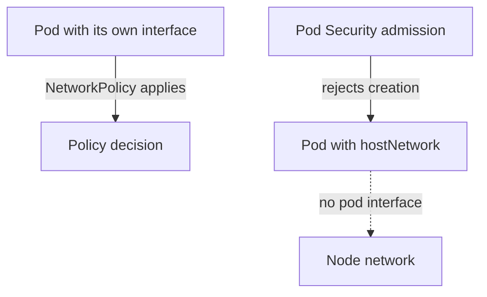

# hostNetwork And Privileged Pods Bypass Policy

NetworkPolicy works on the network interface of a pod. A pod that does not have its own interface, or that can reach into the node, escapes that control. This part shows the effect with a policy that has no effect on a host network pod, finds such pods, and lists the controls that apply at the namespace level.

## Why the policy skips them

A pod with `hostNetwork: true` shares the network namespace of the node. It has the node's addresses and listens on node ports. Calico attaches its pod rules to the virtual interface of each pod, and a host network pod has none. The Kubernetes documentation says that the behaviour of NetworkPolicy for host network pods is not defined and that plugins differ. With Calico, a policy that selects a host network pod does not restrict it. Traffic from such a pod looks like traffic from the node, and policy for node traffic needs Calico host endpoints or a firewall on the node.

A privileged pod is a different case. It keeps its pod interface, so pod policy still applies to its traffic. The danger is the rest of what privilege gives. A privileged container has almost all Linux capabilities and access to the devices of the node. With `hostPID: true` it can see and enter processes of the node. With a host path it can change files of the node. From there it can alter the network rules of the node or read the kubelet credential, which makes the pod policy irrelevant.

## See a policy that does not apply

<!-- astrona:playground:renew -->

The pod `fake-imds` uses the host network. Try to isolate it with a policy that denies all ingress, then check whether a client can still reach it. Save this as `networkpolicy-deny-ingress.yaml`:

```yaml
apiVersion: networking.k8s.io/v1
kind: NetworkPolicy
metadata:
  name: deny-all-ingress
  namespace: metadata-stub
spec:
  podSelector: {}
  policyTypes:
  - Ingress
```

Apply it and send the request from a client pod:

```sh
kubectl apply -f networkpolicy-deny-ingress.yaml
kubectl -n starfleet exec shuttle -- curl -s -m 3 -o /dev/null -w '%{http_code}\n' http://169.254.169.254/latest/meta-data/
```

The request prints `200`. The policy exists and it selects the pod, and the pod still answers. Delete the policy to restore the playground:

```sh
kubectl -n metadata-stub delete networkpolicy deny-all-ingress
```

The same limit applies in the other direction, so an egress policy in a namespace does not restrict a host network pod that runs there.

## Find the pods

List host network pods across the cluster. The custom columns print one row per pod and `grep` keeps the ones with the value `true`:

```sh
kubectl get pods -A -o custom-columns='NAMESPACE:.metadata.namespace,NAME:.metadata.name,HOSTNETWORK:.spec.hostNetwork' | grep true
```

System pods appear, such as the proxy and the network agent. In the application namespaces, `dock/net-tool` appears, and `metadata-stub/fake-imds` appears as part of the playground. List privileged containers and the host process namespace in the same way:

```sh
kubectl get pods -A -o jsonpath='{range .items[*]}{.metadata.namespace}{"/"}{.metadata.name}{" privileged="}{.spec.containers[*].securityContext.privileged}{" hostPID="}{.spec.hostPID}{"\n"}{end}' | grep -E 'privileged=true|hostPID=true'
```

Only system pods should match in a healthy cluster.

## Namespace-level controls

Because policy cannot help, the control must stop such pods from being created. The Pod Security Standards define three levels. The `baseline` level forbids `hostNetwork`, `hostPID`, `hostIPC`, host path volumes and privileged containers. Test what it would reject in `dock` with a server-side dry run, which changes nothing:

```sh
kubectl label --dry-run=server --overwrite namespace dock pod-security.kubernetes.io/enforce=baseline
```

The response is a warning that names `net-tool` and the field it violates. In a real cluster you set the label for real after fixing or moving the pods, start with the `warn` and `audit` modes, and keep system namespaces on a separate, less strict level. Other tools, such as a validating admission policy or a policy engine, can express the same rule with exceptions.



The diagram shows that the control for host network pods acts when the pod is created, not on its traffic.

You now know which pods escape pod policy and how to find and prevent them. The lab on the next page asks you to list them.

## Common pitfalls

> [!WARNING]
> - **Writing more policy for a host network pod.** It will not apply. Remove the cause.
> - **Equating privileged with host network.** They are different settings, and a pod can have one without the other.
> - **Enforcing `baseline` in `kube-system`.** System components need host access, so exempt or separate them.
> - **Skipping the dry run.** Enforcing a level without testing can stop a rollout.
