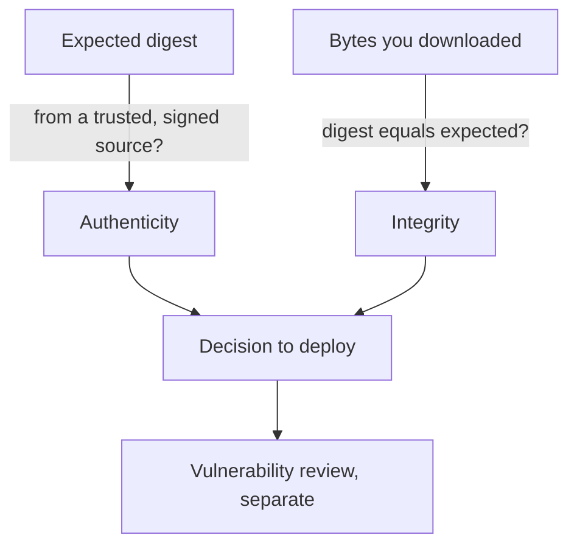

# Integrity, Authenticity And The Exact Artifact

A download that finishes without error says nothing about whether the file is the right one. Verification asks three separate questions. This part defines them, explains why the third one is the hard one, and describes how to choose the artifact so that the answers refer to the file you will really run.

## Three questions

**Integrity.** Are these bytes the same as the bytes someone intended? A cryptographic digest answers this. A digest function such as SHA-256 reads the whole file and produces a fixed-size value. A change of one bit changes the value. If the digest you compute equals the expected digest, the file is the same as the one the digest describes.

**Authenticity.** Did the expected publisher produce those bytes? A digest cannot answer this. If an attacker controls both the download and the page that shows the digest, the attacker publishes a matching pair, and the check passes on a malicious file. A digital signature answers the question, because only the holder of the private key can produce it. It answers it only if you also know the public key or the identity that you should expect. A signature that is valid for any key tells you nothing.

**Suitability.** Is this the right release for this machine, and is it free of known defects? Verification of integrity and authenticity does not cover vulnerabilities. A correctly signed release can still contain a bug. Keep these decisions apart so that a green result for one does not hide a missing result for another.



The diagram shows that integrity needs an expected value and authenticity decides whether that value can be trusted.

## Why the source of the expected value matters

Suppose the release page lists `kubectl` and its digest. If the page and the file come from the same location, a compromise of that location changes both. The checksum then confirms that the download was not damaged in transit, and nothing more. Digests are strong when they come from a different channel than the file, or when they are themselves signed. This is why release processes publish a signature next to the checksum manifest and why verification checks the signature first.

## Choose the exact artifact

A release is identified by the component, the version, the operating system and the CPU architecture. `kubectl` for `linux/amd64` and for `linux/arm64` are different files with different digests. The version label such as `v1.35.0` is useful to a human, and the digest binds your decision to exact bytes. Record all of these before the file enters your automation: component, version, platform, source and digest.

As reference, the Kubernetes project publishes a digest file next to each binary on its download host. The documented pattern fetches the binary and its `.sha256` file for the same version and platform, then checks them together. These commands need network access to the real release host, so treat them as a pattern and do not expect to run them in the playground:

```sh
VERSION=v1.35.0
curl -LO "https://dl.k8s.io/release/$VERSION/bin/linux/amd64/kubectl"
curl -LO "https://dl.k8s.io/release/$VERSION/bin/linux/amd64/kubectl.sha256"
echo "$(cat kubectl.sha256)  kubectl" | sha256sum --check
```

The check prints `kubectl: OK` when the digest matches. Both files come from the same host in this pattern, so it protects against corruption and against a man in the middle on an unprotected link, and it does not protect against a compromise of the host. The signature steps in the later parts close that gap.

## Common pitfalls

> [!WARNING]
> - **Treating a finished download as verified.** Nothing was checked.
> - **Taking the digest from the same place as the file.** A matching pair can be forged together.
> - **Verifying the wrong platform.** A good digest for `amd64` says nothing about the `arm64` file you copied.
> - **Reading a green result as a security review.** Authenticity does not mean the release has no vulnerabilities.
