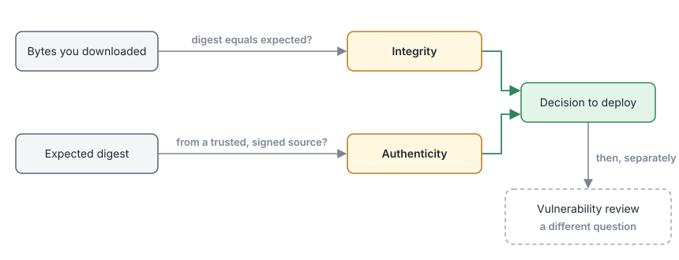
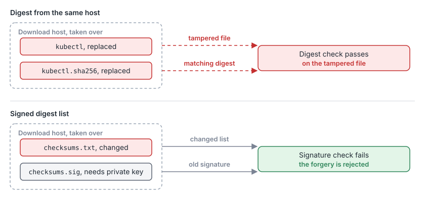

# Integrity, Authenticity And The Exact Artifact

A download that finishes without an error tells you nothing about whether the file is the right one. The transfer can succeed and still deliver a file that someone changed. Before you run a binary with high privilege on a node, you need a better answer than "the download worked".

Verification gives that answer by asking three separate questions. On this page, you learn what each question means and which tool answers it. You also see why the second question is the hard one, and how to choose the artifact so that every answer refers to the file you will really run. An artifact is one released file, such as the `kubectl` binary for one version and one platform.

## Three questions

Each question needs its own kind of evidence. If you mix them up, a good answer to one question can hide a missing answer to another, so it helps to keep them apart from the start.

**Integrity.** Are these bytes the same as the bytes someone intended? A cryptographic digest answers this question. A digest function, such as SHA-256 (Secure Hash Algorithm with a 256-bit result), reads the whole file and produces a value of fixed size. If one bit of the file changes, the value changes. So if the digest you compute equals the expected digest, your file is the same as the file that the digest describes.

**Authenticity.** Did the expected publisher produce those bytes? A digest cannot answer this question. Suppose an attacker controls both the download and the page that shows the digest. The attacker then publishes a file and a digest that match each other, and the check passes on a malicious file.

A digital signature answers the authenticity question. A signature is a value that the publisher computes with a private key, which is a secret key that only the publisher holds. Only the holder of the private key can produce a valid signature. But the signature helps only if you also know which public key or which identity to expect. A signature that you accept from any key tells you nothing.

**Suitability.** Is this the right release for this machine, and is it free of known defects? Checks for integrity and authenticity do not look for vulnerabilities. A correctly signed release can still contain a bug. Keep this decision apart from the other two, so that a green result for one question does not hide a missing result for another.



The drawing shows how the questions connect. Integrity needs an expected digest, authenticity decides whether you can trust that digest, and the vulnerability review stays a separate step after both.

## Why the source of the expected value matters

The integrity check is only as good as the expected digest you compare with. So the next question is where that digest comes from.

Suppose the release page lists `kubectl` and its digest. If the page and the file come from the same location, an attacker who takes over that location can change both. The checksum then only confirms that the download was not damaged on the way, and nothing more.



The drawing compares the two cases. A digest from the same host as the file can be forged together with the file, while a signed digest list cannot be changed without the private key.

A digest is strong when it comes from a different channel than the file, or when the digest itself is signed. This is why release processes publish a signature next to the checksum manifest. A checksum manifest is a text file that lists the expected digest of each released file. It is also why verification checks the signature first.

## Choose the exact artifact

Even a perfect check is worthless if it checks the wrong file. So before you verify anything, you must know exactly which file you want.

A release is identified by four things: the component, the version, the operating system and the CPU architecture. `kubectl` for `linux/amd64` and `kubectl` for `linux/arm64` are different files with different digests. A version label such as `v1.35.0` is useful to a human, but the digest ties your decision to exact bytes.

Record all of these values before the file enters your automation:

- the component, such as `kubectl`;
- the version, such as `v1.35.0`;
- the platform, that is, the operating system and the architecture;
- the source the file came from;
- the digest of the file.

The Kubernetes project publishes a digest file next to each binary on its download host. The documented pattern downloads the binary and its `.sha256` file for the same version and platform, and then checks them together. These commands need network access to the real release host. Treat them as a pattern, and do not expect to run them in the playground:

```sh
VERSION=v1.35.0
curl -LO "https://dl.k8s.io/release/$VERSION/bin/linux/amd64/kubectl"
curl -LO "https://dl.k8s.io/release/$VERSION/bin/linux/amd64/kubectl.sha256"
echo "$(cat kubectl.sha256)  kubectl" | sha256sum --check
```

The check prints `kubectl: OK` when the digest matches. In this pattern, both files come from the same host. So it protects against a damaged download and against a man-in-the-middle attack on an unprotected link, where someone between you and the host changes the data. It does not protect against an attacker who takes over the host itself.

You now know the three questions, why the source of the expected digest decides its value, and how to name the exact artifact. One question is still open: what does a digest check catch in practice, and where exactly does it stop protecting you?

## Common pitfalls

> [!WARNING]
> - **Treating a finished download as verified.** Nothing was checked.
> - **Taking the digest from the same place as the file.** An attacker can forge a matching pair together.
> - **Verifying the wrong platform.** A good digest for `amd64` says nothing about the `arm64` file you copied.
> - **Reading a green result as a security review.** Authenticity does not mean that the release has no vulnerabilities.
