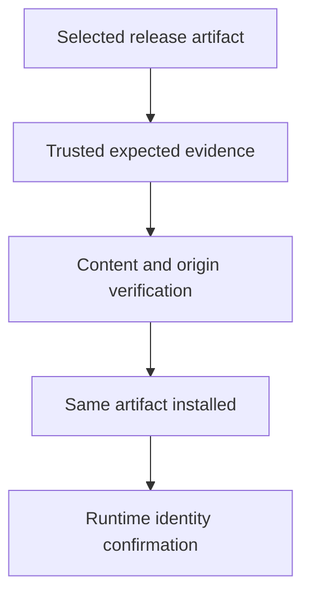

# Verifying Release Artifacts Before Deployment

A verified download and the binary actually executed have different hashes. Verification described one artifact, while installation selected another. The trust decision must stay linked to execution.

## Learning objectives

- Distinguish integrity checks from publisher authenticity.
- Bind verification evidence to an exact release and architecture.
- Explain authenticated checksum and signature trust chains.

## Before you start

This chapter is standalone reading material; no running cluster or installed tools are required. A Pod is the Kubernetes unit for running one or more containers, and a namespace groups namespaced objects. Treat the worked configurations as teaching examples rather than recorded observations from a provisioned environment.

## Responsible components and behavior

A platform binary executes with the authority of its host or component identity. Verifying it before deployment reduces the chance of installing substituted or corrupted software. The verification decision must connect the actual file to an expected release, architecture and authorized publisher. A recognizable filename or successful download does not establish that connection.

## Integrity And Authenticity Answer Different Questions

A cryptographic digest is a compact representation of file bytes. Comparing the locally computed digest to an expected digest detects a difference with strong cryptographic assurance. However, the comparison is meaningful only if the expected value is trustworthy. An attacker who controls both a binary and the page supplying its checksum can publish a matching pair.

Authenticity asks whether an authorized publisher endorsed those bytes. A digital signature can support that judgment, but only when the verification process also checks the expected signing identity and trust chain. Accepting any cryptographically valid signer would allow an unrelated publisher to satisfy the check. Key-based and identity-based signing systems establish trust in different ways; each needs a policy for authorized release identities.

## Select The Exact Artifact

Release selection includes the platform version, operating system and CPU architecture. A verified Linux binary for one architecture is not necessarily usable on another. Verification should refer to the documented artifact for the intended component, rather than assume that similarly named files are interchangeable.

Record the artifact identity and digest before it enters deployment automation. A version label provides useful human context, while the digest binds the decision to exact bytes. Where a release uses signed manifests or checksums, verify that the intended binary is actually included in the authenticated metadata. Verification of an unrelated artifact or a neighboring release does not cover the chosen file.

## Evaluate The Verification Evidence

A reasonable review identifies the official release channel, expected publisher identity and supported verification mechanism. It then checks whether the locally obtained bytes match the authenticated evidence. If signature verification depends on a trusted public key, the source and lifecycle of that key matter. If it depends on certificate identity and transparency evidence, expected issuer and subject constraints matter.

For example, a file with a matching digest from an unauthenticated message proves consistency with that message, not trust in the publisher. A valid signature by a developer's personal test key may prove that person signed the file, but it does not automatically satisfy the organization's release policy. State what the evidence establishes instead of treating every green verification result as equivalent.

## Preserve The Binding Through Deployment

Verification can be defeated by a later replacement. A shared writable download directory, untrusted mirror update or mutable artifact reference can substitute bytes after the check. Store verified artifacts under controlled access and ensure the deployment process consumes the same artifact. Automation should fail clearly when verification is missing or does not match policy rather than silently continue with an unchecked fallback.

A signed malicious release can still be vulnerable. Publisher authenticity is not a vulnerability assessment, code review or compatibility guarantee. Keep those decisions separate so evidence for one does not conceal missing evidence for another. Release provenance can add information about how software was built, but it also needs policy and trust interpretation.

## Work through the decision

A checksum comparison detects whether content matches the selected digest, but the expected digest also needs a trustworthy source. If both bytes and checksum come from one compromised location, agreement alone does not establish the publisher's identity. A supported signature process adds issuer evidence under its trust policy.

Record the exact version, platform variant, artifact digest and trusted verification material. Then ensure the installed or deployed bytes are the verified bytes. A familiar filename, tag or mirror hostname cannot preserve that relationship by itself. Verification of origin also leaves known vulnerabilities and runtime permissions as separate properties to review.

A release check protects execution only when verified identity survives the delivery path.

A release check protects execution only when verified identity survives the delivery path.

## Common pitfalls

> [!WARNING]
> A digest from an untrusted source does not establish publisher authenticity. Verification covers exact bytes and an expected trust policy; replacement after verification breaks that assurance.
