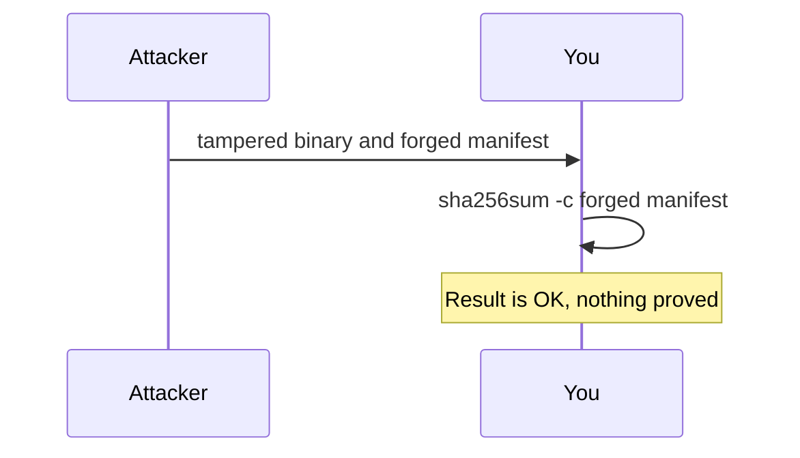

# Digests At Work And The Limits Of A Checksum

A digest is simple to compute and easy to misuse. This part computes digests in the playground, shows that a tampered binary is detected, and then shows the limit: a checksum file that an attacker wrote matches the attacker's binary just as well.

## Look at the staged release

The staged files are in the control plane node container of the playground, in `/var/lib/training-release`. Commands run in the node container with `podman exec`, as in the benchmark section of this course. The node name follows the playground name.

<!-- astrona:playground:renew -->

```sh
NODE=astro-ats-031-playground-050-01-control-plane
podman exec $NODE ls -l /var/lib/training-release
podman exec $NODE cat /var/lib/training-release/checksums.txt
```

The listing shows the five files. The manifest has one line with a 64-character hexadecimal digest, two spaces, and the path of the `kubectl` file.

## Compute and compare

`sha256sum` computes the digest of a file. With `-c` it reads a manifest, recomputes each digest and reports `OK` or `FAILED` per file.

```sh
podman exec $NODE sha256sum /var/lib/training-release/kubectl
podman exec $NODE sha256sum /var/lib/training-release/kubectl-tampered
podman exec $NODE sha256sum -c /var/lib/training-release/checksums.txt
```

The two digests differ, although the tampered file is the original plus a few bytes. The third command reports `OK` for `kubectl`. The digest of the tampered file is not the one in the manifest, so a check of that file against this manifest would report `FAILED`. A digest detects every change, however small.

## The forged manifest

The check above trusted `checksums.txt`. Suppose an attacker replaced both the binary and the manifest. Create that situation inside the node container: write a new manifest with the digest of the tampered file, and check against it.

```sh
podman exec $NODE sh -c 'sha256sum /var/lib/training-release/kubectl-tampered > /tmp/forged-checksums.txt'
podman exec $NODE sha256sum -c /tmp/forged-checksums.txt
```

The check reports `OK` for `kubectl-tampered`. The tampered binary passes, because the digest check only compares a file with a manifest and never asks who wrote the manifest. This is the limit of a bare checksum. The fix is to authenticate the manifest, which is the next part.



The diagram shows that a check against a manifest you cannot attribute passes for an attacker too.

## Common pitfalls

> [!WARNING]
> - **Reading `OK` as trust.** It says that the file matches the manifest.
> - **Checking the digest only on the download machine.** Check again where the file is installed.
> - **Pasting the digest from a web page into a command without knowing who controls the page.** Prefer a signed manifest.
> - **Leaving test files behind.** Remove `/tmp/forged-checksums.txt` when you finish the exercise.
