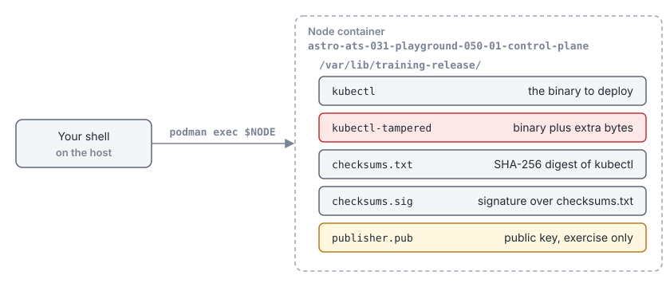
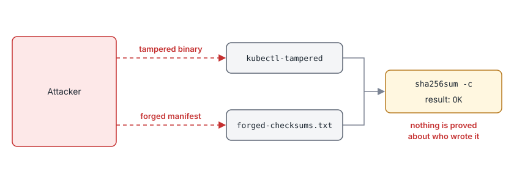

# Digests At Work And The Limits Of A Checksum

A digest is simple to compute, and it is also easy to trust too much. Many people run a checksum command, see `OK`, and stop there. That habit is dangerous when the checksum file itself could come from an attacker.

On this page, you compute digests in the playground and see that a tampered binary is detected. Then you see the limit of the method. A checksum file that an attacker wrote matches the attacker's binary just as well as the real file matches the real binary.

## Look at the staged release

The files you check do not live in a pod. They sit in the container of the control plane node, in the directory `/var/lib/training-release`. In a `kind` cluster, each Kubernetes node is a container on your machine, so you run commands inside a node with `podman exec`. The name of the node container follows the name of the playground.



The drawing shows where the files are. Your shell on the host sends each command with `podman exec` into the control plane node container, and the command reads the files in `/var/lib/training-release`.

Start by listing the directory and reading the manifest:

<!-- astrona:playground:renew -->

```sh
NODE=astro-ats-031-playground-050-01-control-plane
podman exec $NODE ls -l /var/lib/training-release
podman exec $NODE cat /var/lib/training-release/checksums.txt
```

The listing shows the five files. The manifest has one line. The line holds a digest of 64 hexadecimal characters, then two spaces, then the path of the `kubectl` file.

## Compute and compare

Now that you know what the manifest holds, you can check a file against it. The `sha256sum` command computes the SHA-256 digest of a file. With the `-c` option, it reads a manifest instead, computes the digest of each file listed there again, and reports `OK` or `FAILED` for each file.

```sh
podman exec $NODE sha256sum /var/lib/training-release/kubectl
podman exec $NODE sha256sum /var/lib/training-release/kubectl-tampered
podman exec $NODE sha256sum -c /var/lib/training-release/checksums.txt
```

The two digests are different, even though the tampered file is only the original file plus a few bytes. The third command reports `OK` for `kubectl`. The digest of the tampered file is not the one in the manifest, so a check of that file against this manifest would report `FAILED`. A digest detects every change, however small.

## The forged manifest

The check above trusted `checksums.txt` without asking where it came from. That is the weak point, and you can show it in the playground.

Suppose an attacker replaced both the binary and the manifest. Create that situation inside the node container. The first command writes a new manifest with the digest of the tampered file. The second command checks against that new manifest.

```sh
podman exec $NODE sh -c 'sha256sum /var/lib/training-release/kubectl-tampered > /tmp/forged-checksums.txt'
podman exec $NODE sha256sum -c /tmp/forged-checksums.txt
```

The check reports `OK` for `kubectl-tampered`. The tampered binary passes, because `sha256sum -c` only compares a file with a manifest. It never asks who wrote the manifest.



The drawing shows the problem. When you cannot tell who wrote the manifest, a check against it passes for an attacker too.

You now know how to compute a digest, how to compare a file with a manifest, and that a digest catches even a tiny change. You have also seen the limit of a bare checksum: it says nothing about who wrote the manifest. The open question is how to prove that the manifest really comes from the publisher.

## Common pitfalls

> [!WARNING]
> - **Reading `OK` as trust.** It only says that the file matches the manifest.
> - **Checking the digest only on the download machine.** Check again on the machine where the file is installed.
> - **Pasting a digest from a web page into a command without knowing who controls the page.** Prefer a signed manifest.
> - **Leaving test files behind.** Remove `/tmp/forged-checksums.txt` when you finish the exercise.
