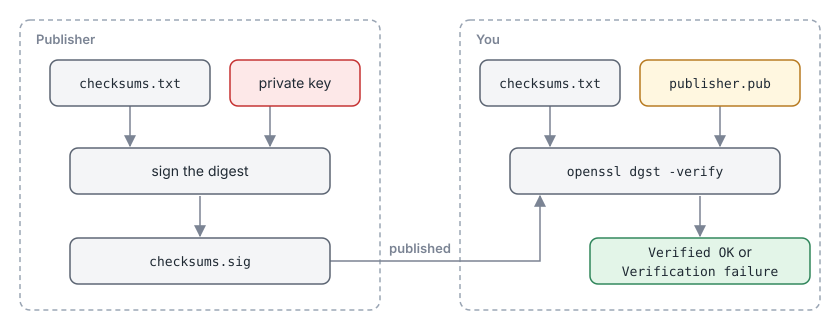
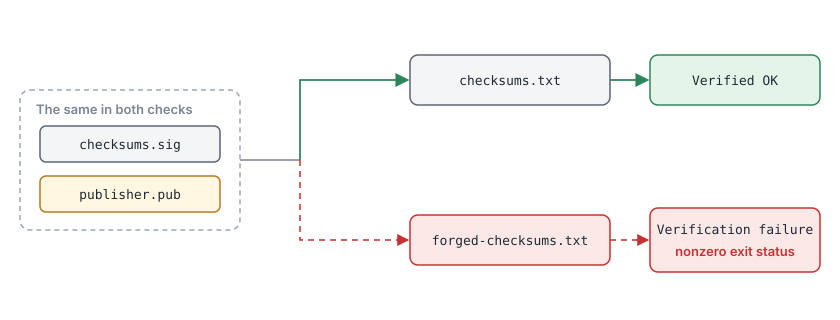

# Verify A Signed Manifest And Record The Result

A bare checksum check passes for a forged manifest, because it never asks who wrote the manifest. To close that gap, you need proof that the manifest comes from the publisher. The signature in `checksums.sig` gives that proof.

The signature ties the manifest to a key. If you hold the right public key, and you got it from a channel you trust, a valid signature shows that the key holder produced exactly this manifest. Then you can trust the digests in it. On this page, you verify the signature, see it reject a forged manifest, check the binary against the trusted manifest, and record the result in the cluster.

## How the signature works

Before you run the commands, it helps to know who does what. Two keys work as a pair. The private key is secret and only the publisher holds it. The public key can be shared with everyone, and it can only check signatures, not make them.

The publisher computes a digest of the manifest and signs that digest with the private key. The result is the signature, stored in `checksums.sig`. Anyone with the matching public key, `publisher.pub`, can check the signature against the digest of the manifest they hold. If the check succeeds, two things are true: the manifest has not changed since it was signed, and the holder of the private key signed it.



The drawing shows the two sides. The publisher signs with the private key, and you verify with the public key, so the private key never has to leave the publisher.

In the playground, the private key was deleted right after it signed the manifest. So nobody, including you, can sign a new manifest with it.

The public key must come from a trusted source too. If an attacker can swap the public key, the attacker can sign anything with a matching private key. In practice, you get the key through a separate channel that you trust, such as the documentation of the project or a pinned copy in your own repository.

## Verify the signature

You can now run the check. The `openssl dgst -verify` command takes the public key, the signature file and the signed data, and it reports whether the signature matches.

<!-- astrona:playground:renew -->

To compare a good case with a bad case, first create the forged manifest again. It is a file in the node container, so it may no longer exist. The first command below writes it, the second verifies the real manifest, and the third verifies the forged one:

```sh
NODE=astro-ats-031-playground-050-01-control-plane
podman exec $NODE sh -c 'sha256sum /var/lib/training-release/kubectl-tampered > /tmp/forged-checksums.txt'
podman exec $NODE openssl dgst -sha256 -verify /var/lib/training-release/publisher.pub -signature /var/lib/training-release/checksums.sig /var/lib/training-release/checksums.txt
podman exec $NODE openssl dgst -sha256 -verify /var/lib/training-release/publisher.pub -signature /var/lib/training-release/checksums.sig /tmp/forged-checksums.txt
```

The real manifest gives `Verified OK`. The forged manifest gives `Verification failure`, and the command exits with a nonzero status, because the forged manifest is not what the publisher signed.



The drawing compares the two results. The signature file and the key stay the same, and only the manifest changes, so the answer changes. That is the difference between integrity and authenticity.

## The order of the checks

A valid signature makes the manifest trustworthy. Only then is it worth comparing the binary with it, so the order of the checks matters:

1. Verify the signature of the manifest.
2. Compare the binary with a digest from that trusted manifest.

A manifest whose signature failed is an untrusted manifest, and a comparison against it proves nothing. The signature passed above, so now check the binary and the tampered copy:

```sh
podman exec $NODE sha256sum -c /var/lib/training-release/checksums.txt
podman exec $NODE sha256sum /var/lib/training-release/kubectl-tampered
```

The first command reports `OK`. The second prints a digest that is not the one in the trusted manifest, so you reject the tampered copy and you must not run it. Remove the forged manifest now:

```sh
podman exec $NODE rm /tmp/forged-checksums.txt
```

## Record the result

A check that nobody wrote down cannot be reviewed later. So store the outcome in the cluster as a ConfigMap, together with the digest that you verified. A ConfigMap is a Kubernetes object that holds plain key and value data.

The first command below computes the digest of the verified file and keeps it in the `SHA` shell variable. The second creates the ConfigMap, and the third reads its data back:

```sh
SHA=$(podman exec $NODE sha256sum /var/lib/training-release/kubectl | cut -d' ' -f1)
kubectl -n starfleet create configmap artifact-review --from-literal=result=verified --from-literal=tampered=rejected --from-literal=sha256="$SHA"
kubectl -n starfleet get configmap artifact-review -o jsonpath='{.data}'
```

The output lists the result, the rejection of the tampered copy and the exact digest. Keep in mind that a ConfigMap is a note, not a security control. It records what a person verified, and anyone who can edit ConfigMaps in that namespace can change the note.

## What this verification proves

The result has a clear limit, because the key in the playground is a local exercise key. The check shows that the holder of that key signed the manifest, and that the staged `kubectl` matches the manifest. It does not show that the file came from the real Kubernetes project, because the key does not belong to that project. For a real release, you need the key or the identity that the project publishes.

You now know how a key-based signature proves who wrote a manifest, why the signature check comes before the digest check, and how to record the result. Two questions are still open: how do you make sure that the verified file is the one that really gets installed, and how do you check a release that is signed with an identity instead of a key?

## Common pitfalls

> [!WARNING]
> - **Running `sha256sum -c` before the signature check.** The manifest is not trusted yet.
> - **Trusting any valid signature.** It must come from the key you expect.
> - **Downloading the public key together with the file.** A swapped key makes the check meaningless.
> - **Running the tampered copy to see what happens.** Reject it and do not run it.
