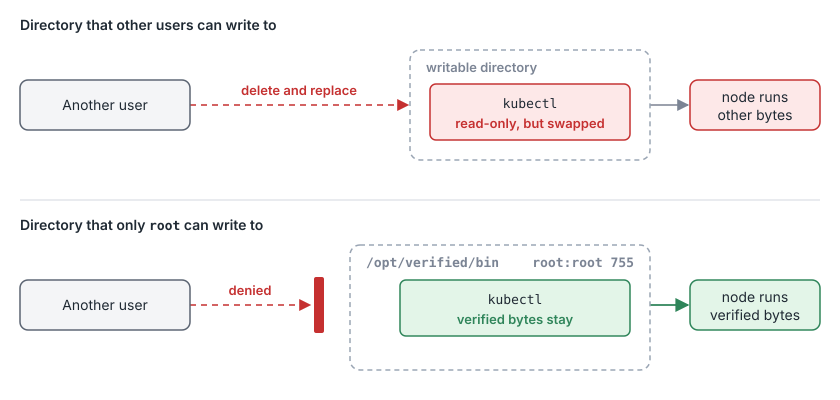
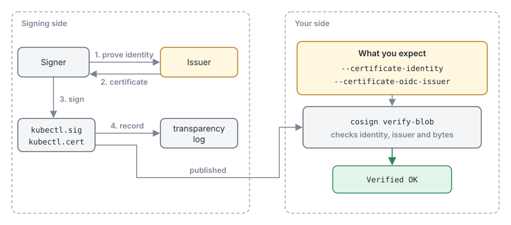

# Keep The Binding Through Delivery, And Identity-Based Signatures

A correct check is wasted if a different file is installed after it. The check proves something about one set of bytes at one moment. If another file takes its place before the node runs it, the proof no longer applies.

On this page, you learn how to keep the verified bytes tied to what really runs. Then you look at signatures that are tied to an identity instead of a long-lived key. Many current releases, including the Kubernetes release binaries, are signed this way.

## Verify the file you will use

Time passes between the check and the use of a file. In a shared download directory or on a mirror that others can write to, another process can replace the file during that gap. You protect against this in three ways:

- Verify after the copy, at the final location of the file.
- Keep the verified file in a directory that only the deployment user can write to.
- Make the pipeline fail when the verification is missing or does not match, instead of falling back to the unchecked file.

Start with the first point. Copy the staged binary to a new place, compute the digest of the copy, look that digest up in the trusted manifest, and then remove the copy:

<!-- astrona:playground:renew -->

```sh
NODE=astro-ats-031-playground-050-01-control-plane
podman exec $NODE sh -c 'cp /var/lib/training-release/kubectl /tmp/kubectl-staged && sha256sum /tmp/kubectl-staged'
podman exec $NODE grep "$(podman exec $NODE sha256sum /tmp/kubectl-staged | cut -d' ' -f1)" /var/lib/training-release/checksums.txt
podman exec $NODE rm /tmp/kubectl-staged
```

The `grep` command finds the digest of the copy in the trusted manifest. So the bytes at the final location are the bytes you verified.

## Protect the directory, not only the file

The directory around the file matters as much as the file itself. A user who can write to the directory can delete the verified file and put another file in its place. This works even when the file itself is read-only, because deleting and creating files is a change to the directory.



The drawing compares the two cases. When other users can write to the directory, they can swap a read-only file. When only `root` can write to the directory, the swap is denied.

The `install` command copies a file and sets its owner and mode in one step. The command `install -d` creates a directory in the same way. The commands below put the binary into a new directory that only `root` can write to, and then read the owner and the mode back with `stat`:

```sh
podman exec $NODE install -d -o root -g root -m 0755 /opt/verified/bin
podman exec $NODE install -o root -g root -m 0755 /var/lib/training-release/kubectl /opt/verified/bin/kubectl
podman exec $NODE stat -c '%U:%G %a %n' /opt/verified /opt/verified/bin /opt/verified/bin/kubectl
```

```text
root:root 755 /opt/verified
root:root 755 /opt/verified/bin
root:root 755 /opt/verified/bin/kubectl
```

Mode `755` means that the owner may read, write and run the file. Everyone else may only read and run it. The group and other users have no write permission on the file or on either directory, so only `root` can change what sits at `/opt/verified/bin/kubectl`.

After the install, compute the digest of `/opt/verified/bin/kubectl` and compare it with the manifest, exactly as you did for the copy above. When you are done, remove the directory with `podman exec $NODE rm -r /opt/verified`.

The same idea applies to container images. A tag such as `v1.35.0` can be moved to point at another image. A digest reference such as `image@sha256:<digest>` names exact content. So when you have verified an image digest, deploy the image by that digest.

## Signatures tied to an identity

So far, the signature depended on a public key that you had to get and protect. Identity-based signing removes the long-lived key. The `cosign` tool supports this kind of signing.

Here is how it works. The signer proves its identity to an issuer, such as a cloud account provider. The issuer then gives the signer a short-lived certificate that names that identity. A certificate is a signed document that ties a public key to a name. The signature, the certificate and a record in a public transparency log together show who signed and when. A transparency log is a public, append-only list of signing events that anyone can search.



The drawing shows the steps on the signing side and the check on your side. You verify by stating the identity and the issuer that you expect, and `cosign` checks that the certificate names exactly those.

For Kubernetes release artifacts, the project publishes signature and certificate files next to the binaries. The verification pattern uses `cosign verify-blob` with the expected identity and issuer. The values below follow the Kubernetes release documentation at the time of writing, so confirm them in that documentation before you rely on them. The command needs the real release files and network access, so it is reference material and not a step for the playground:

```sh
cosign verify-blob kubectl \
  --signature kubectl.sig \
  --certificate kubectl.cert \
  --certificate-identity krel-staging@k8s-releng-prod.iam.gserviceaccount.com \
  --certificate-oidc-issuer https://accounts.google.com
```

On success, `cosign` prints `Verified OK`. This means that the certificate names the expected identity and issuer, and that the signature covers these bytes. The issuer is given as an OIDC (OpenID Connect) issuer, which is the login service that confirmed the identity.

Both options are required. If you leave out the identity or the issuer, a valid signature from anyone would pass. In this model, your trust decision rests on the expected identity and issuer, and you must take both from the project documentation.

## What verification does not do

Verification has clear limits. It does not search for vulnerabilities, it does not review the code, and it does not confirm that the release works with your cluster.

Provenance data adds more information. Provenance data says how and where a release was built. You still need a policy that says which builders you trust.

Keep a record of each check, so you can answer later which exact bytes ran on which node. The record holds:

- the version and the platform;
- the digest;
- the key or the identity that you used;
- the date of the check.


The drawing gives the order to follow for every platform binary that you deploy.

You now know how to keep the verified bytes tied to what runs, why the directory matters as much as the file, and how identity-based signatures name the signer. You also know what verification does not cover. The question that stays open for every release is where you get the trusted key, identity and issuer from, because every check depends on them.

## Common pitfalls

> [!WARNING]
> - **Verifying once at download and never again.** Check the file that is installed.
> - **Checking only the file mode.** If other users can write to the directory, they can replace a read-only file.
> - **Leaving out the expected identity.** Without it, any valid signer passes.
> - **Using a tag that can move as a pin.** Pin by digest.
> - **Copying the playground key into a real process.** It is an exercise key, not a trusted root key.
