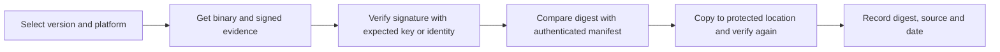

# Keep The Binding Through Delivery, And Identity-Based Signatures

A correct check is wasted if a different file is installed afterwards. This part covers how to keep the verified bytes bound to what runs, then looks at signatures that are tied to an identity rather than to a long-lived key, which is how many current releases are signed.

## Verify the file you will use

Time passes between the check and the use. In a shared download directory or on a writable mirror, another process can replace the file in that gap. Protect against this in three ways. Verify after the copy, on the final location. Keep the verified file in a directory that only the deployment user can write. Make the pipeline fail when verification is missing or does not match, instead of falling back to the unchecked file.

Copy the staged binary and verify the copy:

<!-- astrona:playground:renew -->

```sh
NODE=astro-ats-031-playground-050-01-control-plane
podman exec $NODE sh -c 'cp /var/lib/training-release/kubectl /tmp/kubectl-staged && sha256sum /tmp/kubectl-staged'
podman exec $NODE grep "$(podman exec $NODE sha256sum /tmp/kubectl-staged | cut -d' ' -f1)" /var/lib/training-release/checksums.txt
podman exec $NODE rm /tmp/kubectl-staged
```

The digest of the copy appears in the authenticated manifest, so the bytes in the final location are the verified bytes. The same idea applies to container images. A tag such as `v1.35.0` can be moved to another image, while a digest reference such as `image@sha256:<digest>` names exact content, so deploy by digest when you have verified one.

## Signatures tied to an identity

A key-based signature needs a public key that you must obtain and protect. Identity-based signing, which `cosign` supports, removes the long-lived key. The signer proves its identity to an issuer, such as a cloud account, and receives a short-lived certificate that names that identity. The signature, the certificate and a record in a public transparency log together show who signed and when. You verify by stating the identity and the issuer that you expect.

For Kubernetes release artifacts the project publishes signature and certificate files next to the binaries. The verification pattern uses `cosign verify-blob` with the expected identity and issuer. The values below follow the Kubernetes release documentation at the time of writing, so confirm them there before you rely on them. The command needs the real release files and network access, so it is reference material and not a step for the playground:

```sh
cosign verify-blob kubectl \
  --signature kubectl.sig \
  --certificate kubectl.cert \
  --certificate-identity krel-staging@k8s-releng-prod.iam.gserviceaccount.com \
  --certificate-oidc-issuer https://accounts.google.com
```

A success message `Verified OK` means that the certificate names the expected identity and issuer and that the signature covers these bytes. Leaving out the identity or issuer would accept a valid signature from anyone, so both options are required. In this model the trust decision rests on the expected identity and issuer, which you must take from the project documentation.

## What verification does not do

Verification does not search for vulnerabilities, does not review the code and does not confirm that the release is compatible with your cluster. Provenance data, which says how and where a release was built, adds information, and you still need a policy that says which builders you trust. Keep a record of the version, platform, digest, the key or identity used and the date of the check, so you can answer later which exact bytes ran on which node.



The diagram gives the order to follow for every platform binary that you deploy.

## Common pitfalls

> [!WARNING]
> - **Verifying once at download and never again.** Check the file that is installed.
> - **Omitting the expected identity.** Without it any valid signer passes.
> - **Using a mutable tag as a pin.** Pin by digest.
> - **Copying the playground key into a real process.** It is a fixture and not a trust root.
