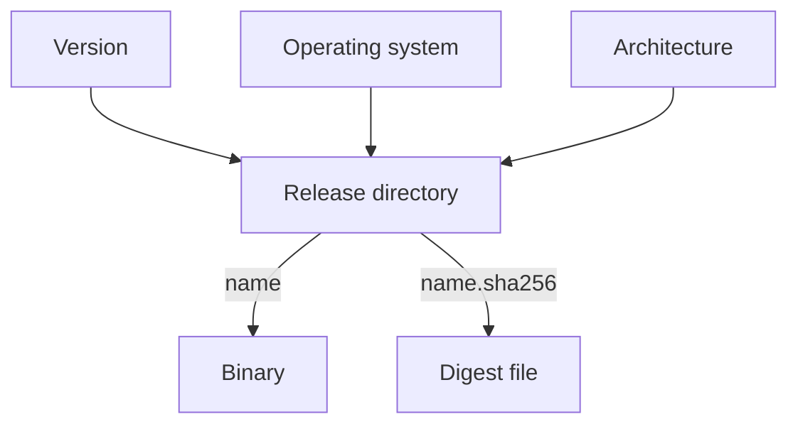

# Kubernetes Release Artifacts

Before you can verify a file you must know which file it is and where its checksum lives. The Kubernetes project publishes release binaries at predictable addresses, so a script, or you, can build the address from three facts: the version, the operating system and the CPU architecture. This part explains the layout, shows the same layout in the playground mirror, and names the files that belong together.

## The address of a release binary

A release binary is stored under `https://dl.k8s.io/release/<version>/bin/<os>/<architecture>/<name>`. For `kubectl` on Linux with an `amd64` processor in version `v1.35.0`, the path ends in `release/v1.35.0/bin/linux/amd64/kubectl`. The same directory holds `kubeadm` and `kubelet`. Next to each binary the project publishes a checksum file with the same name and the extra suffix `.sha256`.

The version `latest` does not exist as a directory. The file `release/stable.txt` holds the version string of the current stable release instead, and a script reads it to learn which version directory to use. The project also publishes files for the latest patch of one minor version, named like `stable-1.35.txt`. Confirm the exact names in the release documentation of the version you download, because the layout belongs to the project and can change.

The project also publishes full release tarballs, for example the server tarball for one platform, with checksum files that use SHA-512. The binaries in this module are the individual downloads, and the exact checksum algorithm of any file is the one named by its suffix.

## The same layout in the playground

The playground mirror copies this layout, without the host name. Set two variables and list the staged release directories. The node name follows the playground name.

<!-- astrona:playground:renew -->

```sh
NODE=astro-ats-031-playground-050-02-control-plane
MIRROR=/var/lib/training-release/k8s
podman exec $NODE cat $MIRROR/release/stable.txt
podman exec $NODE ls $MIRROR/release
```

The first command prints the staged stable version. The second lists one directory for each staged version. Now list the directory that the `current` link points to:

```sh
podman exec $NODE ls -l $MIRROR/current/
```

The listing shows six files: three binaries and the three `.sha256` files that go with them. The link `current` exists only in the playground, as a shortcut to the version and architecture of this node. On the real site you build that path yourself.

## What a checksum file contains

A `.sha256` file from the Kubernetes release site holds only the digest, 64 hexadecimal characters, and does not name the file it describes. The same is true in the mirror. Print one and count its length:

```sh
podman exec $NODE cat $MIRROR/current/kubectl.sha256
podman exec $NODE wc -c $MIRROR/current/kubectl.sha256
```

The count is 64 if the file ends without a newline. This format matters in the next step, because the tool that checks digests expects a file name on each line.



The diagram shows that three facts select one directory, and that the binary and its digest file sit side by side in it.

A digest file from the same site as the binary proves that the download arrived intact. It does not prove who published it. That limit is why a digest is the first check and not the last one.

You can now build the address of a release file and name the checksum file that belongs to it. The open question is how to feed that checksum file to a tool, which is the next topic.

## Common pitfalls

> [!WARNING]
> - **Guessing the architecture.** `amd64` and `arm64` files have the same name in different directories.
> - **Using `latest` in an address.** Read `stable.txt` to find the version.
> - **Downloading a binary from one version and its checksum from another.** The two files must come from the same directory.
> - **Treating the playground mirror as the real site.** It copies the layout, and its digests are computed locally at start.
