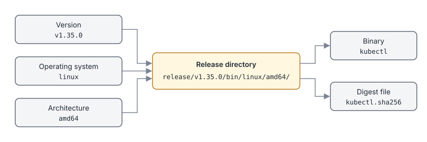
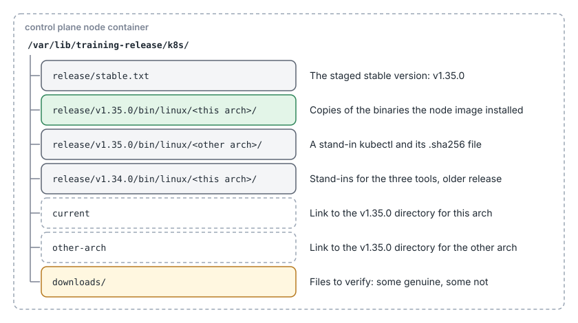

# Kubernetes Release Artifacts

Before you can verify a file, you must know which file it is and where its checksum lives. A release artifact is a file that the Kubernetes project publishes for a release, such as a binary or a checksum file. The project publishes these files at predictable addresses.

Because the addresses follow a fixed pattern, a script, or you, can build the address from three facts: the version, the operating system and the CPU architecture. On this page, you learn the layout, see the same layout in the playground mirror, and name the files that belong together.

## The address of a release binary

A release binary is stored under `https://dl.k8s.io/release/<version>/bin/<os>/<architecture>/<name>`. Take `kubectl` for Linux on an `amd64` processor in version `v1.35.0`. Its path ends in `release/v1.35.0/bin/linux/amd64/kubectl`. The same directory holds `kubeadm` and `kubelet`.

Next to each binary, the project publishes a checksum file. It has the same name as the binary, with the extra suffix `.sha256`. SHA-256 (Secure Hash Algorithm, 256 bits) is the hash function that computed the digest in that file.



The drawing shows that three facts select one directory, and that the binary and its digest file sit side by side in it.

There is no directory called `latest`. Instead, the file `release/stable.txt` holds the version string of the current stable release. A script reads this file to learn which version directory to use. The project also publishes files for the latest patch of one minor version, with names like `stable-1.35.txt`.

The project owns this layout, and it can change. So confirm the exact names in the release documentation of the version you download.

The project also publishes full release tarballs, for example the server tarball for one platform. A tarball is one archive file that holds many files. The checksum files of the tarballs use SHA-512. This module uses the individual binary downloads. For any file, the suffix of its checksum file names the algorithm.

## The same layout in the playground

The playground mirror copies this layout, without the host name. Set two variables, then list the staged release directories. The node name follows the name of the playground.

<!-- astrona:playground:renew -->

```sh
NODE=astro-ats-031-playground-050-02-control-plane
MIRROR=/var/lib/training-release/k8s
podman exec $NODE cat $MIRROR/release/stable.txt
podman exec $NODE ls $MIRROR/release
```

The first command prints the staged stable version. The second command lists one directory for each staged version. Now list the directory that the `current` link points to:

```sh
podman exec $NODE ls -l $MIRROR/current/
```

The listing shows six files: three binaries and the three `.sha256` files that go with them. The link `current` exists only in the playground. It is a shortcut to the version and architecture of this node. A second link, `other-arch`, points to the same version for the other architecture. On the real site, you build these paths yourself.



The drawing shows what each path of the mirror holds. Only the directory for the newer version and this architecture holds real binaries; the other release directories hold small stand-in files.

## What a checksum file contains

A `.sha256` file from the Kubernetes release site holds only the digest: 64 hexadecimal characters. It does not name the file it describes. The files in the mirror follow the same rule. Print one, and count its length:

```sh
podman exec $NODE cat $MIRROR/current/kubectl.sha256
podman exec $NODE wc -c $MIRROR/current/kubectl.sha256
```

The count is 64 if the file ends without a newline. This format matters when you check a file, because the checking tool expects a file name on each line.

A digest file from the same site as the binary proves that the download arrived intact. It does not prove who published the file. Anyone who can change the binary on the site can also change the digest next to it. That limit is why a digest is the first check and not the last one.

You can now build the address of a release file and name the checksum file that belongs to it. The open question is how to give that checksum file to a tool that does the comparison for you.

## Common pitfalls

> [!WARNING]
> - **Guessing the architecture.** `amd64` and `arm64` files have the same name, in different directories.
> - **Using `latest` in an address.** Read `stable.txt` to find the version.
> - **Downloading a binary from one version and its checksum from another.** The two files must come from the same directory.
> - **Treating the playground mirror as the real site.** The mirror copies the layout, and the playground computes its digests locally when it starts.
