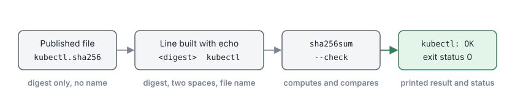
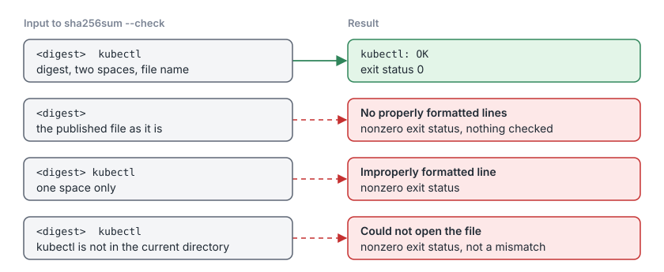

# sha256sum And The Check Format

The command that the exam expects is short. But it fails in quiet ways when its input has the wrong shape. On this page, you verify a binary with `sha256sum --check`, learn the line format that the tool reads, and see what the exit status tells a script.

## Compute a digest and compare it

`sha256sum` is a command line tool that reads a file and prints its SHA-256 digest, followed by the file name. You could compare that digest with the published one by eye. But a person easily misses one changed character in 64.

The `--check` option makes the tool do the comparison. It reads lines of the form `digest`, two spaces, `file name`. For each line, it computes the digest of the named file again and reports `OK` or `FAILED`.

The published `.sha256` file holds only the digest, so you add the two spaces and the name yourself. The downloads directory of the mirror holds a `kubectl` and its checksum file:

<!-- astrona:playground:renew -->

```sh
NODE=astro-ats-031-playground-050-02-control-plane
MIRROR=/var/lib/training-release/k8s
podman exec -w $MIRROR/downloads $NODE sh -c 'echo "$(cat kubectl.sha256)  kubectl" | sha256sum --check'
echo "exit status: $?"
```

The command inside `sh -c` builds the line `digest`, two spaces, `kubectl`, and pipes it to `sha256sum --check`. The tool prints `kubectl: OK`. The exit status of `podman exec` is the exit status of the command inside, which is 0 here. The option `-w` sets the working directory inside the node container, so the tool finds `kubectl` by its short name.



The drawing shows how the line is built from the published file and what the tool does with it.

## What the tool reads

The format is strict. Two characters separate the digest from the name. The first is a space. The second is either a second space, for text mode, or an asterisk, for binary mode. Linux treats both modes the same. The tool takes the file name exactly as written, so it looks the file up relative to the current directory.

Three input mistakes are common. The first mistake is to give `sha256sum --check` the published file directly. That file has no file name on its line:

```sh
podman exec -w $MIRROR/downloads $NODE sha256sum --check kubectl.sha256
echo "exit status: $?"
```

The tool reports that no lines were properly formatted. It checks nothing and returns a nonzero status. The exact wording differs between versions of the tool, so read the message and the status together.

The second mistake is one space instead of two:

```sh
podman exec -w $MIRROR/downloads $NODE sh -c 'echo "$(cat kubectl.sha256) kubectl" | sha256sum --check'
echo "exit status: $?"
```

This also fails, with an improperly formatted line and a nonzero status. The third mistake is to run the check in a directory where the named file does not exist. The tool then reports that it could not open the file. That is a different kind of failure from a digest mismatch.



The drawing compares the correct line with the three mistakes, and shows that each mistake ends with a nonzero exit status before any digest is compared.

## Exit status in scripts

A script must not read the printed text. It reads the exit status. The status is 0 only when every line was properly formatted and every file matched. Two options help a script:

- `--status` prints nothing, so the script uses the status alone.
- `--strict` makes improperly formatted lines an error, even when other lines were fine.

```sh
podman exec -w $MIRROR/downloads $NODE sh -c 'echo "$(cat kubectl.sha256)  kubectl" | sha256sum --check --status --strict' && echo "verified" || echo "not verified"
```

The result is `verified`. A pipeline that deploys the binary only when this command succeeds does not depend on a log line that nobody read. The reverse is also true: a script that ignores the status installs the file, whatever the check said.

You can now check a binary against its published digest and read the result as a status. The open question is what to do when the answer is `FAILED`.

## Common pitfalls

> [!WARNING]
> - **Writing one space instead of two.** The line is improperly formatted, and the tool compares nothing.
> - **Passing the `.sha256` file to `--check`.** The file has no file name on its line.
> - **Reading only the printed text.** Test the exit status, and use `--strict` so a malformed line cannot pass.
> - **Checking in the wrong directory.** A missing file is an error, not a mismatch.
