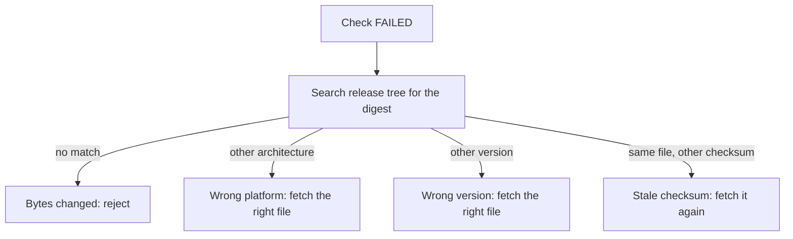

# Detect A Tampered Or Wrong Binary

A `FAILED` result has several possible causes, and they need different responses. The bytes may have been changed, the file may be for another architecture or version, or the checksum file may belong to another release. This part checks four suspicious downloads, then finds out for each one what its bytes really are.

## Check every download

The downloads directory of the mirror holds a `kubectl`, a `kubeadm`, a `kubelet` and two more `kubectl` copies. Each file has a `.sha256` file with its name plus the suffix. List the directory and then check every file against its own checksum file:

<!-- astrona:playground:renew -->

```sh
NODE=astro-ats-031-playground-050-02-control-plane
MIRROR=/var/lib/training-release/k8s
podman exec $NODE ls $MIRROR/downloads
podman exec -w $MIRROR/downloads $NODE sh -c 'for f in $(ls | grep -v "\.sha256$"); do if echo "$(cat $f.sha256)  $f" | sha256sum --check --status; then echo "$f: OK"; else echo "$f: FAILED"; fi; done'
```

One file passes: `kubectl`. The other four fail: `kubeadm`, `kubelet`, a copy of `kubectl` named for the other architecture, and a copy of `kubectl` named for the older version. Four failures have four different causes, and the digest alone does not tell them apart.

## Find out what the bytes are

The release tree of the mirror holds the digests of every staged file. Compute the digest of a failing file and search the tree for it. If the digest appears in a `.sha256` file, the bytes are exactly that published file. If it appears nowhere, the bytes are not any file in the release.

```sh
podman exec -w $MIRROR/downloads $NODE sh -c 'for f in kubeadm kubelet; do echo "== $f"; grep -rl "$(sha256sum $f | cut -d" " -f1)" ../release || echo "no published file has these bytes"; done'
```

For `kubeadm`, the search finds nothing. No published file has these bytes, and the checksum file for `kubeadm` is the genuine one, so the bytes were changed after the digest was published. This is the tampered case: the file has the right name and the wrong content. Do not run it.

For `kubelet`, the search finds a `.sha256` file in the newer release directory. The bytes are the genuine `kubelet` of that release. The checksum file that came with the download belongs to the older release, so the checksum file is stale and the binary is fine. The fix is to fetch the checksum file again from the directory of the same version, not to discard the binary.

Run the same search for the two `kubectl` copies. The file named for the other architecture matches the `kubectl.sha256` in the other architecture directory, so it is a genuine file for the wrong processor, paired with the checksum file for this one. The file named for the older version matches the checksum file of the newer version, so its name makes a false claim about its version.

```sh
podman exec -w $MIRROR/downloads $NODE sh -c 'for f in $(ls | grep "^kubectl-"  | grep -v "\.sha256$"); do echo "== $f"; grep -rl "$(sha256sum $f | cut -d" " -f1)" ../release; done'
```



The diagram shows one failed check leading to four different actions, depending on which published file the bytes match.

The search works because the mirror holds the digests of other files. On the real site you use the same idea by fetching the checksum file for the other architecture or version that you suspect. A tampered file cannot be explained that way, and that is the signal to reject it.

## What a failure does not tell you

A mismatch shows that these bytes differ from the published digest. It does not show who changed them or when, and a match does not show that the digest is trustworthy. Treat a tampered download as a security event: keep the file for review, do not run it, and report where it came from.

You can now sort a failing download into one of four causes. The version that a binary prints is another claim you can test, which is next.

## Common pitfalls

> [!WARNING]
> - **Treating every mismatch as an attack.** A wrong architecture or a stale checksum file is a download mistake, and the fix differs.
> - **Treating every mismatch as a mistake.** If the digest matches no published file, reject the file.
> - **Replacing the checksum file with one computed from the download.** That check always passes and proves nothing.
> - **Running a failing binary to find out what it is.** Search with digests instead.
