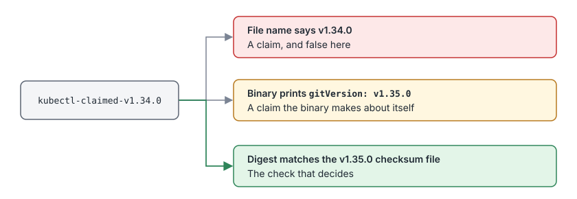

# Read The Version Of A Binary

The name of a file is a claim, and so is the version that the program prints about itself. Neither one proves what the file is. On this page, you read the version, the source commit, the build date and the platform from `kubectl`, `kubeadm` and `kubelet`. Then you compare them with what a file says it is, and see why a version number is not a verification.

## Version output of the three tools

Each tool reports its own version, with its own command:

- `kubectl version --client` prints the client version only and does not contact a cluster. Adding `-o yaml` prints the fields in a form that a script can read.
- `kubeadm version -o json` does the same for `kubeadm`, in JSON (JavaScript Object Notation) format.
- `kubelet --version` prints one line.

<!-- astrona:playground:renew -->

```sh
NODE=astro-ats-031-playground-050-02-control-plane
MIRROR=/var/lib/training-release/k8s
podman exec $NODE $MIRROR/current/kubectl version --client -o yaml
podman exec $NODE $MIRROR/current/kubeadm version -o json
podman exec $NODE $MIRROR/current/kubelet --version
```

The output of `kubectl` and `kubeadm` has the same main fields:

- `gitVersion`: the release version;
- `gitCommit`: the commit of the source tree that the project built;
- `buildDate`: when the binary was built;
- `goVersion`: the version of the Go compiler;
- `platform`: the operating system and architecture the binary was built for.

The commit identifies the source code. The platform field must match the processor of the machine where the binary will run. `kubelet --version` prints only the release version.

## Compare the claim with the binary

The downloads directory holds a file named `kubectl-claimed-v1.34.0`. Its name says it is the older release. Ask the binary itself:

```sh
podman exec $NODE $MIRROR/downloads/kubectl-claimed-v1.34.0 version --client -o yaml
```

The output reports `gitVersion: v1.35.0`, so the name made a false claim. A search for its digest in the release tree shows the same thing from the checksum side. The bytes match the checksum file of the newer release, so this file is a known file and safe to run.

Running a binary to read its version is only safe when the file passed a digest check first. A tampered file can run any code it likes before it prints anything. So use the digest to decide, and use the version output to confirm.



The drawing shows that the file name and the version output are both claims, and that only the digest search decides what the bytes are.

A version string is not proof either. A modified binary can print any version it likes. The digest is the check, and the version output is a quick way to catch a download mistake.

## Version skew

The version also matters for compatibility. Version skew is the difference in version between the components of a cluster. The Kubernetes version skew policy limits how far apart the components may be.

At the time of writing, the policy has these two rules:

- `kubectl` is supported within one minor version of the API server, in either direction.
- `kubelet` must not be newer than the API server.

The policy changes between releases, so read the one for your version. You can see the client version and the server version together from the host, because this command contacts the playground cluster:

```sh
kubectl version
```

The output has a client version and a server version. Compare the minor numbers. Here the node image, the `kubectl` in it and the cluster all come from the same release, so they agree.

You can now read the identity a binary reports and compare it with its name and its digest. The open question is which binary actually runs on a node.

## Common pitfalls

> [!WARNING]
> - **Trusting the version string.** A changed binary can print any version. Verify the digest.
> - **Running an unverified binary to read its version.** Check the digest first.
> - **Ignoring the `platform` field.** A binary for the wrong processor fails or behaves in unexpected ways.
> - **Reading the skew rules from memory.** Check the policy of your own release.
