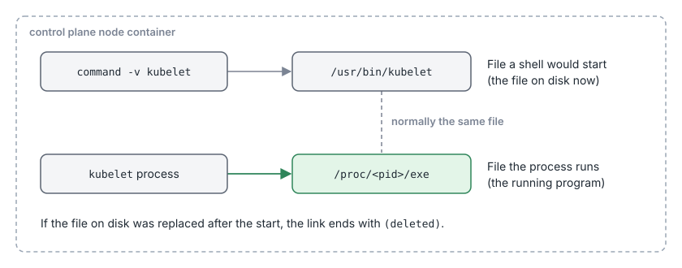
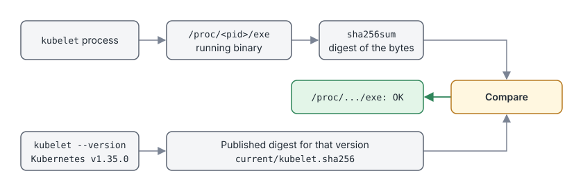

# Verify What Runs On A Node

A node that passed a check at installation time can change later. Someone can replace a file in `/usr/bin` after the check. And the process that runs may use a different file from the one on disk now. On this page, you find the `kubelet` process, resolve the binary it runs, and check that binary against the digest published for its version.

## Which file is the kubelet

Start with the path. `command -v kubelet` prints the file that the shell would run. That tells you what the shell would start, but not what already runs.

The kernel keeps a record for every running process in `/proc`. The entry `/proc/<pid>/exe` is a link to the file that the process was started from. The `<pid>` is the process identifier (PID), the number the kernel gives to each process. To find it, search the process names in `/proc`:

<!-- astrona:playground:renew -->

```sh
NODE=astro-ats-031-playground-050-02-control-plane
MIRROR=/var/lib/training-release/k8s
podman exec $NODE sh -c "command -v kubelet"
podman exec $NODE sh -c "grep -l '^kubelet\$' /proc/[0-9]*/comm"
```

The second command prints the path of a `comm` file, which holds the name of a process. The number in that path is the process identifier of the `kubelet`. A node container runs in its own process namespace, so you can see the `kubelet` of this playground node from inside the container. Use the identifier to resolve the binary:

```sh
KUBELET_PID=$(podman exec $NODE sh -c "grep -l '^kubelet\$' /proc/[0-9]*/comm | head -n 1 | cut -d/ -f3")
podman exec $NODE readlink /proc/$KUBELET_PID/exe
```

On this playground, the link should point at `/usr/bin/kubelet`. If someone replaced the file on disk after the process started, the link would end with the word `(deleted)`. That shows that the running program is not the file that is on disk now.



The drawing shows the two ways to find the `kubelet` binary, and why only the path through the process shows what really runs.

## Check the running binary against the release digest

When you compute the digest of `/proc/<pid>/exe`, `sha256sum` reads the bytes of the program that runs, not the file at a path. Compare that digest with the published digest of the same version and architecture. First read the version that the node reports, then use the `.sha256` file of that version:

```sh
podman exec $NODE kubelet --version
podman exec $NODE sh -c "echo \"\$(cat $MIRROR/current/kubelet.sha256)  /proc/$KUBELET_PID/exe\" | sha256sum --check"
```

The result is `/proc/.../exe: OK`. The running binary has the digest published for its release.

Now run the same check with the digest file of the older release. The result is `FAILED`, because that digest belongs to another version. So choose the digest file by the version that the binary reports, and then confirm the match.

```sh
podman exec $NODE sh -c "echo \"\$(cat $MIRROR/release/v1.34.0/bin/linux/*/kubelet.sha256)  /proc/$KUBELET_PID/exe\" | sha256sum --check"
```



The drawing shows that the check compares the digest of the running binary, not of a path, with the release checksum for the version the binary reports.

## What this check cannot show

The check proves that the running `kubelet` has the bytes of the published file. But it runs on the node itself, with `sha256sum` and a kernel interface from that same node. An attacker with root access can replace those tools or hide a process. So a result from a compromised node is weak evidence.

A stronger check compares the same digest from outside, for example from a management host. Another option is signed evidence of the node state. Also keep in mind what one check covers:

- It covers one file. It says nothing about the configuration that the `kubelet` reads, or about the other binaries on the node.
- It shows the state at the moment you ran it, not before or after.

The file system also records when a file changed. A recent modification time on `/usr/bin/kubelet` is a hint that someone replaced the file. But a user with root access can set a modification time to any value, so only the digest decides.

You can now check that the `kubelet` on a node is the one the project published. You also know which questions this check leaves open: whether the tools on the node can be trusted, and what changed outside this one file.

## Common pitfalls

> [!WARNING]
> - **Checking the path instead of the process.** `command -v kubelet` shows what a shell would start, not what runs.
> - **Using the checksum of another version.** Read the version first, then pick the digest file.
> - **Trusting a clean result from a node you suspect.** The tools on the node can be changed too.
> - **Believing a recent file date proves a replacement, or an old date proves none.** Dates can be set to any value.
