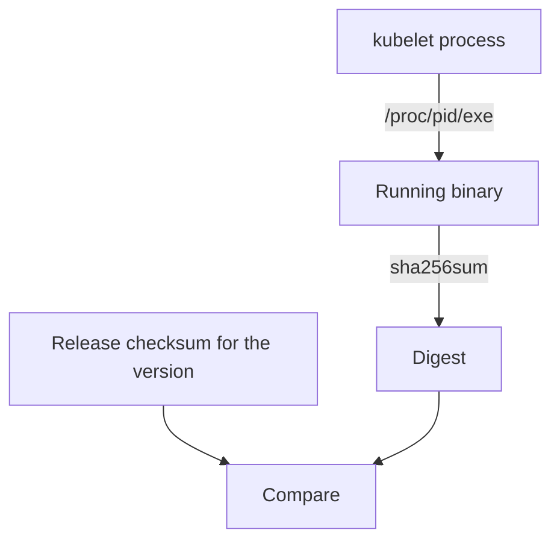

# Verify What Runs On A Node

A node that was verified at installation time can change later. A file in `/usr/bin` can be replaced after the check, and the process that runs may use a different file from the one on disk. This part finds the `kubelet` process, resolves the binary it runs, and checks that binary against the digest published for its version.

## Which file is the kubelet

Start with the path. `command -v kubelet` prints the file that the shell would run. That answers what the shell would start, but not what already runs. The running process has a kernel record: the directory `/proc/<pid>/exe` is a link to the file that the process was started from. To find the process identifier, search the process names in `/proc`:

<!-- astrona:playground:renew -->

```sh
NODE=astro-ats-031-playground-050-02-control-plane
MIRROR=/var/lib/training-release/k8s
podman exec $NODE command -v kubelet
podman exec $NODE sh -c "grep -l '^kubelet\$' /proc/[0-9]*/comm"
```

The second command prints the path of a `comm` file, which holds the process name. The number in the path is the process identifier of the `kubelet`. A node container runs its own process namespace, so the `kubelet` of this playground node is visible from inside it. Use the identifier to resolve the binary:

```sh
KUBELET_PID=$(podman exec $NODE sh -c "grep -l '^kubelet\$' /proc/[0-9]*/comm | head -n 1 | cut -d/ -f3")
podman exec $NODE readlink /proc/$KUBELET_PID/exe
```

On this playground the link should point at `/usr/bin/kubelet`. If someone replaced the file on disk after the process started, the link would end with the word `(deleted)`, which shows that the running program is not the file now on disk.

## Check the running binary against the release digest

Reading the digest of `/proc/<pid>/exe` hashes the bytes of the program that runs, not the path. Compare it with the published digest of the same version and architecture. First read the version the node reports, then use the `.sha256` file of that version:

```sh
podman exec $NODE kubelet --version
podman exec $NODE sh -c "echo \"\$(cat $MIRROR/current/kubelet.sha256)  /proc/$KUBELET_PID/exe\" | sha256sum --check"
```

The result is `/proc/.../exe: OK`. The running binary has the digest published for its release. Run the same check with the digest file of the older release and the result is `FAILED`, because it belongs to another version. Choose the digest file by the version that the binary reports, and then confirm the match.

```sh
podman exec $NODE sh -c "echo \"\$(cat $MIRROR/release/v1.34.0/bin/linux/*/kubelet.sha256)  /proc/$KUBELET_PID/exe\" | sha256sum --check"
```

## What this check cannot show

The check proves that the running `kubelet` has the bytes of the published file. It runs on the node itself, using `sha256sum` and a kernel interface from the same node. An attacker with root access can replace those tools or hide a process, so a result from a compromised node is weak evidence. A stronger check compares the same digest from outside, for example from a management host, or uses signed evidence of the node state. The check also covers one file. It says nothing about the configuration the `kubelet` reads, or about the other binaries on the node, and it shows the state at the moment you ran it.

Compare also what the file system says about changes. A recent modification time on `/usr/bin/kubelet` is a hint that the file was replaced, but a modification time can be set to any value, so only the digest decides.



The diagram shows that the digest of the running binary, not of a path, is compared with the release checksum for the reported version.

You can now check that the `kubelet` on a node is the one the project published, and you know which claims remain.

## Common pitfalls

> [!WARNING]
> - **Checking the path instead of the process.** `command -v kubelet` shows what a shell would start, not what runs.
> - **Using the checksum of another version.** Read the version first, then pick the digest file.
> - **Trusting a clean result from a node you suspect.** The tools on the node can be changed too.
> - **Believing a recent file date proves a replacement, or an old date proves none.** Dates can be set.
