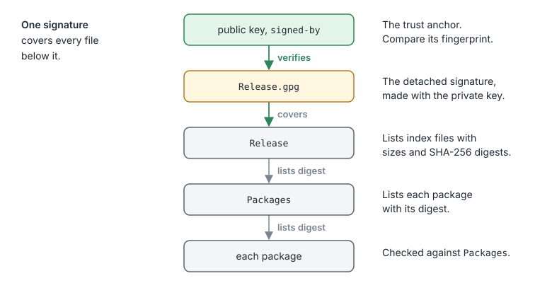
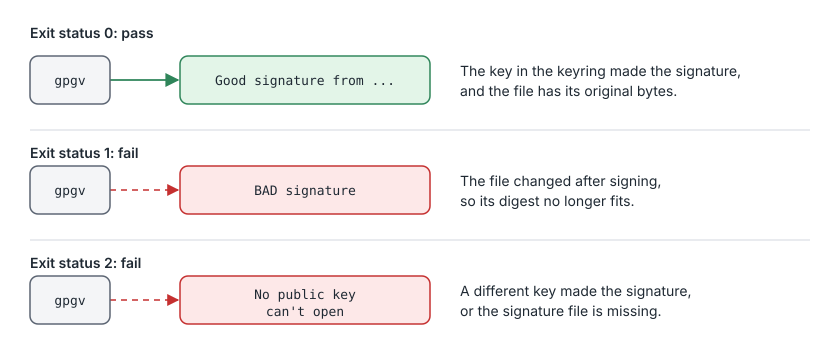

# GPG Signed Repositories

A package manager installs software from a repository, which is a server that publishes packages and lists of packages. If an attacker can change a package on that server, or on the way to your node, the package manager installs the attacker's code. A repository is only as trustworthy as the key that signs it.

This page explains how one signature protects every package in a repository. Then you verify a detached signature and a repository `Release` file with `gpg` in the playground, including a file that changed after signing.

## How a signed repository works

An apt repository publishes a `Release` file. This file lists the other index files, such as `Packages`, with their sizes and SHA-256 digests. A digest is a short value computed from the bytes of a file, so a changed file gives a different digest. The `Packages` index in turn lists each package with its digest.

The publisher signs only the `Release` file, with a GPG private key. GPG (the GNU Privacy Guard) is the tool that makes and checks these signatures. The signature can be detached, which means it is stored in its own file, `Release.gpg`. It can also be stored together with the text in one file, `InRelease`.

The client checks the files in a fixed order:

- It verifies the signature of `Release` with the public key it holds.
- It compares the digest of `Packages` with the digest listed in `Release`.
- It compares each downloaded package with the digest listed in `Packages`.

One signature therefore covers every file below it.



The drawing shows one signature over the `Release` file reaching every package through the digests listed one level below. The chain is only as strong as the public key at the top, so the next question is where that key comes from.

The Kubernetes project publishes its packages at `pkgs.k8s.io`, with one repository for each minor version. The setup instructions download the public key of that repository and convert it to a keyring file, which is a file that holds one or more public keys. The source line of the repository then names that file with the `signed-by` option, so apt trusts that key for that repository only.

The exact paths and the key file name belong to the project and change with releases. Copy them from the official instructions for your minor version. The playground has no network path to that site, so this flow is reference only here.

There is one more catch. A key that you fetch from the same site as the packages gives integrity, but not authenticity, just like a checksum from that site. An attacker who controls the site can replace both. Before you trust a downloaded key, compare its fingerprint, a short value computed from the key, with one that you got from a second channel.

## Verify a file in the playground

With the theory in place, you can check real signatures. The fixture directory on the control plane node holds a public key and signed files. List it, and print the key details with `gpg --show-keys`, which reads a key file without importing it:

<!-- astrona:playground:renew -->

```sh
NODE=astro-ats-031-playground-050-03-control-plane
SIGNED=/var/lib/training-release/signed
podman exec -w $SIGNED $NODE ls
podman exec -w $SIGNED $NODE gpg --show-keys publisher.asc
```

If the listing contains `NO-GPG`, the node has no `gpg`, and the rest of this page is reading only. Otherwise the second command prints the key type, the fingerprint and the user identifier `Training Publisher`.

Now verify the `Release` file with its detached signature. The option `--no-default-keyring` together with `--keyring` makes `gpg` use only the key file you name. Without it, `gpg` would use the keys of the current user:

```sh
podman exec -w $SIGNED $NODE gpg --no-default-keyring --keyring ./publisher.gpg --verify Release.gpg Release
echo "exit status: $?"
```

`gpg` writes its report to the error stream. It prints `Good signature` with the identifier of the key. It also prints a warning that the key is not certified with a trusted signature.

That warning means that no web of trust has vouched for this key on this machine. A web of trust is the GPG system in which keys sign other keys to vouch for them. The warning does not mean the signature is bad. The exit status 0 is what a script should test.

## A file that changed after signing

A good result only matters if a bad file gives a bad result. The same key and signature must fail for a file whose content differs. `release-notes-forged.txt` is the signed file with one line added. Verify the genuine file and then the forged one against the same signature:

```sh
podman exec -w $SIGNED $NODE gpg --no-default-keyring --keyring ./publisher.gpg --verify release-notes.txt.asc release-notes.txt
podman exec -w $SIGNED $NODE gpg --no-default-keyring --keyring ./publisher.gpg --verify release-notes.txt.asc release-notes-forged.txt
echo "exit status: $?"
```

The first command reports a good signature. The second reports `BAD signature` and returns a nonzero status. The reason is that the signature covers the digest of the exact original bytes, and one added line changes that digest.

So the signature check stops a forged file. It does not stop an attacker who replaces the public key, because a new key can sign a new file. The key is the real trust decision.

## Verify with gpgv

So far the node had the full `gpg` tool. Many nodes do not, but a node that uses apt also has `gpgv`, because apt depends on it to check repository signatures. `gpgv` only verifies signatures. It has no key management and no trust model.

Because it has no trust model, `gpgv` accepts any key in the keyring file you name, and it prints no "not certified" warning. Write the keyring with a path that contains a slash, such as `./publisher.gpg`. With a bare file name, `gpgv` looks for the keyring in its home directory instead of the current directory:

```sh
podman exec -w $SIGNED $NODE gpgv --keyring ./publisher.gpg Release.gpg Release
echo "exit status: $?"
podman exec -w $SIGNED $NODE gpgv --keyring ./publisher.gpg release-notes.txt.asc release-notes-forged.txt
echo "exit status: $?"
```

The first command prints `Good signature from "Training Publisher <publisher@training.invalid>"` and exit status 0. The second prints `BAD signature` and exit status 1.

`gpgv` has a third result, and scripts must treat it as a failure too. When a different key made the signature, or the signature file is missing, `gpgv` prints `Can't check signature: No public key` or `can't open`, and the exit status is 2. Only exit status 0 means the file is good.



The drawing shows the three results of `gpgv` side by side, and that a script must accept only exit status 0.

You can now verify a detached signature and a repository file with `gpg` or `gpgv`, and you know that the public key is the trust anchor, the one thing every later check depends on. A signature check happens when a package is downloaded and installed. The open question is how to check packages that are already installed on a node.

## Common pitfalls

> [!WARNING]
> - **Reading the "not certified" warning as a failure.** Test the exit status and the words `Good signature`.
> - **Importing the key into the default keyring.** Every repository then trusts that key. Name the key file for the one repository.
> - **Taking the key from the same site as the packages without checking the fingerprint.** An attacker who controls the site controls both.
> - **Verifying the package but not the Release file.** The digests in an unsigned index prove nothing.
> - **Treating only `BAD signature` as a failure.** A missing signature or an unknown key also fails, with exit status 2.
