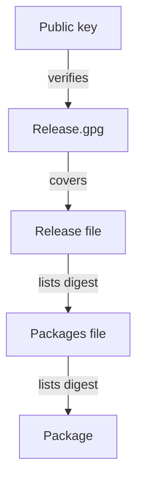

# GPG Signed Repositories

Package managers install software from repositories, and a repository is only as trustworthy as the key that signs it. This part explains how a signed repository protects each package, then verifies a detached signature and a repository Release file with `gpg` in the playground, including a file that changed after signing.

## How a signed repository works

An apt repository publishes a `Release` file. It lists the other index files, such as `Packages`, with their sizes and SHA-256 digests. The index lists each package with its digest. The publisher signs only the `Release` file with a GPG private key. The signature is either detached, stored in `Release.gpg`, or stored together with the text in `InRelease`.

The client verifies the signature of `Release` with the public key it holds, compares the digest of `Packages` with the one in `Release`, and compares each downloaded package with the digest in `Packages`. One signature therefore covers every file below it. The chain is only as strong as the public key the client holds.

The Kubernetes project publishes packages at `pkgs.k8s.io`, with one repository for each minor version. The setup instructions download the public key of that repository, convert it to a keyring file and name it in the source line with the `signed-by` option, so apt trusts that key for that repository only. The exact paths and the key file name belong to the project and change with releases, so copy them from the official instructions for your minor version. The playground has no network path to that site, so this flow is reference only.

Fetching a key from the same site as the packages gives integrity but not authenticity, as with a checksum. Before you trust a downloaded key, compare its fingerprint, a short value computed from the key, with one that you got from a second channel.

## Verify a file in the playground

The fixture directory holds a public key and signed files. List it, and print the key details with `gpg --show-keys`, which reads a key file without importing it:

<!-- astrona:playground:renew -->

```sh
NODE=astro-ats-031-playground-050-03-control-plane
SIGNED=/var/lib/training-release/signed
podman exec -w $SIGNED $NODE ls
podman exec -w $SIGNED $NODE gpg --show-keys publisher.asc
```

If the listing contains `NO-GPG`, the node has no `gpg`, and the rest of this part is reading only. Otherwise the second command prints the key type, the fingerprint and the user identifier `Training Publisher`. Now verify the `Release` file with its detached signature. The option `--no-default-keyring` with `--keyring` makes `gpg` use only the key file you name, instead of the keys of the current user:

```sh
podman exec -w $SIGNED $NODE gpg --no-default-keyring --keyring ./publisher.gpg --verify Release.gpg Release
echo "exit status: $?"
```

`gpg` writes its report to the error stream. It prints `Good signature` with the identifier of the key, and it also prints a warning that the key is not certified with a trusted signature. The warning means that no web of trust has vouched for this key on this machine; it does not mean the signature is bad. The exit status 0 is what a script should test.

## A file that changed after signing

The same key and signature fail for a file whose content differs. `release-notes-forged.txt` is the signed file with one line added. Verify the genuine file and then the forged one against the same signature:

```sh
podman exec -w $SIGNED $NODE gpg --no-default-keyring --keyring ./publisher.gpg --verify release-notes.txt.asc release-notes.txt
podman exec -w $SIGNED $NODE gpg --no-default-keyring --keyring ./publisher.gpg --verify release-notes.txt.asc release-notes-forged.txt
echo "exit status: $?"
```

The first command reports a good signature. The second reports `BAD signature` and returns a nonzero status, because the signature covers the digest of the exact original bytes. The signature check stops a forged file. It does not stop an attacker who replaces the public key, so the key is the real trust decision.



The diagram shows one signature over the `Release` file reaching every package through the digests listed one level below.

You can now verify a detached signature and a repository file, and you know that the key is the trust anchor. The next question is how to check packages that are already installed.

## Common pitfalls

> [!WARNING]
> - **Reading the "not certified" warning as a failure.** Test the exit status and the words `Good signature`.
> - **Importing the key into the default keyring.** Every repository then trusts that key. Name the key file for the one repository.
> - **Taking the key from the same site as the packages without checking the fingerprint.** An attacker who controls the site controls both.
> - **Verifying the package but not the Release file.** The digests in an unsigned index prove nothing.
