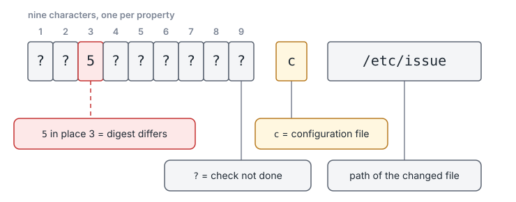

# Package Verification On A Node

A signature check happens when a package is installed. After that, nothing stops a file that the package installed from changing on disk. A person with access to the node, or an attacker, could edit a configuration file or replace a binary.

This page explains how the package manager compares installed files with its own records. You run that check on a playground node, and you see which files the check cannot cover.

## What the package manager remembers

The check depends on records that the package manager keeps from install time. When dpkg, the low-level Debian package tool, installs a package, it records the list of files. For many of them, it also records an MD5 digest from the package. MD5 (Message Digest 5) is an older algorithm that computes a short value from the content of a file.

The command `dpkg --verify`, also written `dpkg -V`, compares the files on disk with that record. It prints one line for each file that differs, and a clean system prints nothing. Each line has the same layout:

- Nine characters come first. A `5` in the third place means that the content digest differs. Other positions mean a changed size, mode, owner or time.
- A question mark in any of the nine places means that the check could not be done for that property.
- After the nine characters comes the letter `c` if the file is a configuration file.
- The path of the file comes last.



The drawing splits one real output line into its parts, so you can read any line of this kind.

Other tools do a similar job. The tool `debsums` checks installed files with the digests stored in the package files. On RPM based systems, the command `rpm -V` prints the same kind of nine character line, with `S` for size and `5` for content digest.

All of these tools depend on stored digests, and the digests are stored on the same machine as the files. An attacker with root access can change both the file and the record. So these tools find accidents and simple changes, not a careful attacker.

Packages also carry a signature. `rpm -K` can check it against an imported key, and apt checks it through the repository. That check happens at install time, not later.

## Run the check on a node

Now you can see the check work. The playground node is a Debian-based container with `dpkg`, so the check runs there. Start with the file that matters most on a Kubernetes node: the `kubelet`, the agent that starts the containers on each node. `dpkg -S` names the package that installed a path:

<!-- astrona:playground:renew -->

```sh
NODE=astro-ats-031-playground-050-03-control-plane
podman exec $NODE dpkg -S /usr/bin/kubelet
```

```text
dpkg-query: no path found matching pattern /usr/bin/kubelet
```

No package owns the `kubelet` here. The `kind` image build copied the Kubernetes binaries into place, so `dpkg` has no record of them, and a package check cannot cover them.

On a node installed from the Kubernetes package repository, the `kubelet` package owns `/usr/bin/kubelet`, and the check applies. For a binary without a package record, compare its digest with an authenticated digest from the release instead.

Files that did come from a package can be checked. The `base-files` package installs `/etc/issue` and other small files. Verify it:

```sh
podman exec $NODE dpkg --verify base-files
```

```text
missing     /usr/share/doc/base-files
missing     /usr/share/doc/base-files/README
missing     /usr/share/doc/base-files/README.FHS
missing     /usr/share/doc/base-files/changelog.gz
missing     /usr/share/doc/base-files/copyright
missing     /usr/share/lintian/overrides/base-files
missing     /usr/share/doc/base-files/FAQ
```

The `missing` lines are documentation files that the image build removed to save space. They are expected in a minimal image.

A clean check proves little until you see a change caught. Change one installed file and verify again, this time without the `missing` lines:

```sh
podman exec $NODE sh -c 'echo changed >> /etc/issue'
podman exec $NODE sh -c 'dpkg --verify base-files | grep -v "^missing"'
```

```text
??5?????? c /etc/issue
```

The `5` in the third place says that the MD5 digest of `/etc/issue` no longer matches the package. The `c` marks a configuration file, which an administrator may edit on purpose. The same line without the `c` on a binary, such as `??5??????   /bin/mount`, needs an explanation, because binaries do not change after install.

There is one more detail for scripts. In this version, `dpkg --verify` returns exit status 0 even when it prints a changed file. A script must therefore read the output, not the exit status.

## What to look for

The playground showed one changed file. On a real node, sort the output of a verify command like this:

- An empty output means the files match the record.
- A line with a `5` on a binary in `/usr/bin` needs an explanation, because binaries do not change after install.
- A line on a file in `/etc` that is marked as configuration is normal when an operator edited it.

Compare each finding with the change history of the node before you decide that an attacker is involved.

You can now say what the package manager checks, and what it cannot see: files that no package installed, and changes made by someone who also edited the records. Package records only cover files from packages. The open question is how to check single files, such as a downloaded binary, and container images.

## Common pitfalls

> [!WARNING]
> - **Reading a clean result as proof of integrity.** The records live on the same machine as the files.
> - **Expecting package tools to cover manually placed binaries.** They only know files from packages.
> - **Treating every difference as an attack.** Edited configuration files are expected to differ.
> - **Running the check once.** Run it on a schedule, and keep the output as evidence.
> - **Testing the exit status of `dpkg --verify`.** It can be 0 while the output lists a changed file. Read the lines.
