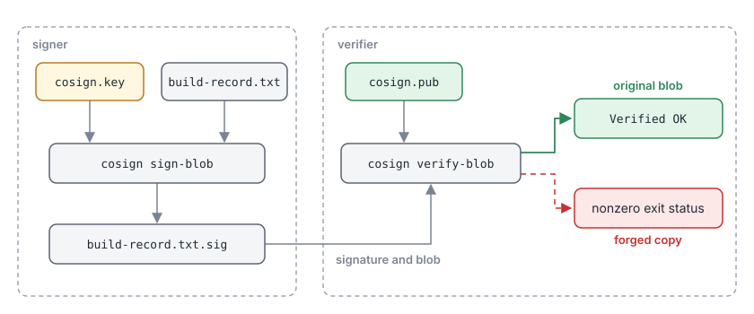

# cosign With A Local Key Pair

GPG signs repository files, but much of the software on a cluster arrives as single files and container images. A downloaded binary or an image needs its own signature, and many projects use cosign for that. cosign is a command line tool of the Sigstore project that signs and verifies blobs and container images. A blob is any file, such as a binary or a text file.

On this page, you verify a signed file with a local public key, and you watch a forged file fail. Then you create a key pair of your own to see the full round trip from signing to verifying.

## Key-based verification

A key pair has two halves. The private key signs, and the public key verifies. `cosign verify-blob` takes the public key, the signature file and the blob. It recomputes the digest of the blob and checks the signature against it. A blob that changed after signing fails, just as it does with GPG.



The drawing shows who holds which key. The private key stays with the signer, and the verifier needs only the public key, the signature file and the blob.

The difference from GPG lies in the tools around the signature. cosign can store a signature next to an image in a container registry, the server that stores and serves images. cosign can also record each signing event in a public transparency log named Rekor. A transparency log is a public list of signing events that only grows; nobody can remove an entry. An entry in the log gives evidence of when something was signed.

A key-based exercise without network access cannot reach Rekor, so the commands below switch the log off. Flag names have changed between cosign versions. The commands follow the behavior of cosign 2.x. When your version rejects a flag, read the `--help` output of `cosign sign-blob` and `cosign verify-blob` on that version.

## Verify the fixture

Now you can check a real signature. The fixture directory holds `cosign.pub`, `build-record.txt` and its signature. If the listing there contains `NO-COSIGN`, the node has no `cosign`, and this page is reading only.

<!-- astrona:playground:renew -->

```sh
NODE=astro-ats-031-playground-050-03-control-plane
SIGNED=/var/lib/training-release/signed
podman exec $NODE ls $SIGNED
podman exec $NODE cosign version
podman exec -w $SIGNED $NODE cosign verify-blob --key cosign.pub --signature build-record.txt.sig --insecure-ignore-tlog=true build-record.txt
```

The first command lists the fixtures. The second prints the tool version. The third verifies the blob and prints `Verified OK`.

The option `--insecure-ignore-tlog=true` tells cosign to skip the transparency log check. Its name contains the word insecure on purpose: without the log, nothing shows when the signature was made.

A pass is only useful if a changed file fails. Verify the forged copy against the same signature:

```sh
podman exec -w $SIGNED $NODE cosign verify-blob --key cosign.pub --signature build-record.txt.sig --insecure-ignore-tlog=true build-record-forged.txt
echo "exit status: $?"
```

Verification fails with an error about the signature, and the exit status is nonzero. One added line changed the digest, so the signature no longer fits.

## Create a key pair and sign a file

The fixture was signed for you. To see the round trip, make your own pair in a scratch directory on the node. `cosign generate-key-pair` writes `cosign.key` and `cosign.pub`. It asks for a password to protect the private key. Setting `COSIGN_PASSWORD` to an empty value skips the question, which is acceptable for a throwaway key and not for a real one.

```sh
podman exec -w /tmp $NODE sh -c "COSIGN_PASSWORD='' cosign generate-key-pair"
podman exec -w /tmp $NODE sh -c "echo 'my record' > my-record.txt && COSIGN_PASSWORD='' cosign sign-blob --yes --key cosign.key --tlog-upload=false --output-signature my-record.sig my-record.txt"
podman exec -w /tmp $NODE cosign verify-blob --key cosign.pub --signature my-record.sig --insecure-ignore-tlog=true my-record.txt
```

The first command makes the key pair. The second signs a new file with the private key, without uploading to the log. The last command prints `Verified OK`.

In a real process, the private key never leaves the signer. Remove the scratch files, including the private key, when you finish:

```sh
podman exec -w /tmp $NODE rm -f cosign.key cosign.pub my-record.txt my-record.sig
```

## Images and the limits of a local key

Files are one half of what cosign signs; container images are the other. cosign signs an image with `cosign sign --key` and checks it with `cosign verify --key`. Both commands talk to a container registry, because the signature is stored there next to the image. The playground has no registry, so image signatures are reading only here.

The command identifies the image by digest, a value computed from the image content. Always verify and deploy the digest, because a tag, the readable name such as `1.37.0`, can move to other content after the check.

A local key pair moves the trust question to the key. Whoever gave you the public key you verify with decides whom you trust. The file `cosign.fetched.sha256`, if the bootstrap created it, records the digest of the `cosign` binary that the bootstrap downloaded without a signature check. That is a small example of the same problem.

You can now verify a signed file with a public key, and make and check a signature of your own. A private key that lives for years must be stored, protected and rotated. The open question is how to avoid a long lived private key altogether.

## Common pitfalls

> [!WARNING]
> - **Leaving `--insecure-ignore-tlog` in a real pipeline.** It removes the evidence of when and by whom something was signed.
> - **Using an empty key password outside an exercise.** The private key is then unprotected.
> - **Taking the public key from the place that hosts the file.** Get it from a separate trusted channel.
> - **Verifying an image by tag.** The tag can point to another image tomorrow; verify the digest.
