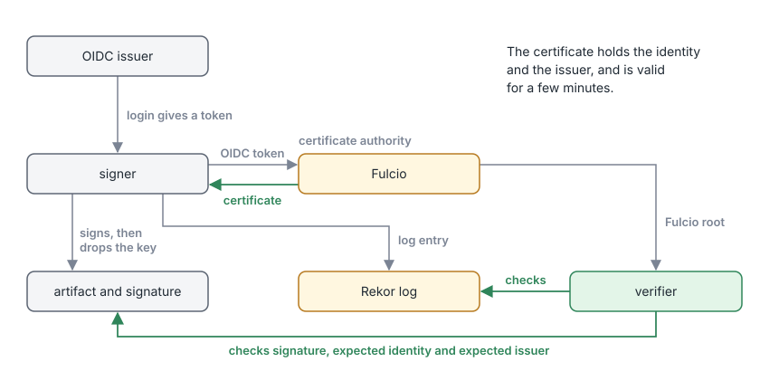

# Keyless Verification And Release Signatures

A long lived private key is a burden. Someone must store it, protect it and rotate it, and anyone who steals it can sign anything. Keyless signing removes that key.

This page explains how keyless signing works, what a verifier must state, and how the Kubernetes project publishes signature files next to its release files. It is reading only, because the flow needs network access to public services that the playground does not have.

## How keyless signing works

Keyless signing still uses a key, but only for a few minutes. Instead of a stored key, it ties each signature to an identity that a login service has confirmed. The steps run in this order:

1. The signer logs in to an identity provider and receives a short lived token that names the identity. The identity provider is also called the OIDC issuer. OIDC (OpenID Connect) is the standard login protocol that the identity provider uses.
2. The signer sends the token to Fulcio, the certificate authority of the Sigstore project. A certificate authority is a service that issues certificates.
3. Fulcio issues a certificate that is valid for a few minutes. The certificate contains the identity, such as an email address or a service account, and the issuer.
4. The signer signs the artifact with a fresh key, and then throws the key away.
5. The signer writes the signing event to Rekor, the transparency log.

The drawing shows that the certificate ties the signature to an identity, and that Rekor records the event for the verifier.

When anyone verifies the signature later, the certificate has already expired. The log entry closes that gap: it proves that the signature was made while the certificate was valid.

A verifier needs three things: the artifact, the signature and the certificate. With them, it checks three facts:

- The certificate chains to the Fulcio root certificate.
- The signature fits the artifact.
- The log entry exists in Rekor.

## What the verifier must state

Those three checks are not enough on their own. Anyone can get a certificate for their own identity, so a valid signature from any identity proves nothing. The verifier must therefore pass the identity it expects and the issuer it expects.

With `cosign verify-blob`, these are the options `--certificate-identity` and `--certificate-oidc-issuer`. Each has a companion option that accepts a pattern instead of an exact value. If you leave both out, or accept any value with a wide pattern, every valid signer passes.

## Kubernetes release files

The Kubernetes project uses this model for its release artifacts. Next to each signed artifact, it publishes a signature file and a certificate file. To verify a downloaded binary, you pass the binary, its signature file and its certificate file to `cosign verify-blob`, together with the expected identity and issuer.

Do not take those two values from this page or from memory. Read them from the official release documentation for the exact version you download, because the signing identity can change between releases. The same documentation names the signature file and the certificate file, and the cosign options that your cosign version requires.

A passing check proves three things: the named identity signed the artifact, it logged in through the named issuer, and the log recorded the time. It does not prove that the artifact is free of defects. It also does not prove that the identity is the one you meant to trust, unless you took the expected values from a trusted source.

## Why it is not a playground exercise

Keyless verification fetches the Fulcio root certificate and queries Rekor on public servers. Downloading the real release files also needs the project's servers. The playground has no such network path, and a staged fixture could only imitate the certificate chain. For that reason this page has no commands.

You can now explain what a keyless check states and what it proves. A signature names who built an image, but a cluster runs an image by its name, and a name such as a tag can change. The open question is how to tie a running container to one exact image.

## Common pitfalls

> [!WARNING]
> - **Verifying without an expected identity and issuer.** Any valid signer passes.
> - **Copying the identity from a blog or from memory.** Read it from the release documentation of your version.
> - **Skipping the log check offline and forgetting that you did.** Record which checks ran.
> - **Reading a pass as a vulnerability review.** It shows who signed, not that the content is safe.
