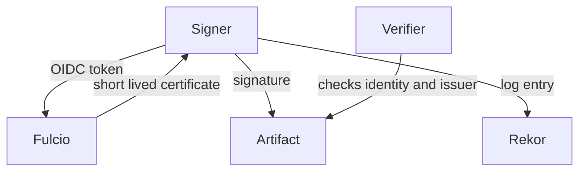

# Keyless Verification And Release Signatures

A long lived private key must be stored, protected and rotated. Keyless signing removes it. This part explains how keyless signing works, what a verifier must state, and how the Kubernetes project publishes signature files next to its release artifacts. It is reading only, because the flow needs network access to public services that the playground does not have.

## How keyless signing works

In keyless signing, the signer logs in to an identity provider and receives a short lived token that names the identity. The identity provider is also called the OIDC issuer (OpenID Connect issuer). The signer sends the token to a certificate authority named Fulcio. Fulcio issues a certificate that is valid for a few minutes and contains the identity, such as an email address or a service account, and the issuer. The signer signs the artifact with a fresh key, and then throws the key away.

The signing event is written to Rekor, the transparency log. Because the certificate has already expired when anyone verifies, the log entry gives the proof that the signature was made while the certificate was valid. A verifier needs three things: the artifact, the signature and the certificate. It checks that the certificate chains to the Fulcio root, that the signature fits the artifact, and that the log entry exists.

The diagram shows that the certificate ties the signature to an identity, and that the log records the event for the verifier.

## What the verifier must state

A valid signature from any identity is not enough, because anyone can obtain a certificate for their own identity. The verifier therefore passes the identity it expects and the issuer it expects. With `cosign verify-blob`, these are the options `--certificate-identity` and `--certificate-oidc-issuer`, with companion options that accept a pattern instead of an exact value. Leaving both out, or accepting any value with a wide pattern, accepts every valid signer.

## Kubernetes release files

The Kubernetes project signs its release artifacts with this model and publishes a signature file and a certificate file next to each signed artifact. A reader verifies a downloaded binary by passing the binary, its signature file and its certificate file to `cosign verify-blob`, together with the expected identity and issuer. Do not take those two values from this page or from memory. Read them from the official release documentation for the exact version you download, because the signing identity can change between releases. The file names for the signature and the certificate, and the cosign options required by your cosign version, are in the same documentation.

When the check passes, it proves that the artifact was signed by the named identity through the named issuer, at a time recorded in the log. It does not prove that the artifact is free of defects, and it does not prove that the identity is the one you meant to trust unless you wrote the expected values from a trusted source.

## Why it is not a playground exercise

Keyless verification fetches the Fulcio root and queries Rekor on public servers, and downloading the real release files needs the project servers. The playground has no such path, and a staged fixture could only imitate the certificate chain. For that reason this part has no commands.

You can now explain what a keyless check states and what it proves. The next question is how to tie a running container to an exact image.

## Common pitfalls

> [!WARNING]
> - **Verifying without an expected identity and issuer.** Any valid signer passes.
> - **Copying the identity from a blog or from memory.** Read it from the release documentation of your version.
> - **Skipping the log check offline and forgetting that you did.** Record which checks ran.
> - **Reading a pass as a vulnerability review.** It shows who signed, not that the content is safe.
