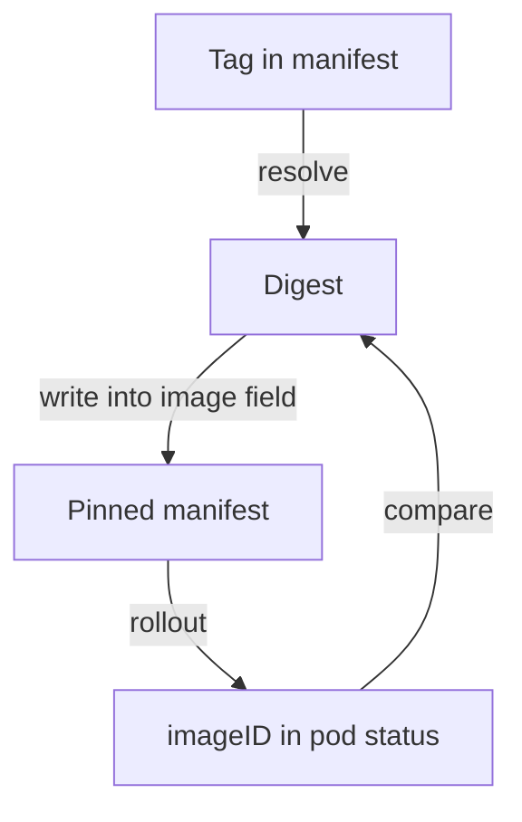

# Image Digests And Pinning

A container image reference such as `busybox:1.37.0` names a tag, and a tag is a label that the registry owner can move to different content. A digest names the content itself. This part reads the digest of an image on a node, compares it with what a running pod reports, and shows how a manifest pins an image by digest.

## Tag and digest

An image is stored as a manifest, a small document that lists the layers and the configuration, and the SHA-256 digest of that manifest identifies the image. A reference with a digest has the form `repository@sha256:<digest>`. The runtime fetches exactly that manifest, and a registry that returns different content fails the check. A reference may carry both a tag and a digest, as in `busybox:1.37.0@sha256:<digest>`. In that case the container runtime resolves by the digest, and the tag is a label for readers.

Some images are published for several architectures through an index, a manifest that points to one manifest for each platform. The digest of the index and the digest of the manifest for one platform are different values. A pod can report either form depending on how the runtime pulled the image, so compare carefully and read the form before you compare.

## Read digests on a node

`crictl` is the command line client for the container runtime interface, and it talks to the runtime on the node. `crictl images --digests` lists the images known to that node with a digest column. Run it on the control plane node, and list the images that `kubeadm` needs for a given version:

<!-- astrona:playground:renew -->

```sh
NODE=astro-ats-031-playground-050-03-control-plane
podman exec $NODE crictl images --digests
podman exec $NODE kubeadm config images list --kubernetes-version v1.35.0
```

The first command prints repository, tag, digest, image identifier and size for each image. For images that were loaded into the node from a local archive, the digest column can be empty, because the node holds no record of a registry digest. The second command prints the control plane images with their tags. A tag in that list is not a pin.

## What a running pod reports

The Kubernetes API reports, for each container, the image that the pod asked for and the `imageID` that the runtime actually started. The `shuttle` pod runs `busybox`. Read its two fields:

```sh
kubectl -n starfleet get pod shuttle -o jsonpath='{.spec.containers[0].image}{"\n"}{.status.containerStatuses[0].imageID}{"\n"}'
```

The first line is the tag from the manifest. The second line is the `imageID`. When it has the form `docker.io/library/busybox@sha256:<digest>`, the digest after `@sha256:` is the one the container runs from. When it shows only `sha256:<value>`, the runtime has reported an image identifier and not a registry digest, and that value cannot be used in an `image` field. The form depends on how the image reached the node.

## Pin an image in a manifest

A pinned Deployment replaces the tag with the digest in the `image` field. The reference below uses a placeholder, which you replace with the digest you read from your own pod:

```yaml
containers:
- name: relay
  image: docker.io/library/busybox:1.37.0@sha256:<digest>
```

After the Deployment rolls out, the `imageID` of its pods must carry the same digest. If it does not, the pod runs something other than what the manifest pinned, and the rollout needs a look before anything else. The pin protects a restart next month as much as today's rollout, because a restart pulls by the digest again. It does not make the image safe. It only fixes which image it is.



The diagram shows the digest read once, written into the manifest, and read again from the running pod to confirm the match.

You can now find a digest, pin a manifest to it and prove what runs. The last topic is what to verify beyond the identity of an image.

## Common pitfalls

> [!WARNING]
> - **Treating a tag as a pin.** The registry owner can move it.
> - **Mixing the index digest with the platform manifest digest.** They are different values for the same image.
> - **Pinning once and never comparing.** Read the `imageID` after the rollout.
> - **Reading a pinned digest as a security result.** It names the image and does not show that it is free of vulnerabilities.
