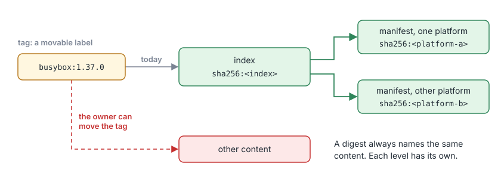
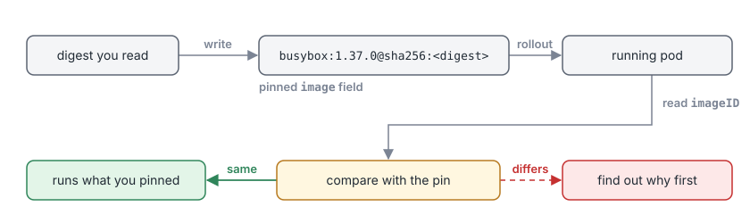

# Image Digests And Pinning

A container image reference such as `busybox:1.37.0` names a tag. A tag is a readable label, and the owner of the registry can move it to different content at any time. So the same manifest can start a different image next month, and nobody would see it in the YAML.

A digest solves this, because it names the content itself. On this page, you read the digest of an image on a node, compare it with what a running pod reports, and see how a manifest pins an image by digest.

## Tag and digest

To see why a digest is stable, you need to know how an image is stored. A registry stores each image as a manifest, a small document that lists the layers and the configuration of the image. The SHA-256 digest of that manifest identifies the image.

A reference with a digest has the form `repository@sha256:<digest>`. The container runtime, the program on the node that pulls images and starts containers, fetches exactly that manifest. If the registry returns different content, the check fails. A reference may carry both a tag and a digest, as in `busybox:1.37.0@sha256:<digest>`. In that case, the runtime pulls by the digest, and the tag is only a label for readers.

Some images are published for several CPU architectures through an index. An index is a manifest that points to one manifest for each platform. The digest of the index and the digest of the manifest for one platform are different values.



The drawing shows the two kinds of names. A tag can point anywhere, while each digest names one fixed manifest, and an index digest differs from the digest of each platform manifest.

A pod can report either form, depending on how the runtime pulled the image. So read which form you have before you compare two values.

## Read digests on a node

Now look at real digests. `crictl` is the command line client for the CRI (Container Runtime Interface), and it talks to the container runtime on the node. `crictl images --digests` lists the images that the node knows, with a digest column. Run it on the control plane node, and also list the images that `kubeadm` needs for a given version:

<!-- astrona:playground:renew -->

```sh
NODE=astro-ats-031-playground-050-03-control-plane
podman exec $NODE crictl images --digests
podman exec $NODE kubeadm config images list --kubernetes-version v1.35.0
```

The first command prints the repository, tag, digest, image identifier and size of each image. For images that were loaded into the node from a local archive, the digest column can be empty, because the node holds no record of a registry digest.

The second command prints the control plane images with their tags. A tag in that list is not a pin.

## What a running pod reports

The node knows its images, but the question that matters is which image a container really runs. The Kubernetes API reports two values for each container: the `image` that the pod asked for, and the `imageID` that the runtime actually started. The `shuttle` pod runs `busybox`. Read its two fields:

```sh
kubectl -n starfleet get pod shuttle -o jsonpath='{.spec.containers[0].image}{"\n"}{.status.containerStatuses[0].imageID}{"\n"}'
```

The first line is the tag from the manifest. The second line is the `imageID`, and its form tells you what you can do with it:

- When it has the form `docker.io/library/busybox@sha256:<digest>`, the digest after `@sha256:` is the one the container runs from.
- When it shows only `sha256:<value>`, the runtime reported an image identifier, not a registry digest. That value cannot be used in an `image` field.

The form depends on how the image reached the node.

## Pin an image in a manifest

Once you have a registry digest, you can pin it. A pinned Deployment replaces the tag with the digest in the `image` field. The reference below uses a placeholder, which you replace with the digest you read from your own pod:

```yaml
containers:
- name: relay
  image: docker.io/library/busybox:1.37.0@sha256:<digest>
```

After the Deployment rolls out, the `imageID` of its pods must carry the same digest. If it does not, the pod runs something other than what the manifest pinned, and you must find out why before anything else.



The drawing shows the digest read once, written into the manifest, and read again from the running pod to confirm the match.

The pin protects a restart next month as much as the rollout today, because a restart pulls by the digest again. It does not make the image safe. It only fixes which image it is.

You can now find a digest, pin a manifest to it and prove what runs. A pinned digest names an image, but it says nothing about what the image contains. The open question is what to verify beyond the identity of an image, and how to stop an unverified image before it starts.

## Common pitfalls

> [!WARNING]
> - **Treating a tag as a pin.** The registry owner can move it.
> - **Mixing the index digest with the platform manifest digest.** They are different values for the same image.
> - **Pinning once and never comparing.** Read the `imageID` after the rollout.
> - **Reading a pinned digest as a security result.** It names the image and does not show that it is free of vulnerabilities.
