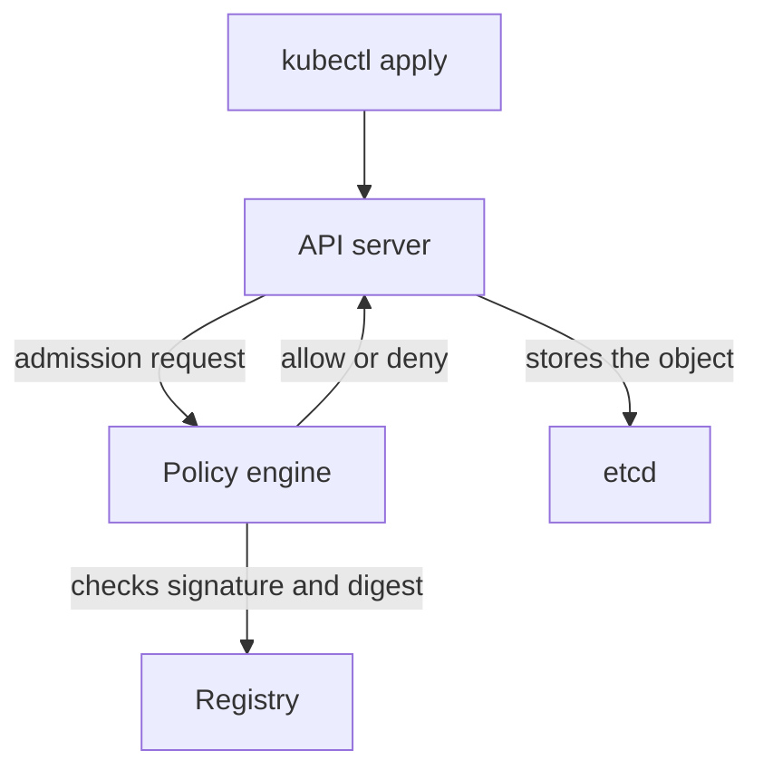

# SBOMs And Admission-Time Verification

Knowing which image runs is one question. Knowing what is inside it, and stopping an unverified image from starting, are two more. This part describes the software bill of materials and the checks a cluster can make when an object is created. It is reading only, because the tools involved need extra components that the playground does not install.

## What an SBOM lists

A software bill of materials (SBOM) is a machine readable list of the components inside an artifact: packages, libraries, their versions and often their licenses and sources. Two common formats are SPDX and CycloneDX. A scanner can compare the list with a database of known vulnerabilities, so when a new vulnerability is published you search your SBOMs instead of unpacking every image.

An SBOM is a statement made by whoever produced it. A list generated at build time from the build inputs can be wrong or incomplete, and a list that is not signed can be replaced. For that reason an SBOM is often attached to an image as a signed attestation, a signed statement that is bound to the image digest. Verifying the signature on the attestation, and the digest it names, is what links the list to the image.

## Verification at admission

The Kubernetes API server runs admission control before it stores an object. A validating admission webhook, or a ValidatingAdmissionPolicy, can refuse a Pod whose image does not meet a rule. Policy engines such as Kyverno or the Sigstore policy controller implement rules like "every image must have a valid signature from this key or identity, and must be referenced by digest". When the rule fails, the API server rejects the Pod at creation, before any container starts.

For the check to be meaningful, the policy must require the digest form, because a tag could resolve to another image after the check. The policy must state the expected key or the expected identity and issuer, as in the keyless model. The webhook must fail closed, so a webhook outage does not let unverified images in, and the exemptions, such as system namespaces, must be small and reviewed.

The diagram shows the policy engine deciding before the object is stored.

## What these checks do not prove

A signature shows who signed, not that the content is safe. Admission checks only objects that are created or updated; a Pod that started before the policy existed keeps running until it is replaced. An SBOM lists components and does not list vulnerabilities, bugs or malicious logic in them. A signed image from a trusted builder can still contain a vulnerable library. Each control answers one question, and the controls work together: pinned digest, valid signature, a current component list and an admission rule that enforces them.

You can now say what an SBOM contains and where signature checking fits in the cluster, and you know the limit of each.

## Common pitfalls

> [!WARNING]
> - **Trusting an unsigned SBOM.** Anyone can write one.
> - **Writing an admission policy that accepts tags.** Require digests.
> - **Letting the webhook fail open.** A failure of the policy engine must block, not allow.
> - **Assuming old pods are covered.** Admission applies when an object is created or updated.
